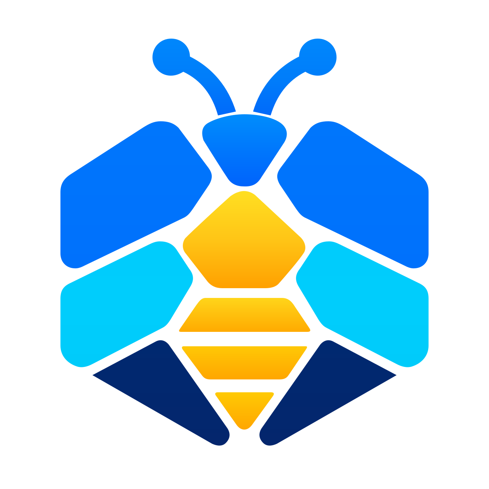
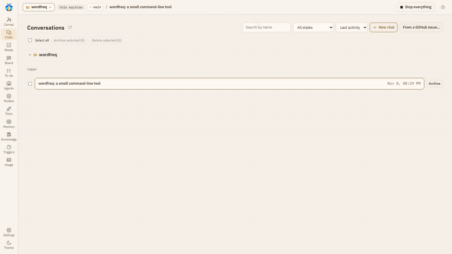
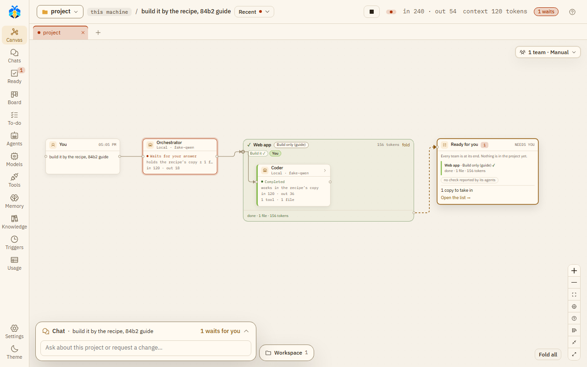
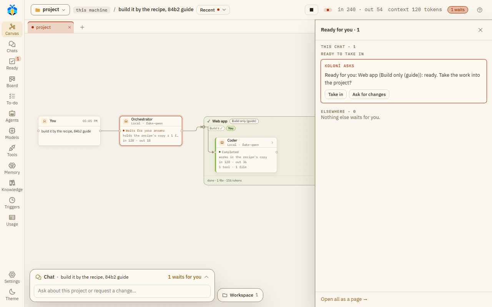
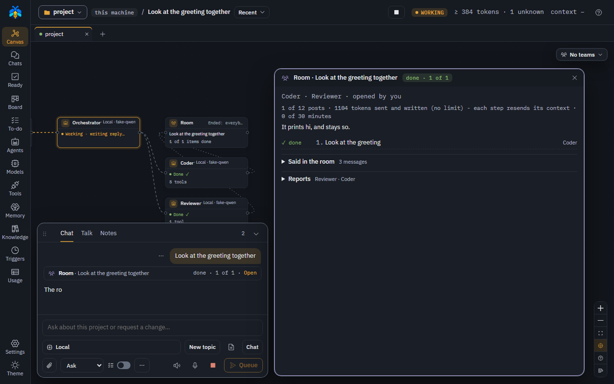
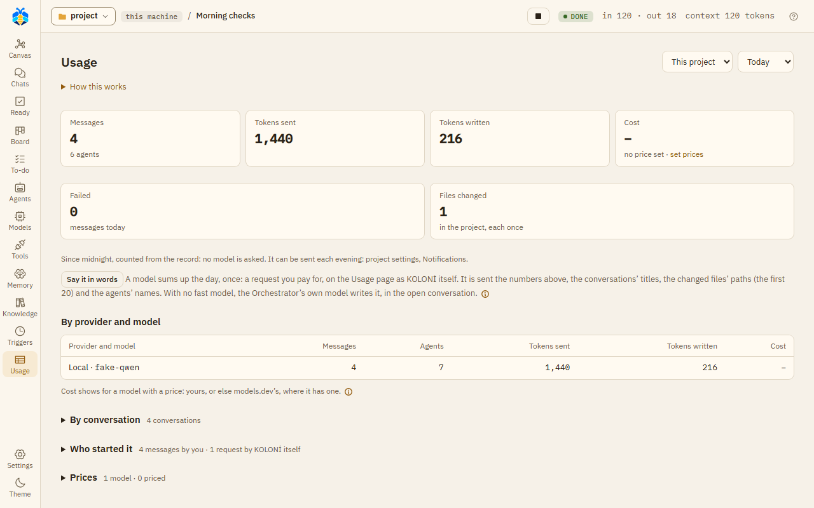

<div align="center">



# KOLONİ

**Five AI coding CLIs as one team, on your machine, every change on a card.**

[](LICENSE)
[](pyproject.toml)

**[Guide](https://koloni.skyulf.com/manual/)** ([in this repo](docs/index.md)) ·
**[Quick start](#quick-start)** ·
**[Security](#security)** ·
**[Why KOLONİ](docs/getting-started/why-koloni.md)**

</div>

<p align="center">
  
</p>

KOLONİ runs Claude Code, Codex, GitHub Copilot CLI, agy and Qoder, plus a local llama.cpp server or
any OpenAI-compatible API, side by side in one chat with a canvas. A lead hands parts of the job to
roles; each sub-agent works in its own copy of your project; what it changed comes back on a card
with the diff and your tests, and you take it in or discard it. Stop never loses half-done work.
Secrets go only into the command that needs them.

It runs on your machine, listens on `127.0.0.1` only, and sends no telemetry. Each CLI still sends
your code to its own service, as it always did. Version 0.1.0 is the first release, an alpha:
expect rough edges and read [Known limits](docs/reference/known-limits.md).

## See it

<table>
<tr>
<td width="50%"><br><sub><b>The canvas.</b> Every agent is a box with its model, state and what it did; a team is a frame with its steps and tokens.</sub></td>
<td width="50%"><br><sub><b>The card.</b> A team's work stays in its copy until you say Take in, or Ask for changes in your own words.</sub></td>
</tr>
<tr>
<td width="50%"><br><sub><b>A room.</b> Two to six agents on one goal, in rounds, with a token budget and a clock.</sub></td>
<td width="50%"><br><sub><b>Usage.</b> Tokens, AI credits and plan windows per run, as the CLIs reported them; nothing invented.</sub></td>
</tr>
</table>

<sub>The recording above is a real run (Claude Code, haiku), sped up five times. The screenshots are from the app with a scripted test model, so their model names read "fake-qwen".</sub>

## How it works

1. **Add a provider** on the Models page: a CLI you are signed in to, your llama.cpp server, or an
   API key. Each role can run on a different one; a role on Copilot can take `auto`.
2. **Open a folder** and write what you want, at one of three levels: **Ask before changes**,
   **Auto-edit files** or **Full auto**. **Plan first** adds a plan to approve before anything moves.
3. **The Orchestrator works or delegates.** 29 built-in roles (Coder, Reviewer, Tester, Researcher,
   UI designer, Security reviewer, …) and your own; teams with stages; recipes you draw.
4. **Take it in.** A sub-agent's changes come back as a card with the diff and your project's test
   command. Take in, discard, or ask for changes. At Auto-edit and Full auto, clean work lands by
   itself; a git branch merges by itself only at Full auto.

## What is in the box

- **Agents and teams**: roles, teams with stages (Plan → Build → Check → Write & keep up), recipes
  (draw, copy, or describe in a sentence), discussions and rooms, Compare (one message to two
  models, each in its own copy). [Roles](docs/agents/roles.md) · [Teams](docs/agents/teams.md) · [Recipes](docs/agents/recipes.md)
- **Evidence**: the canvas and each agent's window show the tools, commands and real diffs as
  recorded. Undo a turn; Stop or Stop everything keeps half-done work behind a card.
  [Chat and canvas](docs/use/chat-and-canvas.md) · [Working copies](docs/use/workspace.md)
- **Control**: cards for changes, commands, web and HTTP; delete and shell-wrapped commands always
  ask; secret files open only on your word; a key an agent needs comes through `ask_secret` on a
  hidden card and reaches only that command. [Permissions](docs/use/permissions.md) · [Security model](docs/security/model.md)
- **Knowledge and memory**: experts learn from docs, a public GitHub repository or a folder on
  this machine (code kept as text, a free symbol map, answers with file:line); notes agents keep
  and you approve. [Knowledge](docs/knowledge.md) · [Memory](docs/memory.md)
- **Work over time**: a To-do list with suggested tasks, triggers (clock, files, webhook), and
  jobs that run while you're away and wait for you on a card.
  [To-do](docs/automation/todo.md) · [Triggers](docs/automation/triggers.md) · [While you're away](docs/automation/overnight.md)
- **Git and GitHub**: a branch per team, merged or sent as a pull request from the card; a chat
  started from a GitHub issue with your own `gh`. [Branches](docs/use/workspace.md#branches)
- **Money**: tokens and credits per run, plan meters for each CLI, a monthly budget per project.
  [Usage and budgets](docs/money/usage.md)
- **More tools**: MCP servers (each asks before it runs unless you say otherwise) and skills from a
  folder or a GitHub repository. [MCP servers](docs/tools/mcp.md) · [Skills](docs/tools/skills.md)

## Models and CLIs

| Provider | How it runs | Sign in |
|---|---|---|
| Claude Code | session (KOLONİ's tools over MCP) or native | `claude auth login` |
| Codex | session (KOLONİ's tools over MCP), step, or native | `codex login` |
| GitHub Copilot CLI | session or native; `auto` picks the model | `gh auth login` |
| agy | reads (its default) | agy's own sign-in |
| Qoder | session | Qoder's own sign-in |
| llama.cpp `llama-server` | OpenAI-compatible, started with `--jinja`; the Server tab starts and stops it | — |
| Anthropic API, any OpenAI-compatible API | per token | your key |

KOLONİ never signs in for you; CLI use counts against your plan with that vendor. Which CLI can do
what, measured: [CLIs](docs/reference/cli.md).

## Quick start

Needs **Python 3.12–3.14** with [uv](https://docs.astral.sh/uv/), **Node.js 24**, **Git**, and at
least one model from the table above.

**Windows** (PowerShell):

```powershell
uv venv .venv --python 3.12
uv pip install --python .venv/Scripts/python.exe -r requirements-dev.lock
uv pip install --python .venv/Scripts/python.exe --no-deps -e .
npm --prefix frontend ci
npm --prefix frontend run build
.venv/Scripts/python.exe -m app.main
```

**macOS and Linux**:

```bash
uv venv .venv --python 3.12
uv pip install --python .venv/bin/python -r requirements-dev.lock
uv pip install --python .venv/bin/python --no-deps -e .
npm --prefix frontend ci
npm --prefix frontend run build
.venv/bin/python -m app.main
```

The window prints `KOLONİ is open at http://127.0.0.1:8790/#key=…` and opens it in your browser.
Every request carries that key, so a `curl` from an agent's command cannot approve its own cards.
Your data lives in `runtime/`; `KOLONI_PORT` and `KOLONI_RUNTIME_ROOT` move a second KOLONİ to
another port and folder. Stop with Ctrl+C.

The walk-through, updating (`scripts/update.ps1` / `.sh`, with a database backup), Docker, and
every environment variable: [Quick start](docs/getting-started/quick-start.md) ·
[Backup and update](docs/backup-and-update.md) · [Install › Docker](docs/getting-started/install.md#docker) ·
[Environment variables](docs/reference/environment.md).

**Platforms.** Windows is used and measured every day. Linux: CI's checks on every push and the
full test suite in WSL; a clean install by the guide and the real CLIs are not measured there yet.
The Docker image was built and run once. macOS: not yet. Details: [Install](docs/getting-started/install.md) and [Known limits](docs/reference/known-limits.md).

## Security

- Listens on `127.0.0.1` only; a page key on every request; one user.
- Risky steps wait for your card: harmful or shell-wrapped commands, secret files, and files that
  steer agents (`.claude/`, `.git/`, `.mcp.json`, …) ask at every level, with a few exceptions for
  CLIs run with their own tools ([Known limits](docs/reference/known-limits.md#secrets)).
- A secret given on a card goes only into that command's environment, never into the chat, the
  record or the model. A branch holding that turn's secret is deleted, not merged.
- Keys are stored in plain text in `runtime/data/koloni.db`; keep `runtime/` private. What leaves
  your machine (model providers, web searches, the catalogue): [Data and privacy](docs/security/privacy.md).
- Report a security problem privately: [SECURITY.md](SECURITY.md). Where the walls end:
  [Security model](docs/security/model.md).

## Contributing

```powershell
cd frontend && npx playwright install chromium && cd ..
./scripts/verify.ps1
```

`verify.ps1` runs pytest, Ruff, Ty, the frontend's checks, Vitest, the build and the Playwright
tests against a scripted model server. Commits are signed off (`git commit -s`, DCO) and a pull
request agrees to the short [CLA](CLA.md). How to send a change: [CONTRIBUTING.md](CONTRIBUTING.md);
architecture and live tests: [developer pages](docs/developer/architecture.md). Questions go to
[Discussions](https://github.com/flyingriverhorse/Koloni/discussions), bugs to
[Issues](https://github.com/flyingriverhorse/Koloni/issues).

## License

Copyright 2026 Murat H. Unsal. AGPL-3.0-or-later: [LICENSE](LICENSE), [NOTICE](NOTICE). Using
KOLONİ on your own machine is free; if you give it to others or let them use a modified KOLONİ over
a network, you must offer its source under the same license. A
[commercial license](COMMERCIAL-LICENSE.md) is available for those who cannot meet those terms.
Third-party licences: [THIRD-PARTY-NOTICES.md](THIRD-PARTY-NOTICES.md).

---

<p align="center"><sub>Copyright 2026 Murat H. Unsal · Part of <a href="https://www.skyulf.com/">Skyulf</a>.</sub></p>
