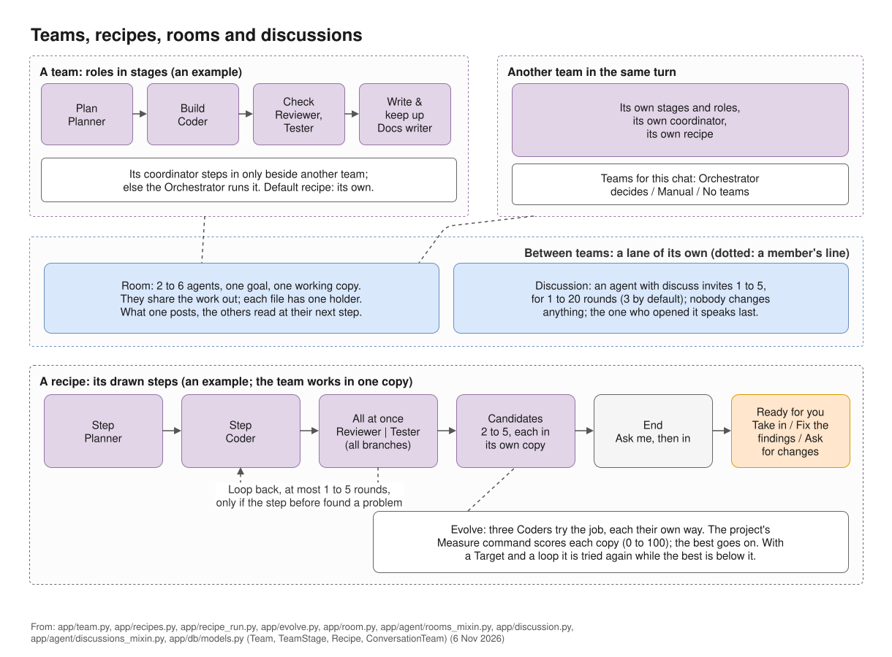
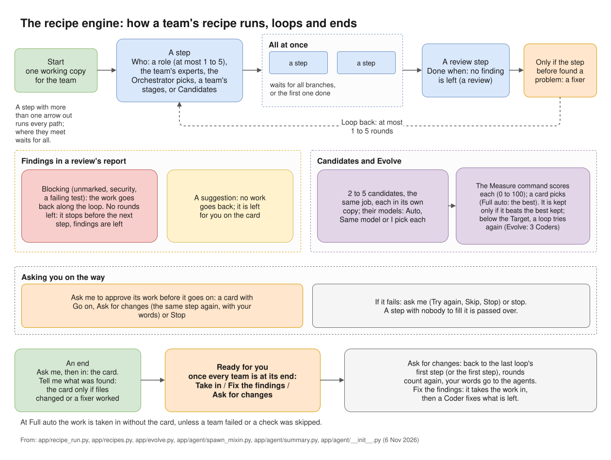

# Recipes and candidates

A recipe is the drawn steps of a piece of work: who does each step, what runs at once, where it loops
back and how it ends. "A chat's team runs by the recipe picked for it, else by its team's default."
Recipes are on the Agents page, tab **Recipes**.

*Teams, recipes, rooms and discussions in one picture.*

## Making a recipe

- **+ Draw a new recipe** starts an empty one.
- Pick a ready recipe and press **Copy it**. Ready recipes cannot be changed: "A ready recipe: copy it
  to change it."
- **Or write it**: describe the recipe in a sentence and press **Make it a recipe**. "The
  Orchestrator's model draws it on the board; nothing is saved until you save it."

The ready recipes include Feature, Bugfix, Review only, Integration, Quality check, Model change,
Pipeline change, Infra change, Docs, Research, Spec, Analysis, Upkeep and Evolve.

## The parts of a recipe

The toolbar adds parts to the drawing: **+ Step**, **+ All at once**, **+ Loop back**, **+ Room** and
**+ Ask me**. **Tidy up** lays the drawing out again.

**A step** says who does it:

- **The Orchestrator picks**;
- **The team's experts**;
- **A role**, with **At most** 1 to 5 agents;
- **Candidates (the best one goes on)** (see below);
- **A team's stages**.

A step can also have **Done when**, **Only if the step before found a problem**, **If it fails**
(ask me or stop), and **Ask me to approve its work before it goes on**. That last one gives a card with
**Go on**, **Ask for changes** and **Stop**.

**All at once** runs steps side by side. It waits for **all branches** or for **the first one done**.

**Loop back** goes back to an earlier step, **at most** 1 to 5 rounds.

**Room** puts 2 to 6 roles in one room. See [Rooms](rooms.md).

**Ask me** is an end: **Ask me, then in**, or **Tell me what was found**. Every recipe needs an end.

## Where a recipe is kept

Choose **Kept in KOLONİ, for every folder**, or **Kept in this folder's .koloni/recipes (in git)**. A
recipe kept in the folder travels with the project, but only recipes kept in KOLONİ can be picked under
**Teams for this chat** or as a team's default.

## How a recipe runs and ends

The team works in one working copy, step by step, following the drawing. When the work reaches its
end, the **Teams' work is ready** card asks whether to take it into the project: **Take in**,
**Fix the findings** or **Ask for changes**. See [Ready and approval cards](../use/ready.md).

At **Full auto**, the work is taken in without the card, unless a team failed or a check was skipped.

*How a recipe runs, loops and ends. ([full size](../diagrams/recipe-engine.svg))*

## Candidates

A step whose **Who** is **Candidates (the best one goes on)** gives the same job to 2 to 5 agents.
Each works in its own working copy. For their models choose **Auto, the Lead picks**, **Same model** or
**I pick each**.

Each candidate's work is scored by the project's **Measure command** (Settings › This project › Checks and git):
a command whose last line of output is a number from 0 to 100. A card then lists the scores and asks
which candidate's work goes on. At Full auto the best score goes on by itself.

With a **Target** (0 to 100) and a loop, the step is tried again while the best score is below the
target, and a new result replaces the kept one only if it scores higher. The ready recipe **Evolve**
works this way: three Coders try the job, each their own way.
