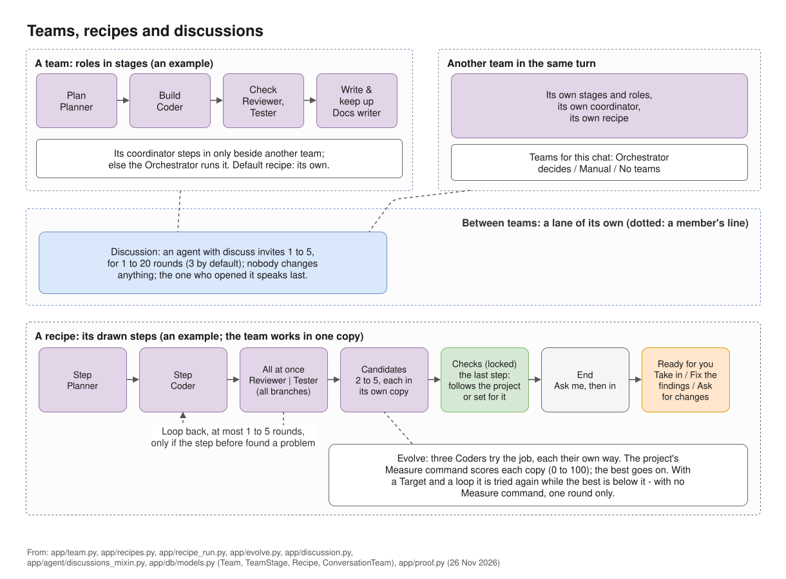
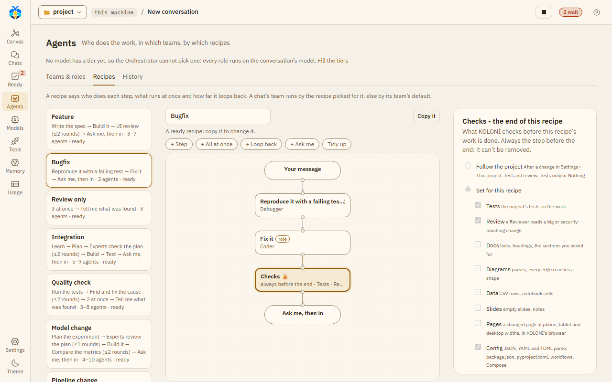

# Recipes and candidates

A recipe is the drawn steps of a piece of work: who does each step, what runs at once, where it loops
back and how it ends. "A chat's team runs by the recipe picked for it, else by its team's default."
Recipes are on the Agents page, tab **Recipes**.

*Teams, recipes, rooms and discussions in one picture.*

## Making a recipe

- **+ Draw a new recipe** starts an empty one.
- Pick a ready recipe and press **Copy it**. Ready recipes cannot be changed: "A ready recipe: copy it
  to change it."
- **Or write it**: describe the recipe in a sentence and press **Make it a recipe**. The note
  under it says which model it asks - the first of the balanced tier ("Asks Balanced: Local ·
  qwen3"), passing over one whose server is not running, else the Orchestrator's own - and if
  that one does not answer, the next is asked. Where none answers, it says so and names every
  model it tried, each with why ("No model answered: Local · qwen3 (not running),
  …"). The model draws the recipe on the board; nothing is saved until you save it.

The ready recipes include Feature, Bugfix, Review only, Integration, Quality check, Model change,
Pipeline change, Infra change, Docs, Research, Spec, Analysis, Upkeep and Evolve.

## The parts of a recipe

The toolbar adds parts to the drawing: **+ Step**, **+ All at once**, **+ Loop back**, **+ Room** and
**+ Ask me**. **Tidy up** lays the drawing out again.

**A step** says who does it:

- **The Orchestrator picks**;
- **The team's experts**;
- **A role**, with **At most** 1 to 5 agents;
- **Candidates (the best one goes on)** (see below);
- **A team's stages**.

A step can also have **Done when**, **Only if the step before found a problem**, **If it fails**
(ask me or stop), and **Ask me to approve its work before it goes on**. That last one gives a card with
**Go on**, **Ask for changes** and **Stop**.

Before a step that runs only if a problem was found, a test run that failed is a problem, whatever
the agent's report says. At any other review step it is one too where the report says nothing is wrong,
unless its **Already failing before** lines name every test that run says failed - with its file or
suite where the run gives them (a bare name only where no other failing test has it), and never one
the run's reproduce step showed failing: that is the bug. A later pass clears a failed run only where it
is the same command in the same folder, or a run of the same test tool in that folder that picks none of
its tests (`pytest` and `python -m pytest` are one tool): a narrower pass - a test name, `-k`, `::`, `-t`,
`--grep`, `-run`, `--filter`, tests left out (`--ignore`, `--deselect`), options of its own (`-c`,
`-o`, `--rootdir`, `PYTEST_ADDOPTS`) - clears no wider failure. A pass of files or folders clears it only
where it counted tests and every test the failed run names as failing is in one of them. A run that
never started its tests (the tool not found), one that runs none (`-h`, `--help`, `--version`,
`--collect-only`, a list of the tests, no tests found, or a summary that counts 0 passed and 0 failed)
and one whose exit is hidden (`; true`, `|| true`, a pipe after it) gives no verdict either way. In a step
with the id `reproduce` (Bugfix's first) the failing test is the work: the agent's report says it "fails
as it should".

A Tester at a review step, or any agent of a step with the id `test` or `tests`, passes only on a command
it ran that checks something. Where the project has a test command (yours, one KOLONİ saved, or one its
files name) and the recipe changed code, that is a test run that really ran tests - its runner counted
some, or your own test command ran. Elsewhere a mere read (`ls`, `cat`, `git status`) checks nothing, nor
does `echo`, `true`, `cd .`, `sleep`, `python -c "pass"`, a `--version` or `--help`, or a test run that
ran none. Its task says so, and one that ran none does not pass - "it is a check that ran no test on
record". Where you declined its command,
the recipe stops at **Teams' work is ready**, "Not checked: you declined …", rather than sending the work
back. A reviewer that only reads (a Data analyst, a Performance engineer) passes on its report. (Where an
agent's CLI keeps its own commands off KOLONİ's record, its report is taken as it is.)

**All at once** runs steps side by side. It waits for **all branches** or for **the first one done**.

**Loop back** goes back to an earlier step, **at most** 1 to 5 rounds.

**Room** puts 2 to 6 roles in one room. See [Rooms](rooms.md).

**Ask me** is an end: **Ask me, then in**, or **Tell me what was found**. Every recipe needs an end.

### The Checks step

Every recipe ends in a **Checks** step 🔒: what KOLONİ checks before the recipe's work is done
([What KOLONİ checked](../use/checked.md)). It is always the last step, joined to the step(s) that
lead to the end, and it moves when you add a step after them. It cannot be removed or dragged.

Click it to choose:

- **Follow the project** (the default): the project's **After a change** - Test and review, Tests
  only or Nothing - with its **Check by kind of work** and **Fix rounds**.
- **Set for this recipe**: **Tests**, **Review**, **Docs**, **Diagrams**, **Data**, **Slides** and
  **Pages** (a changed page in KOLONİ's own browser at phone, tablet and desktop widths), each on or
  off, and **Fix rounds** - the project's, until it passes, 1 to 10, or **0 - check only** (a problem is said,
  nothing goes back to be fixed). With **Review** on, a big change of screens is also tried by the
  Tester ([the live try](../use/checked.md#the-live-try)).

A recipe that makes no code - a report, the docs - turns **Tests** off and its kind of work on: its
turn runs no tests and checks the documents it wrote; a fixable problem (a broken link) goes back
as a fix round, as a failing test does. With every check off, the answer says "Not checked: this
recipe's Checks step checks nothing". The choice is kept with the recipe - in a folder's
`.koloni/recipes/*.json` too, as its graph's `checks`.

The ready recipes come set: **Bugfix** and **Feature** check their tests and a review, **Docs** its
documents and a review, **Evolve** its tests; the others follow the project. A recipe set for itself
checks so even in a project at **Nothing** - set its Checks step to **Follow the project** to leave it
to the project. Only a recipe you picked (**Teams for this chat**: Manual) can check less than the
project does; one the Orchestrator picked (Orchestrator decides) only adds to the project's checks
and takes the larger Fix rounds - it never turns them off. A recipe's turn follows its Checks step,
never the chat's **Test and review changes** switch. Rounds never stack: where the recipe's own
loop of test and fix ran out, the Checks step sends nothing back on top.

## Where a recipe is kept

Choose **Kept in KOLONİ, for every folder**, or **Kept in this folder's .koloni/recipes (in git)**. A
recipe kept in the folder travels with the project, but only recipes kept in KOLONİ can be picked under
**Teams for this chat** or as a team's default.

## How a recipe runs and ends

The team works in one working copy, step by step, following the drawing. When the work reaches its
end, the **Teams' work is ready** card asks whether to take it into the project: **Take in**,
**Fix the findings** or **Ask for changes**. See [Ready and approval cards](../use/ready.md).

At **Full auto**, the work is taken in without the card, unless a team failed or a check was skipped.

*How a recipe runs, loops and ends. ([full size](../diagrams/recipe-engine.svg))*

## Candidates

A step whose **Who** is **Candidates (the best one goes on)** gives the same job to 2 to 5 agents.
Each works in its own working copy. For their models choose **Auto, the Lead picks**, **Same model** or
**I pick each**.

Each candidate's work is scored by the project's **Measure command** (Settings › This project › Checks and git):
a command whose last line of output is a number from 0 to 100. A card then lists the scores and asks
which candidate's work goes on. At Full auto the best score goes on by itself.

With a **Target** (0 to 100) and a loop, the step is tried again while the best score is below the
target, and a new result replaces the kept one only if it scores higher. The ready recipe **Evolve**
works this way: three Coders try the job, each their own way. With no measure command there is no
score to compare, so the step runs one round only, and its card says so.
