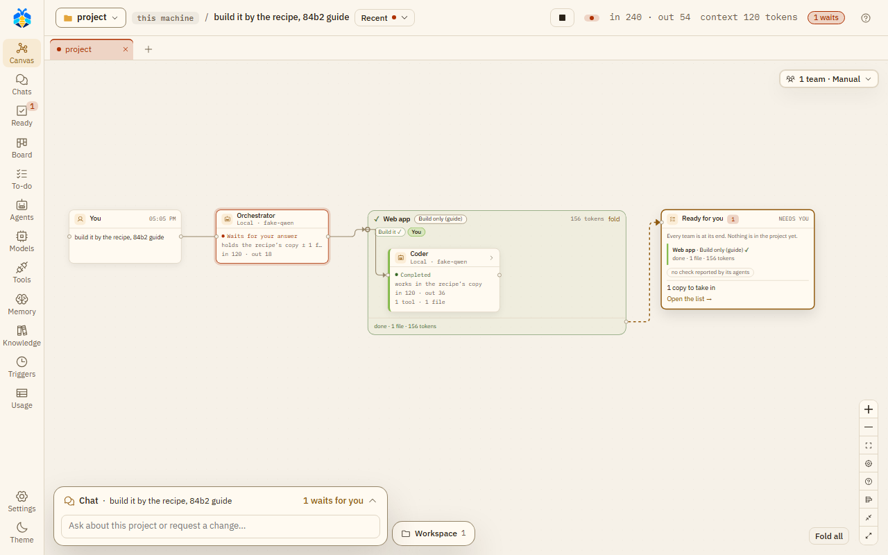

# Teams

A team is a named group of roles, set out in stages. A role can be in more than one team. Teams are on
the Agents page, tab **Teams & roles**.

## The ready teams

KOLONİ comes with these teams: Web app, Backend / API, Data, Docs, DevOps, Quality, Research,
Product, Maintenance, ML and DataOps. You can change them, or make your own with **New team**.

To build a website, the Web app team also has a Copywriter for the site's words and an SEO specialist
in **Build**, and an Accessibility reviewer in **Check**: the SEO specialist makes the site easy to
find, the reviewer checks it is easy to use with a keyboard or a screen reader.

## Stages

A team starts with four stages: **Plan**, **Build**, **Check** and **Write & keep up**. Drag a role
from the role list into a stage. You can rename, move or remove a stage (one must stay), and add one
with **+ Add a stage**. Each stage has an "all at once" box for roles that work at the same time.

Each team also has a **Default recipe**, the recipe it runs by unless a chat picks another, and
**The Orchestrator may pick it**.

## Coordinators

Each team has its own lead, shown as "*Team* coordinator". It "steps in only when this team works
beside another team; else the Orchestrator runs it." Switched off, the Orchestrator always runs that
team itself.

## Teams for a chat

On the canvas, **Teams for this chat** chooses how the chat uses teams:

| Mode | What it does |
|---|---|
| **Orchestrator decides** | "It picks the teams and a recipe for each, and says why." |
| **Manual** | "You pick the teams it may use; it opens only those a message needs." For each team, pick its default recipe, **No recipe**, or another recipe. **+ Add a team with a recipe** adds one. |
| **No teams** | "As before: it calls any role itself." |

**Use for new chats in this project** keeps the choice for the project's new chats (Settings › This
project → **New chats start with** shows and changes it). **Plan first** is the switch under the message
box, not here. While a team runs,
**Stop** stops it and **Finish now** ends it with what it has.

### A team that was not opened

In **Manual**, a turn that did work may open some of the teams you gave the chat and not others. The
Orchestrator is first told once to open the missing team or say why not. If it still does not, a line
at the turn's end says so, just above the Orchestrator's answer: "Quality was not opened in this
turn." (or "… were not opened in this turn." for several). It is not on the **Teams' work is ready** card. A
turn that opened none of them, because the Orchestrator answered itself, gets no such line.

## Waiting for another team

An agent of one team, its coordinator for example, can wait for the work of another team of the chat
that has a coordinator: a file or an endpoint it needs. Waiting spends none of its steps, and it holds
no place among the agents at work: its box says it is waiting.

- When the other team's work in this turn has ended, the waiting agent is told how it ended, its
  coordinator's report and the files it changed.
- When a message reaches the waiting agent, the wait ends there: it is told a message came, reads it,
  and may wait again.
- One wait lasts at most 10 minutes. After that the agent is told the other team is still at work,
  and may wait again, go on without it, or end with what is left undone.
- An agent waits at most three times in a turn.
- Two teams cannot wait for each other: the second is told to do its part first.
- A team not opened in this turn has nothing to wait for.
- **Stop** on the waiting team ends the wait, and its work.

See [Step limits](step-limits.md) for what a coordinator does when its steps run out.

<video src="../videos/team.webm" poster="../../videos/team.jpg" controls muted loop playsinline preload="none" style="width: 100%; height: auto" aria-label="Video: a message to a chat with the Web app team; the team's frame fills with its recipe's step and its Coder, and Ready for you waits at the end"></video>

*A team at work: its frame on the canvas fills as its recipe runs.*

*The Web app team at work: its frame holds the recipe's steps and the Coder, and **Ready for you** waits at the end.*

Only recipes kept in KOLONİ are offered here, not a folder's own recipes.

See [Recipes and candidates](recipes.md).
