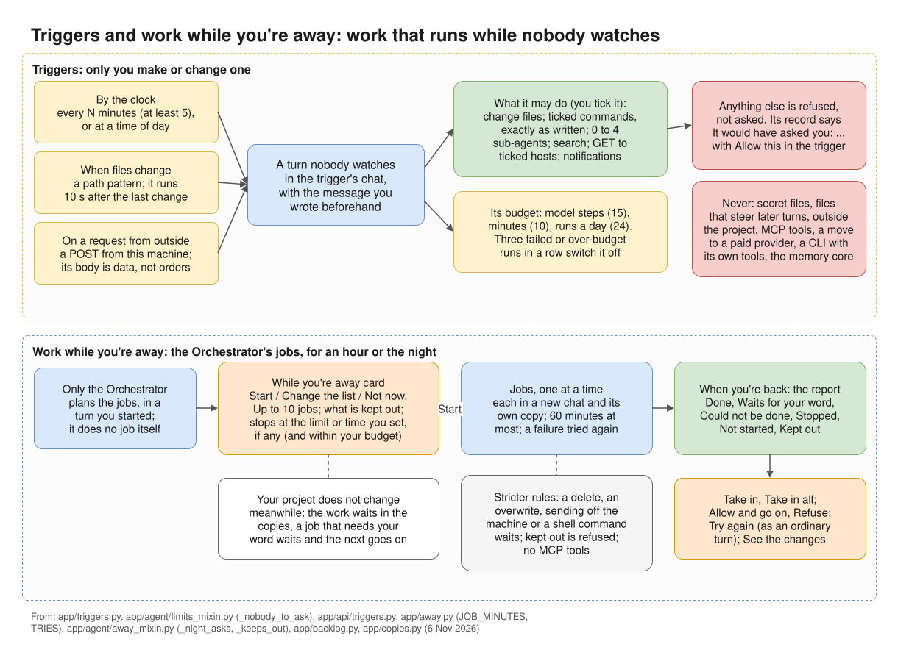

# Work while you're away

Before you leave, the Orchestrator can plan jobs for while you are away: for an hour, an afternoon or
the night. Each job works in its own copy of the project, so your project does not change while you
are gone. When you are back you decide what comes in.

*Work while you're away (below) and triggers (above): work that runs while nobody watches.*

## Planning the jobs

Tell the Orchestrator you are going away (to sleep, out, for a while) and what it should work on
meanwhile. It does none of that work itself. It puts the jobs on a **While you're away** card instead,
and nothing starts before your **Start**.

Only the Orchestrator plans these jobs, in a turn you started, in a chat with a folder, where it keeps
the To-do list. It does not plan them in a **Plan first** turn, nor while jobs of the project run
while you're away. A newer card takes the place of one not started yet.

### The jobs

A card has 1 to 10 jobs, in the order they run. Each job has:

- a title, one plain line of at most 200 characters;
- optionally, what makes it done;
- optionally, a team, and a recipe for it; without a recipe the team works by its default recipe. A
  recipe with no team is not used.

### The card

The card says "The Orchestrator's jobs for while you're away: change anything before you start."

- "**Each job works in its own copy.** Your project does not change while you're away; you take the
  work in when you're back."
- "**If a job needs your word, it waits** and the next one goes on." See
  [Questions and approvals](#questions-and-approvals).
- What is kept out: files or folders of the project no job may change.
- When to stop: **Stop at** a time, or after spending an amount, whichever comes first. By default
  there is no time limit and no spend limit: the jobs run until they are done. Set a time or an
  amount (in the currency of your prices) on the card, or tell the Orchestrator, if you want one.
  If the project has a monthly budget, the jobs spend at most what is left of it. Empty a field and
  that limit is off; the card says "(empty: no time limit)" and "(empty: no spend limit)". On a
  provider paid by plan no money is counted, and the card says so: "there only the time holds".
  Your provider limits hold too.
- A job works at most 60 minutes. Then it stops, what it did is kept in its copy, and the next one
  goes on. On the report it is under **Could not be done**, with "Stopped after 60 minutes, the most
  one job works".

**Change the list** lets you edit each job and what makes it done, take a job out (one must stay), add
one with **+ Add a job** (up to 10), and change what is kept out: up to 20 files or folders of the
project, one a line or with commas between. Name the file or folder itself: a pattern such as
`src/*` or a place outside the project is refused. Then **Save the list**, or **Cancel**.

**Start** starts the jobs; they go onto the [To-do](todo.md) list too. **Not now** puts the card
away. Start is refused while **Stop everything** holds (press **Resume** first), and while a To-do
task is at work.

The card can also offer **Let the Orchestrator answer what it safely can**. It turns on the project's
**When you're away** setting, which then stays on after the jobs; change it back under
Settings › This project › Asking and away. See [Answering for you](answering-for-you.md).

## How the jobs run

Jobs run one at a time, in the card's order. Each starts in a new chat named after it, its first
message the job and what makes it done, and works in a copy of the project of its own.

- **Level and model:** the job's chat has the permission level and the model of the chat where the
  card was, not the To-do page's run settings. Its other settings are the project's, as in any chat:
  who changes the files, opening sub-agents, and the rest.
- **Team and recipe:** a job with a team works in **Manual** with that team, by the recipe the card
  gave.
- **The copy** leaves out `.git/`, `build/`, `dist/` and caches, and shares `node_modules/`, `.venv/`
  and `venv/` with the project. A job that needs what is not in the copy changes nothing and waits for
  you, its report ending "Needs the project itself: …".
- **A job that fails** is tried once more in its chat. Failed twice, it could not be done, and the next
  one goes on.
- **A job that waits for your word** waits, and the next one goes on.

The top bar shows "☾ Away · job 2 of 4" with **Stop all**, and "· until 07:00" after it when the card
has a stop time. The To-do page shows the jobs too: since when, what they spent against the limit,
and each job as it stands, with what its agents are doing right now. A job's chat says at the top when
its jobs started, with a link back to their report.

### Stricter rules while you're away

- **Commands** follow the job chat's level. Below **Full auto**, a command no rule covers waits for you,
  and the job with it. At every level these wait too: a command that deletes, overwrites or sends
  something off the machine; one that hands a command to a shell or another program; and one that
  installs into the project's shared dependency folders.
- **Ordinary file changes** in the job's copy never ask: they are kept for your Take in. Files that
  steer agents, secret files and places outside the project wait for you as in a watched turn, and the
  job with them.
- **Kept-out places:** a write to one, or a command that names one, is refused, and the try is on the
  report.
- **No MCP server tools** are used.
- **CLIs:** a CLI working with its own tools that is not started in the job's copy, or not held to
  it (Copilot working Native, agy when it may write), cannot work on a job: "… cannot work on a job
  while you're away".
- At **Full auto** the Orchestrator does not answer KOLONİ's own cards while you're away, as it does
  while you watch.

## Questions and approvals

What needs your word waits for you, and the job waits with it. The next job goes on meanwhile.

With **When you're away** set to **The Orchestrator answers what it safely can**, the Orchestrator
answers at once while the jobs run, without waiting the minutes you set. It answers only an agent's
question, a recipe's "Ask me", and opening a sub-agent on its role's own model; it does not answer once
the project is over its monthly budget or a provider is over its limit. Everything else waits: commands
and changes that ask, the web, secrets, folders, new roles and skills. See
[Answering for you](answering-for-you.md).

A job that waits is shown under **Waits for your word**, on the report and in **Ready for you**.

## Step limits while away

Nobody is there to answer a Continue / Stop here card, so none comes:

- A sub-agent that reaches its step limit stops. The job's Orchestrator is told its part is not done,
  and may tell it once to go on, with a new step limit.
- One that stopped at its role's own limit, or stops again, ends. The job's Orchestrator hands what is
  left to another agent, or says in its report what is left undone. The job can still count as done:
  read its chat.
- The job's Orchestrator counts no steps. If it goes round in circles (the same call failing the same
  way 5 times, or 10 calls in a row bringing nothing new), the job fails with that reason, is tried once
  more in its chat, and the night goes on with the next job.

See [Step limits](../agents/step-limits.md).

## What stops the jobs

The jobs end when:

- every job was tried;
- the card's stop time comes, if it has one ("Stopped at 07:00, the time you set.");
- they have spent their money ("Stopped at 5.02 of 5.00 USD, the spend limit.");
- the project is over its monthly budget, or the Orchestrator's provider is over its limit, when the
  next job is about to start;
- you press **Stop all** ("Stopped by you.");
- KOLONİ is closed ("Stopped: KOLONİ was closed while you were away.");
- the next job cannot start.

The time and the money are checked before each model step. A clock also watches the stop time and
each job's 60 minutes, so a long command is cut too. When the jobs stop, the job at work stops, its
work kept in its copy, and is shown as **Stopped**. A job that waits for your word goes on waiting.
When KOLONİ is closed, the jobs at work and those that wait count as could not be done: answer what
waits before you close KOLONİ.

**Stop everything** in the top bar holds the jobs instead of ending them: the job at work and a job
that waits for your word are stopped, the next job waits for **Resume**, and the card's time and money
still end them.

A trigger's budget plays no part here: these jobs are not trigger turns.

If you set up [notifications](../settings.md#notifications), you get one when the jobs end.

## When you're back

KOLONİ opens on the report on the canvas until you have seen it. The chat where the card was has one
line, such as "While you were away: 3 done, 1 waits - on the canvas".

The report shows when the jobs ran, what they spent and why they ended; nothing of it is in your
project before you take it in. Its sections are **Done**, **Waits for your word**, **Could not be
done**, **Stopped**, **Not started**, **Proposed while you were away, not started** (with **Add to
To-do** or **Dismiss**) and **Kept out, as you asked** (what tried to change those places, refused).

Each job row says what its reviews found, and warns where its copy changed a place you kept out, or a
file another job changed too. A job that changed nothing is "Done, nothing changed". For each job:

- **Allow and go on** or **Refuse**, when it waits for a command, a change, a web request or an agent
  to open. A question, a folder or a secret is answered in its chat: **Open its chat**. The job then
  goes on in its copy.
- **Take in** brings its work into the project; **Take in all** takes in every done job's work. Where
  two jobs changed one file, the two are joined line by line where their lines do not clash. A
  clashing line is not taken: the card of the job's kept copy, in its chat, decides it.
- **Try again**, for a job that could not be done or was stopped, once the jobs are over. It runs in
  the job's chat as an ordinary turn, not in a copy: its changes go into the project as that chat's
  level says.
- **See the changes** or **Open its chat**.

The To-do page shows the same jobs, open by itself while a job needs a decision of yours.

See [A job while you're away](../examples/overnight-job.md) for the steps from planning to taking the
work in.
