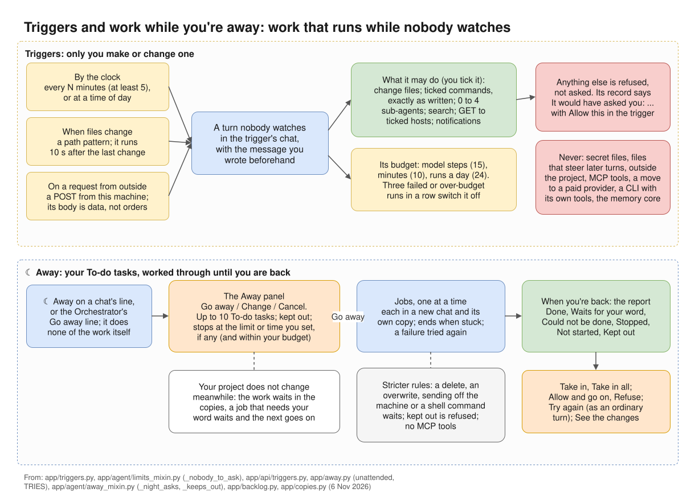
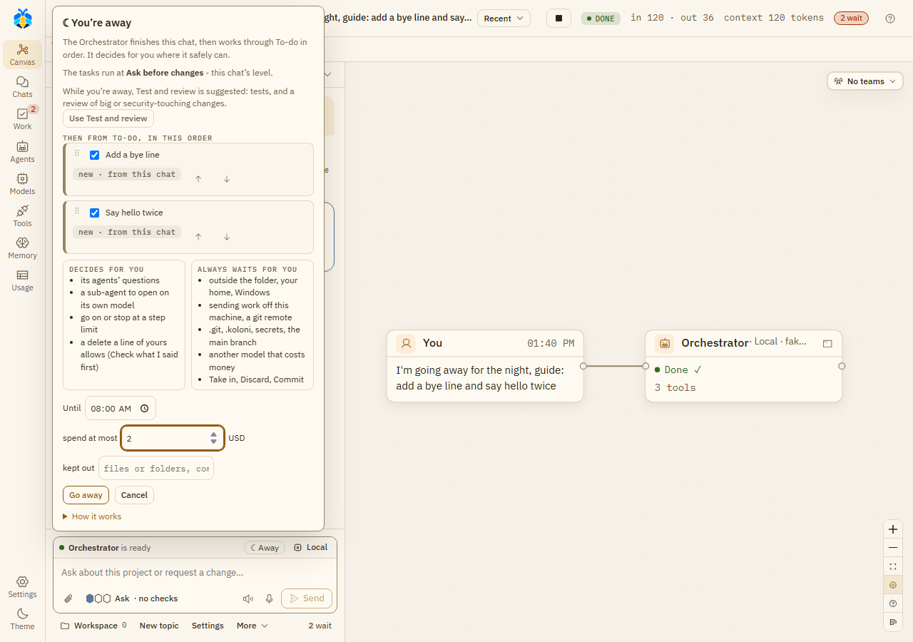
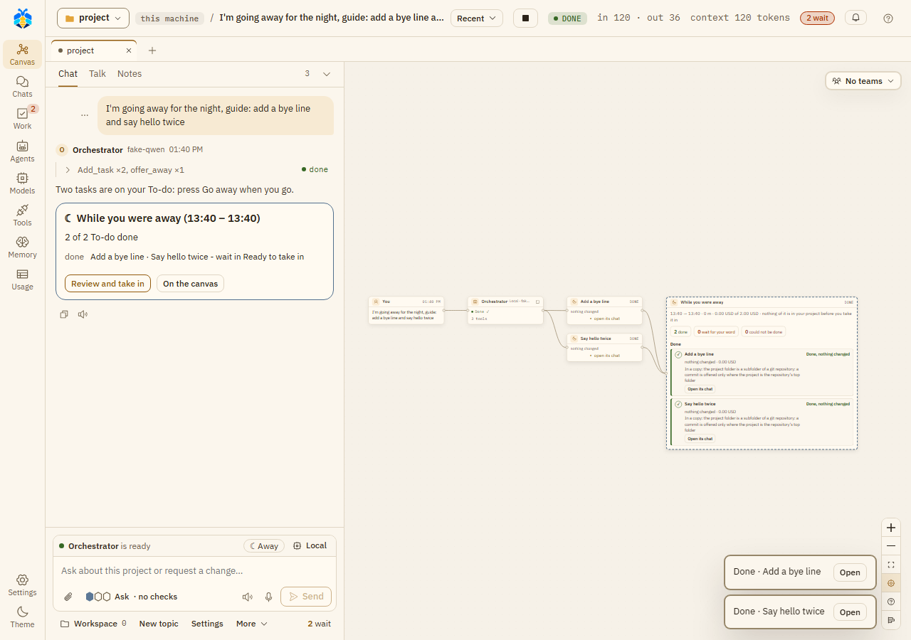

# Work while you're away (☾ Away)

Before you leave - for an hour, an afternoon or the night - press **☾ Away** on a chat's status
line, or tell the Orchestrator you are going. The chat finishes its turn, then the
[To-do](todo.md) tasks you tick are worked through, one at a time, each in its own copy of the
project: your project does not change while you are gone. When you are back you decide what comes
in.

*Work while you're away: work that runs while nobody watches.*

## Going away

**☾ Away** is on the line over the message box of a chat with a folder (not in a plain chat; in a
chat with no turn yet it waits: "Write to the Orchestrator first: Away finishes this chat's turn").
It opens the Away panel:

- "The Orchestrator finishes this chat, then works through To-do in order.", and the level the tasks
  run at: this chat's.
- **Then from To-do, in this order**: the project's open tasks (proposed or to do). The tasks
  proposed in this chat are ticked already ("new · from this chat"); older ones are not ("on To-do
  since Mon"). Tick up to 10; **Move up** and **Move down** change the order, which is saved to
  To-do. A ticked proposed task counts as your OK.
- **Decides for you** and **Always waits for you**: see [Questions and approvals](#questions-and-approvals).
- **Until**, **spend at most** and **kept out**: none unless you set one. If the project has a
  monthly budget, the work spends at most what is left of it. Name a file or folder of the project
  to keep out (up to 20): a pattern such as `src/*` or a place outside the project is refused.
- Where the project is not on **Test and review**: "While you're away, Test and review is suggested:
  tests, and a review of big or security-touching changes." **Use Test and review** sets the project
  to it (Settings › This project › When the work is done › **After a change**) - while you are away, nobody
  but KOLONİ's checks looks at the work ([What KOLONİ checked](../use/checked.md)).
- **Go away**, or **Cancel**. **How it works** says the rest.

*The Away panel, opened from **☾ Away** on the chat's status line.*

Go away is refused while **Stop everything** holds (press **Resume** first), while a To-do task is
at work, and from a chat with no turn.

### From the chat

Tell the Orchestrator you are going away (to sleep, out, in any language) and what it should work on
meanwhile. It does none of that work itself: it puts each piece on To-do and offers one line under
its answer - "☾ Go away now? Add a bye line, Say hello twice · Until 08:00 · at most 2.00 USD" with
**Go away** and **Change** (the panel, there). The line names, and Go away takes, only the tasks the
Orchestrator itself put on To-do in that turn, each by its name: a task a sub-agent proposed (one
of a CLI's own sub-agents too), or an earlier turn's, stays in the panel for you to tick. With an
Orchestrator on a CLI whose own sub-agents KOLONİ cannot yet tell apart (all but Claude Code), the
line names no task: "Tick the tasks to take in Change". The limits are only
those it heard from you. Nothing starts before your Go away. Only
the Orchestrator offers this, in a turn you started in a chat with a folder - not in a **Plan first**
turn, nor while the project is away. A newer offer takes the place of one not answered yet.

### While you're away

The status line says where it stands: "Away · To-do 1 of 2: Add a bye line · 3 decided for you · 1
waits", then "To-do 2 of 2 looked at". The chip becomes **I'm back**, and the message box says
"Write to come back…". Away lasts until you are back: press **I'm back**, or write a message in any
chat of the project. Once every task was looked at, you get one notification if you set them up.

## How the jobs run

Tasks run one at a time, in the panel's order, once the chat you went away from has finished its
turn (a turn that waits for your word does not hold them back). A task added meanwhile does not join.
Each starts in a new chat named after it, its first message the task and what makes it done, and
works in a copy of the project of its own.

- **Level and model:** the job's chat has the model and the permission level of the chat you went away
  from (the Away panel says which). Its other settings are the project's, as in any chat:
  who changes the files, opening sub-agents, and the rest. Where that chat is at **Full auto** and
  **Check what I said first** works in the project (Full auto's judge's box for your words), the
  Orchestrator may run, by your own written words, a command the night would otherwise wait for you on.
- **Team and recipe:** where you picked the teams in that chat (**Manual**), the job's chat has
  them, with their recipes.
- **The copy** leaves out `.git/`, `build/`, `dist/` and caches, and shares `node_modules/`, `.venv/`
  and `venv/` with the project. A job that needs what is not in the copy changes nothing and waits for
  you, its report ending "Needs the project itself: …".
- **A job that fails** is tried once more in its chat. Failed twice, it could not be done, and the next
  one goes on.
- **A job that waits for your word** waits, and the next one goes on.
- **Its notebook:** a job writes in its task's [notebook](todo.md#the-storys-notebook) (its story's, where
  the task is of one): how each turn ended, the files it changed, the Orchestrator's `Task note:` lines
  and what its agents noted for the whole turn. The next night that works the task, or your own turn in
  its chat, goes on from it. **📓** on the task's row in its story's panel on To-do opens it.

### In a git repository: each job on its own branch

Where the project is the top folder of a git repository, a job works on a git branch of its own,
`koloni/<task>` (for example `koloni/fix-login-3f2a`; `koloni/task-3f2a` where the task's title holds
a secret KOLONİ knows, or one's shape - a branch's name goes to origin with its push), in a worktree
of your repository, and commits there as it goes. How Go away finds the project decides it, once for
every job:

| The project | The job | In the morning |
|---|---|---|
| No git; a folder inside a repository; HEAD on no branch; no commit yet; a merge or rebase under way; a git submodule; files in Git LFS | works in a copy, as above | **Take in**; its row says "In a copy: …" and why |
| A git repository with no remote called `origin` | works on its branch, commits there | "No remote: merge it with git, or Take in." |
| A git repository with an `origin` | works on its branch, commits there | its **push** waits under [Waiting for you](#waiting-for-you) |

- **Its first message** says so: the branch's name, commit as you go, do not push - KOLONİ pushes this
  branch when you say yes. A CLI's instructions say the same. Only the files git tracks are in the
  worktree; what git ignores (`.env`, data, build output) is read in the project.
- **Its git:** `git status`, `diff`, `log`, `add` and `commit` on its own branch run without a card. Its
  own `git push` is refused with "KOLONİ pushes this branch when the user says yes: go on" - no card,
  nothing parked. What reaches the rest of your repository (switching branches, reset, stash, fetch,
  config) is parked for you as any card is.
- **A script's push** - a test or a build step that runs `git push` - fails inside the job's worktree:
  KOLONİ starts its commands with git set to push nowhere (a fetch still works). That is a safeguard,
  not a wall: see [Known limits](../reference/known-limits.md#away-on-a-branch).
- **Where git will not** when the job starts (HEAD detached since Go away, say), it works in a copy;
  its Orchestrator is told why, and its row says "In a copy: …".
- **At its end** KOLONİ commits what the job left on the branch ("Orchestrator: fix the login") and keeps
  the worktree for your Take in - the same card as a copy's, file by file. Taking all of it in, or
  Discard, deletes the worktree and the branch, and the row says so instead of its commits: "Its branch
  koloni/fix-login-3f2a was deleted: its work was taken in." Nothing of it goes into your project by
  itself, at Full auto too. A file that holds a secret KOLONİ knows - in its content or its name: a provider key you saved,
  an MCP server's variable a secret's name holds, the page's key, one of the environment's, one given
  on a card, or any value with a secret's shape (`ghp_…`, `sk-…`, a password in an address) and the
  token or password it holds alone - is left out of that commit and stays in the job's worktree only;
  so is a file named as a secret, whatever it holds: `.env.sample`, `api_keys.json`, `token.txt`, a
  data file in a `credentials` or `secrets` folder ([which names](../reference/known-limits.md#git)).
  The job's chat and its push row say which ("· left out: conf.txt (a secret KOLONİ knows, or named as
  one)"), and the rest of the work goes on. A file an agent committed on the branch itself is on the
  branch, not left out: the chat and the row do not call it left out, and **Run** refuses the push
  ("prov.txt on the branch holds a secret KOLONİ knows - take it off the branch first") - or, for one
  only named as a secret, asks first ("credentials.yaml on the branch is named as a secret (its agent
  committed it): Run anyway pushes it"). Such a secret never deletes the job's work: only a secret
  given on a card during the job, which an agent committed on the branch itself, has the branch
  deleted, and the chat says so.
- **Its second try** after a failure, and the turn that goes on after your decisions in the morning,
  work in the same worktree, on the same branch.
- KOLONİ also notes your repository's branches, stash, tags and remotes as the job starts and ends:
  anything that changed outside the job's branch meanwhile is on its row - "Changed outside its
  branch: main 1a2b3c4 → 3c4d5e6", "git's config changed during the job" - for you to look at. KOLONİ
  does not undo it: it may be yours.

The top bar shows "☾ Away · To-do 2 of 4" with **I'm back** and **Stop all**, and "· until 07:00"
after it when you set a stop time. Ready for you's report shows the jobs too: since when, what they spent against the limit,
and each job as it stands, with what its agents are doing right now. A job's chat says at the top when
its jobs started, with a link back to their report.

### Stricter rules while you're away

- **Commands** follow the job chat's level. Below **Full auto**, a command no rule covers is parked
  for you (see [Questions and approvals](#questions-and-approvals)): it does not run, and the job goes
  on without it. At every level these are parked too: a command that deletes, overwrites or sends
  something off the machine; one that hands a command to a shell or another program; and one that
  installs into the project's shared dependency folders.
- **Ordinary file changes** in the job's copy never ask: they are kept for your Take in. Files that
  steer agents, secret files and places outside the project wait for you as in a watched turn, and the
  job with them.
- **Kept-out places:** a write to one, or a command that names one, is refused, and the try is on the
  report.
- **No MCP server tools** are used.
- **CLIs:** a CLI working with its own tools that is not started in the job's copy, or not held to
  it (Copilot working Native, agy when it may write), cannot work on a job: "… cannot work on a job
  while you're away".
- At **Full auto**, where **Check what I said first** works, a command that deletes is first checked
  against your own words - your preferences, the project's saved rules and your messages in the chat
  you went away from, never the task's words - and runs in the job's copy without a card where a line
  of yours names it. Only a delete in the folder, on one line: a command of more than one line or
  continued (a backtick or a backslash at a line's end), a line that also sends work off the machine
  or touches a git remote, Docker's prune or volumes, and a delete of a file that steers agents
  (`AGENTS.md`, `CLAUDE.md`) keep their card - in the chat you went away from as in a task's. See [Permissions](../use/permissions.md).
- At **Full auto**, with [Full auto's judge](../use/permissions.md#full-autos-judge) on (the default), a
  command the list does not stop is first looked at by a small model, reading the chat you went away
  from: one it finds risky is parked for you with its sentence, "KOLONİ's judge: …", and the job goes
  on. (In a chat you watch it is refused unless you chose **Ask me**; while you're away it is always
  parked.)

## Questions and approvals

A card no longer stops a job while you're away. A command's card - whatever its reason: no rule
covers it, it deletes or sends something off the machine, its copy asks for it, Full auto's judge finds
it risky - is **parked**: it does not run, the agent is told "KOLONİ parked this for the user, who is
away: run "…". It did not run. Do what you can without it, and say in your summary what waits.", and
the job goes on. A command a CLI run **Native** asks for with a tool of its own is parked the same
way. The job's copy is kept for the morning even where it changed nothing. When the job has done what
it can, it **waits** - "2 parked" - and the next job starts.

While you're away the Orchestrator decides at once, in the chat you went away from and in the
tasks' chats, what it may decide for you (another chat of the project keeps its own minutes): an
agent's question, a recipe's "Ask me", opening a sub-agent on its role's own model, and going on or
stopping at a step limit. The cards already waiting when you press Go away are decided then. In a job,
its **own questions** go to it too: "The user is away. Decide yourself and say what you assumed in one
sentence. Only if the answer is something only the user can know (a password, an account, a personal
fact), answer `park`." Its answer is on Ready for you, in its **Decided for you** column. What it
answers `park` - and a question it could not answer - is parked for you, and the job goes on. In the
chat you went away from,
its own questions wait for your return. It does not answer once the project is over its monthly budget
or a provider is over its limit.

These still wait for you, and the job with them (the next job goes on): changes of files that steer
agents or are secret, the web, secrets, folders, another model that may cost money, new roles and
skills, Take in, Discard, Commit. See [Answering for you](answering-for-you.md).

Only a job of an Away that runs parks: after **I'm back**, **Stop all** or the Away's end, the next
card of a job still at work waits for you as before. KOLONİ's own commands (its checks) are never
parked. A job that waits is shown under **Waits for your word**, on the report and in **Ready for
you**.

## Step limits while away

Nobody is there to answer a Continue / Stop here card in a job, so none comes (in the chat you went
away from, the Orchestrator decides that card at once):

- A sub-agent that reaches its step limit stops. The job's Orchestrator is told its part is not done,
  and may tell it once to go on, with a new step limit.
- One that stopped at its role's own limit, or stops again, ends. The job's Orchestrator hands what is
  left to another agent, or says in its report what is left undone. The job can still count as done:
  read its chat.
- The job's Orchestrator counts no steps. If it goes round in circles (the same call failing the same
  way 5 times, or 10 calls in a row bringing nothing new), the job fails with that reason, is tried once
  more in its chat, and the night goes on with the next job.

See [Step limits](../agents/step-limits.md).

## What stops the jobs

Away ends when:

- you are back: **I'm back**, or a message of yours (the job at work finishes; its cards then wait for
  you);
- the stop time comes, if you set one ("Stopped at 07:00, the time you set.");
- it has spent its money - what the tasks' chats and the chat you went away from spent since Go away
  ("Stopped at 5.02 of 5.00 USD, the spend limit."); the chat's turn at work is stopped too;
- the project is over its monthly budget, or the Orchestrator's provider is over its limit, when the
  next job is about to start;
- you press **Stop all** ("Stopped by you.");
- KOLONİ is closed ("Stopped: KOLONİ was closed while you were away.");
- the next job cannot start.

The time and the money are checked before each model step. A clock also watches the stop time and
each job's hours at most, so a long command is cut at them too. Its minutes with nothing moving
do not run out while a command or a model step of it is under way, an agent below the Orchestrator
is at work, or it waits for your word: those have limits of their own. When the jobs stop, the job at work stops, its
work kept in its copy, and is shown as **Stopped**. A job that waits for your word goes on waiting -
but **Stop all** stops it too.
When KOLONİ is closed, the jobs at work and those that wait count as could not be done: answer what
waits before you close KOLONİ.

**Stop everything** in the top bar holds the jobs instead of ending them: the job at work and a job
that waits for your word are stopped, the next job waits for **Resume**, and the time and money you
set still end them.

If you set up [notifications](../settings.md#notifications), you get one when every task was looked
at, and one when a limit or Stop all ends Away - none when you come back yourself.

## When you're back

The chat you went away from has one summary: "While you were away (23:10 – 07:42): 2 of 2 To-do
done · 3 decided for you · 1 waits · 0.84 USD", what was done (waiting in Ready to take in), what was
decided for you, **Waiting for you**, what waits (with **Allow and go on** / **Refuse**), **Review and
take in** and **On the canvas**. KOLONİ opened again opens on [Ready for you](#the-night-on-ready-for-you),
on the night, until you have seen it there or its report on the canvas - never over a page you opened
before the night was read.

### The night on Ready for you

KOLONİ opened after the night has ended opens on [Ready for you](../use/ready.md#the-page), at its first
look at the night - never taking you off a page you opened before that look; once the night has been on
screen (here, or its report on the canvas), KOLONİ opens as you left it. Once the night has ended, the
page opens on it: "Last night,
23:10 to 07:42" ("Night of Tue 24 Nov, …" once it ended more than a day ago), a time axis, and a lane
for each job. A job's bar runs from when its first turn of the
night began to when its last one ended - green where it finished, hatched honey where it waits for you,
a dashed edge where it was stopped or could not be done. Each
decision made for you in the job's chat that night - every one, however many - is a small hexagon on
its lane, at its time, in the colour of who decided: filled while it waits for your **OK**, an outline
once you have seen it. The
strip draws only what KOLONİ's records hold: a job that never started, or whose turn is still open, has
no bar and is still listed; a decision made in no job's chat (the chat you went away from) is on no
lane. Under the lanes: what the marks mean, **Not checked** and what the night spent ("Spent 1.40 USD
of 5.00 USD").

- **Not checked: N things** opens on the list, job by job, in the words of each job's last **Checked**
  section of the night: tests not run (a guessed command while you were away, among others), a kind's
  check, the Reviewer or the live or browser try not done, **After a change** set to **Nothing** - and,
  where its push went, that GitHub's checks on it were not waited for (KOLONİ does not wait for them
  yet). A job with no **Checked** section of the night says "not known", never "nothing".
- **The whole report** opens the night's report on the canvas.
- **Copy report as Markdown** copies the whole night - named by its day, its jobs, what waits for you, what
  was decided for you on its jobs, what was not checked and what it spent - for a pull request's
  description. Every job's, agent's and model's word goes in a code span, masked as the screen shows
  it: a parked command too, as the list shows it.

What the night parked is on the page too, first in its list and under **Last night**: the push first,
then the commands and questions - the rows of [Waiting for you](#waiting-for-you), with their own
words. A job that waits only for what it parked is those rows, not a row of its own as well.

### Waiting for you

One list of everything the jobs parked, task by task in the night's order, each in the order it was
parked: the command whole (never cut, in a fixed font; a secret KOLONİ knows, or one known by its
shape - a `Bearer` token, a password in an address - shows as `***`, and what runs is still the line
as recorded), or the question; why, in KOLONİ's words (the
card's reason, the judge's sentence, the Orchestrator's reason in quotes); and a warning where it reads
like orders to a model. It is in [Ready for you](../use/ready.md)'s waiting list (first, the push first
of all), on the summary and on the report.

- **Run** or **Reject** a command; a question takes one of its options, or a line and **Answer**.
- **Stop this task**, on the task's line: what waits of it is closed, the task is stopped, and nothing
  of it runs.
- You decide only once you are back (I'm back), and only while the task's job is not at work. A row
  that cannot be decided now says why: "Needs the project itself: Take in first" (a `git` line, or one
  naming `build/`, `dist/` or another folder a copy leaves out - a copy has no `.git`; in a job on its
  branch a `git` line runs in its worktree), "Its copy is gone:
  there is nothing to run it in" (you discarded it - **Reject** still works), "Where it would run is not
  known: Reject it, or run it yourself" (a CLI that did not say its folder), "The project runs commands
  elsewhere now: Reject it, or set that back" (Docker or this machine, changed since), "Its CLI's own
  shell would run it: Reject it, or run it yourself" (a line Claude Code, Codex or another CLI asked to
  run in its own shell), "A server line: run it yourself". Each row says where it would run - the job's
  copy, or the project itself - its card's words, and "Runs a file an agent wrote" where it does.
- Once every row of a task is decided, KOLONİ runs what you said **Run**, in the order it was parked,
  as it was recorded - the same line, its folder, the job's kept copy (or, where you took some of that
  copy in before your **Run**, the project itself), its time limit - with no card. Just before each, it
  looks again: a line whose copy was taken in or discarded after your **Run** ("its copy was taken in
  after your Run - run it yourself") does not run; and if anything in the job's copy changed after a
  line was parked - by an agent, a command, or an earlier line of this morning - **Run** does not run it
  ("the job changed files after this was parked: run it yourself", on the list as soon as it is
  known; where it runs in the project after a Take in, "its work was taken in after this was parked: run
  it yourself"). A command that runs none of the project's code (`curl`, `wget`, a file command) is the
  exception. A program an agent wrote is still
  refused, and so is a line naming a place you kept out. A Take in or Discard under way is waited for;
  while the lines run, the copy can be neither taken in nor discarded. **Stop** in the job's chat, or
  **Stop everything**, stops a line that runs, and the task (**Try again** works it). A message of
  yours waiting behind it then goes ahead: a turn of yours in the job's chat, which marks the job done
  once it ends, as any turn there does.
- Then the same Orchestrator goes on in the same chat, in one turn, on KOLONİ's message: "KOLONİ: the
  user decided: ran "npm test" ("…"); rejected "git push"; answered "Which database?": "Postgres". Go on
  with the task." - what a line printed, and your answer, in quotes; a line that timed out or was
  stopped says so. It is a job's turn: held to a job's hours, in the kept copy its rows were parked in
  - never a later turn's of the chat, a message of yours, say - (a fresh one where you took some of it
  in), its work kept for your Take in - at Full auto too - and the judge looks at its
  commands. It does not start where the project is over its monthly budget: the job then waits with
  why. A message of yours in that chat meanwhile waits behind it.
- **A job's push** (a git repository with an `origin`): "Push koloni/fix-login-3f2a to origin
  (github.com/…) — one commit by KOLONİ, 5 files · checks ✓ at 3c4d5e6", and "· opens a pull request
  into main" where the project's **How a team's finished branch reaches yours** is **Open a pull
  request** ([Settings](../settings.md)). **Run** pushes the
  branch's work as ONE commit by KOLONİ onto where it left `main` - never the agents' own steps, never
  what you had not committed when it began - and opens the pull request; **Reject** leaves the branch as
  it is. It waits for the task's other rows and its going-on turn ("Waits for this task's other
  decisions and its going-on turn"), and is made again with the branch's new commit after that turn: a
  yes is never for a commit you did not see. Just before it pushes, KOLONİ looks again: a branch
  deleted or moved since the job ended, a secret KOLONİ knows in what would go up - a file's content
  or its name, one an agent committed on the branch itself ("take it off the branch first") -, a
  branch of that name on origin ("origin already has a branch named …"), commits of yours on `main` not on origin ("push main first"; KOLONİ asks origin
  itself, never your remote-tracking branches), origin's `main` ahead of what you fetched ("fetch
  first"), an address git's config rewrites, the project on another branch
  than the one the job ended on, a branch changed since you read the row - nothing goes up, the row
  says why and waits, to try again once that is set right. Where a push to origin goes elsewhere now
  than when the job began, git's config or hooks changed since then, something changed outside the
  branch (its branches, stash, tags, remote-tracking branches, any other ref, git's own files), it
  changed a place you kept out, or it began from your work not committed, the row shows that first:
  **Run anyway** pushes - on Ready for you the row's words say what they do: **Push** (**Push and open
  PR** where the project's way is a pull request), **Not now** and **Push anyway**. The row names the address a push went to as the job began. Take in or Discard of the
  job closes the row ("Its work was taken in or discarded: nothing to push"); taking all of it in
  deletes the branch.

*Back: the summary in the chat you went away from, and the report on the canvas.*

The report shows when the jobs ran, what they spent and why they ended; nothing of it is in your
project before you take it in. Its sections are **Done**, **Waits for your word**, **Could not be
done**, **Stopped**, **Not started**, **Decided for you** (each of them is on Ready for you too, in
its **Decided for you** column, with **OK**, **Change** and - once the agent that asked has finished -
**Change and redo**: see [Decisions](../use/decisions.md#ok-and-change)), **Proposed while you were away, not
started** (with **Add to To-do** or **Dismiss**) and **Kept out, as you asked** (what tried to change
those places, refused).

Each job row says what its reviews found, and warns where its copy changed a place you kept out, or a
file another job changed too. A job that changed nothing is "Done, nothing changed"; one whose work
you took in or discarded says which files ("taken in: hello.py", "discarded: hello.py"). For each job:

- **Allow and go on** or **Refuse**, when it waits for a change, a web request or an agent to open. A
  folder or a secret is answered in its chat: **Open its chat**. The job then goes on in its copy. What
  it parked is under [Waiting for you](#waiting-for-you).
- **Take in** brings its work into the project; **Take in all** takes in every done job's work. Where
  two jobs changed one file, the two are joined line by line where their lines do not clash. A
  clashing line is not taken: the card of the job's kept copy, in its chat, decides it.
- **Try again**, for a job that could not be done or was stopped, once you are back. It runs in
  the job's chat as an ordinary turn, not in a copy: its changes go into the project as that chat's
  level says.
- **See the changes** or **Open its chat**.

Ready for you's report shows the same jobs, with a row per job and what waits for you.

See [A job while you're away](../examples/overnight-job.md) for the steps from going away to taking
the work in.
