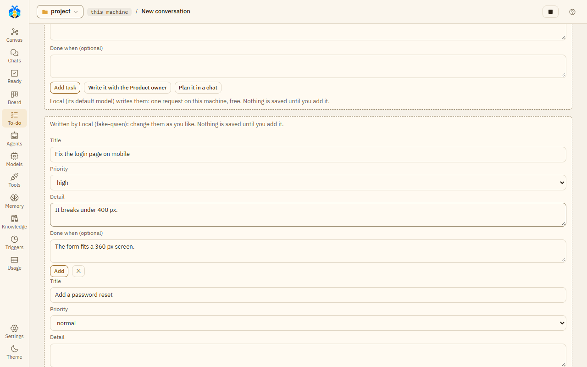

# To-do

The To-do page holds a project's tasks, in your order. "Each task runs in its own chat; you decide when
it is done." Open **To-do** on the left rail.

## Adding tasks

Type in **Add a task — title, then Enter**. Once there is a title you can also set its **Priority**
(high, normal, low), a **Detail** and **Done when (optional)**, then press **Add task**.

A rough note can become several tasks. Type it, for example "the login page is broken on mobile, and
we need a password reset", and press **Write it with the Product owner**. A model writes it as tasks,
each with a title, detail, done when and priority. It is asked once, with no tools: your first fast
model if you have one, else the Orchestrator's. The line under the buttons says which model writes
them and whether the request costs money. The tasks appear under the box for you to change. Press
**Add** on one, **✕** to drop one, or **Add all**. Nothing is saved until you add it. **Plan it in a
chat** works the other way: it opens a chat in the project whose first message asks for the Product
owner. The Product owner reads the project and proposes tasks, which wait for you like any agent's.

*A rough note written as two tasks by **Write it with the Product owner**; nothing is saved until you add one.*

Agents with the To-do tools (the Product owner and the Assistant product owner) can propose tasks and
changes. They wait for you under **Waiting for you**:

| What waits | Buttons |
|---|---|
| A new task an agent proposed | **Add** / **Edit** / **Reject** |
| A task an agent thinks is done ("done?") | **Done** / **Not yet** |
| A change an agent proposed | **Change** / **Reject** |

When several new tasks wait, **Approve all** adds them all. **Edit** opens the task's title and detail;
change them, then press **Add**.

## Follow-up tasks

After a turn in one of the project's chats, the **Assistant PO** suggests what to do next. It looks at
the turn's record: work left undone or for later, a TODO, a step that failed. It proposes at most
three tasks, each with the words they came from ("Proposed by the Assistant PO, from: ..."). Those
words must be an agent's in that turn, or the first line of a step that failed, not your message.
Backticks, `*` and `_` are ignored, and curly quotes count as straight ones, so `` `CHANGELOG.md` ``
still matches CHANGELOG.md. A suggestion without
such words is dropped. So is one that looks like a task already on the list, or one you rejected
before. Each one dropped is written, with why, to `runtime/logs/koloni.log`, and shows in the
Inspector of its canvas box (below). The
suggestions wait under **Waiting for you** like any agent's. An added task starts when you press **Run
the backlog**, or by itself where the To-do list runs by itself. A suggestion whose words look like
they try to give the agent orders says so on its row.

It is one small model request, with no tools, after each turn that did something: changed a file, ran
a command, handed work to a sub-agent or had a step fail. A turn that only answered asks nothing. It
is made once the turn is over, so your next message does not wait for it. It goes to the first model
of the fast tier, or of the tier you chose. It skips a provider that is down, at its limit, out of its
plan, or whose pay-per-token use you refused in that turn. With no such model nothing is suggested.
The model is sent what was said in the turn, the files it changed, the steps that failed and the open
tasks' titles. The secrets KOLONİ knows, and the variables the project passes to its commands, are
masked. Jobs while you're away and triggers get suggestions too; rooms, discussions and To-do tasks' own turns get
none. Nothing is asked while the project is over its monthly budget.

Each request shows on the canvas as an **Assistant PO** box under the turn, on a dashed line down from
the Orchestrator: the model, "2 proposed · 1 dropped" (at Full auto also "Orchestrator added 1"), its
tokens ("–" where not reported), and **To-do →**. Click it to see why each suggestion was dropped; a
double click, or **To-do →**, opens this page. A request that failed or timed out says "Sent, not heard
out". A turn where it was not asked has no such box.

At **Full auto**, in a turn you started, you are not asked. The Orchestrator's model decides each
suggestion, add or reject, with one more request, and says why in one sentence. You see its word under
**Decided for you** in the chat. **OK** keeps it; **Change** undoes it while the task is still todo. A
task it added does not start, by **Run the backlog** or by itself, until you press **OK**, there or
under **Waiting for you** on the To-do page. One it rejected stays on the To-do page, folded under
**Rejected by the Orchestrator**, with **Add**. It is not
asked when the provider has no room left on its plan, or when the To-do list runs by itself. Nor is
it asked when the Orchestrator runs on a CLI and the project does not let it answer while you're away.
It never adds a suggestion whose words look like orders. Suggestions from jobs while you're away and from
triggers always wait for you.

Turn it off, or choose the tier, in [Settings › This project › Agents](../settings.md#agents).

## Your tasks

**Your tasks** lists them by priority, then in your order. Drag a task, or use **⋯** → move up / move
down. The **⋯** menu also has **Edit**, **Waits for** ("it starts once these are done") and **Delete**.

A task's state shows as a tag, such as queued, running, "needs you", "needs you · Take in", stuck, or
done.

## Running tasks

**Run the backlog** starts the next tasks. **Runs by itself** keeps starting them, one after another.
Each task runs in a new chat, with the task as its first message. At most two run at once.

"A task not finished gets one fix round; still not, it is stuck and the next goes on." When an agent
thinks a task is done, it waits as "done?" for your word.

Nothing starts while one of your own turns is at work, while everything is paused, during work while you're away, or
over the project's monthly budget.

### Run settings

**Run settings** sets the level of the task chats (**Ask before changes**, **Auto-edit files** or **Full
auto**), **Who changes the files**, and the **Provider** and **Model name**.

Task chats follow some extra rules: a CLI that works with its own tools does not run them; commands that
delete, overwrite or send something off the machine, or that hand a command to a shell, ask at every
level; and the Orchestrator never answers for you in them.
