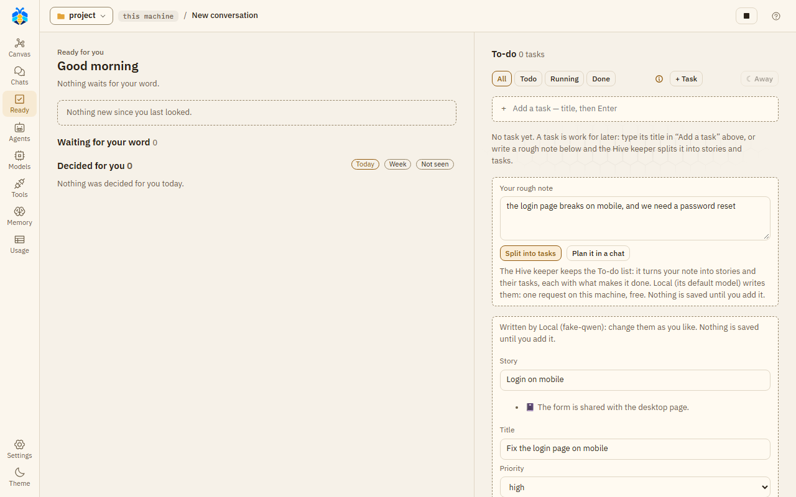
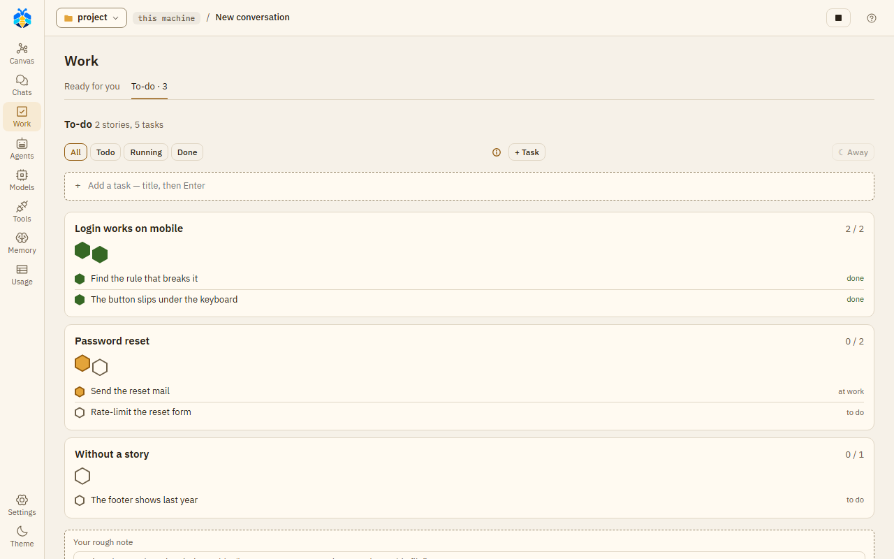
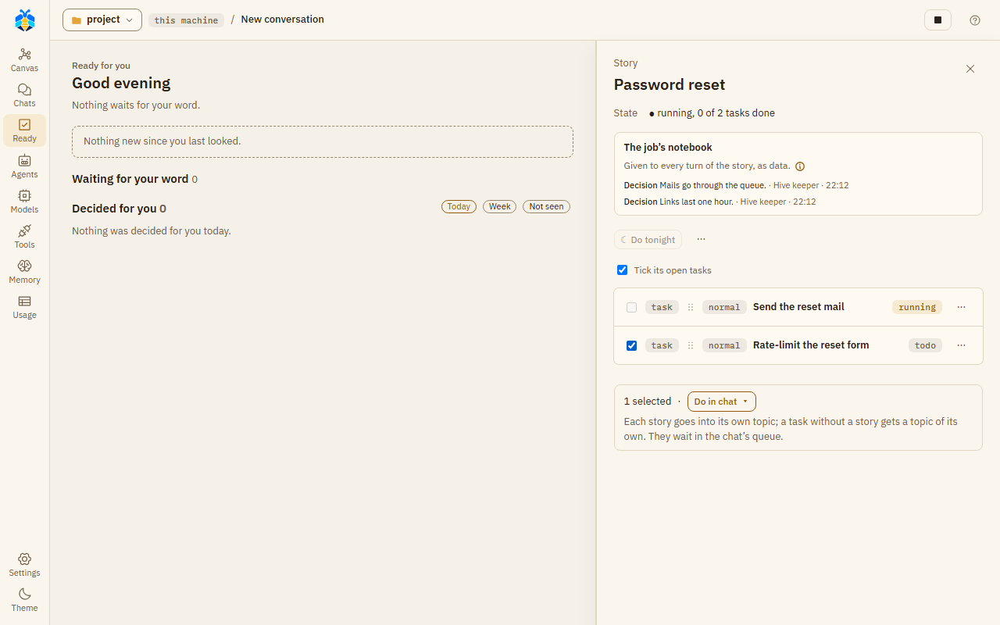
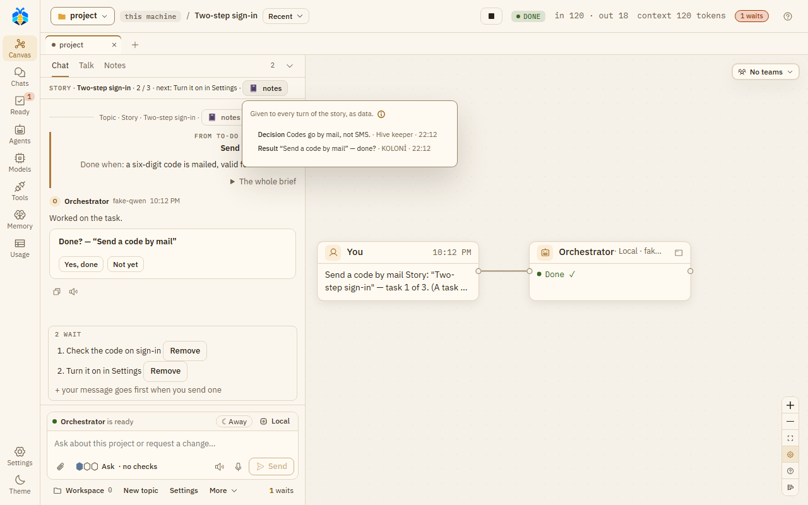
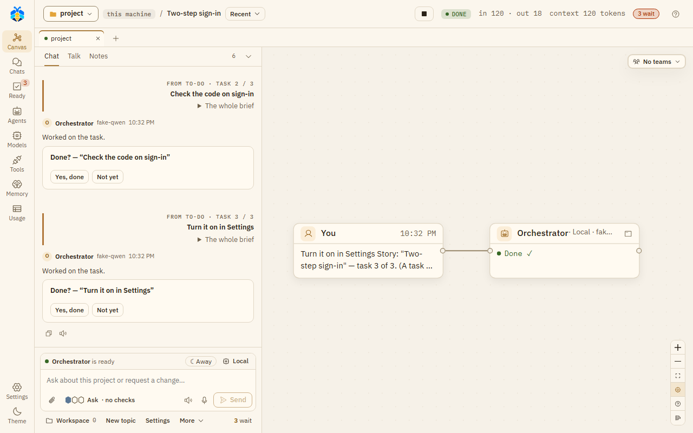

# To-do

To-do holds a project's tasks, in your order: a **story** holds the **tasks** and **bugs** that go on
together (see [Stories](#goals-and-stories)). Ticked tasks run in a chat you give them to, one by one;
you decide when each is done (see [Doing tasks in a chat](#doing-tasks-in-a-chat)).

Since 0.1.10 To-do is the right half of the [Ready for you](../use/ready.md#the-page) page - what was
done and what waits for your word are on its left, so the morning's report, the decisions that wait and
your tasks are in one place. Open **Ready** on the left rail; on a narrow screen To-do is under the
rest. Ctrl+K's **To-do (on Ready for you)**, a chat's **Open it in To-do**, a To-do row of **Decided for
you** and the canvas's **To-do →** bring you there - at that task, where one is named.

Its bar has the filters **All**, **Todo**, **Running** and **Done**, **+ Task** (to the line where a task
is added) and **☾ Away**. **☾ Away** opens the Away panel of the chat you have open, when it is a chat
of this project that has had a turn (see [Work while you're away](overnight.md)).

## Adding tasks

Type in **Add a task — title, then Enter**. Once there is a title you can also set its **Priority**
(high, normal, low), a **Detail**, **Done when (optional)**, its **Story** (none, one of the project's,
or **New story…**, named there) and its **Type** (task or bug), then press **Add task**.

A rough note can become stories and their tasks. Under the cards, type it in **Your rough note**, for
example "the login page is broken on mobile, and we need a password reset", and press **Split into
tasks**: the **Hive keeper** - the role that keeps the To-do list - splits it. A model writes it the way
that role would: tasks that go on together as a story, and each task with a title, detail, done when,
priority and whether it is a task or a bug. A
story may come with a few notes for its notebook. A small note stays a single story or a single task;
at most 4 stories and 12 tasks in all. It is asked once, with no tools, as **Or write it** asks (see
[Recipes](../agents/recipes.md)) - your fast models first, then the other tiers', then the
Orchestrator's model in the chat you are in, then your newest chat's. One that does not answer passes it
on in the same press; with none answering, the message names each one asked and why, and how to fix it.
The line under the buttons says which model is asked first and whether the request costs money.

The draft appears under the box for you to change: each story's title and tasks, and the tasks that
stand alone. A story's **Add** adds that story; **✕** drops a task; **Add
all** adds the rest. The tasks are yours and to do, as if you had typed them. Nothing is saved until you
add it. **Plan it in a chat** works the other way: it opens a chat in the project whose first message
asks for the Hive keeper. The Hive keeper reads the project and proposes tasks, which wait for you like
any agent's.

*A rough note split into two stories and three tasks by **Split into tasks**; nothing is saved until you
add it.*

Agents with the To-do tools (the Hive keeper and the Scout) can propose tasks and
changes. A task an agent proposes may name its story: one of the project's open stories by its title,
or a new one that shows on the list once you add one of its tasks. Its card says where adding it puts
it - *In story “Login” (new) · bug*, "(new)" where the agent's proposal opened the story. Once you add
one of its tasks, the story is yours: it stays though its tasks go. A story an agent opened goes when you reject all its tasks. They wait for you
under **Waiting for your word**, on the left of the page, with everything else that waits:

| What waits | Buttons |
|---|---|
| A new task an agent proposed | **Add** / **Edit** / **Reject** |
| A task an agent thinks is done ("done?") | **Done** / **Not yet** |
| A change an agent proposed | **Change** / **Reject** |

When several new tasks wait, **Approve all** adds them all. **Edit** opens the task's title and detail;
change them, then press **Add**.

## Follow-up tasks

After a turn in one of the project's chats, the **Scout** - the role that looks for what is left
after each turn - suggests what to do next. It looks at
the turn's record: work left undone or for later, a TODO, a step that failed. It proposes at most
three tasks, each with the words they came from ("Proposed by the Scout, from: ..."). Those
words must be an agent's in that turn, or the first line of a step that failed, not your message.
Backticks, `*` and `_` are ignored, and curly quotes count as straight ones, so `` `CHANGELOG.md` ``
still matches CHANGELOG.md. A suggestion without
such words is dropped. So is one that looks like a task already on the list, or one you rejected
before. Each one dropped is written, with why, to `runtime/logs/koloni.log`, and shows in the
Inspector of its canvas box (below). The
suggestions wait under **Waiting for your word** like any agent's. An added task runs once you give it to a
chat ([Doing tasks in a chat](#doing-tasks-in-a-chat)). A suggestion whose words look like
they try to give the agent orders says so on its row.

It is one small model request, with no tools, after each turn that did something: changed a file, ran
a command, handed work to a sub-agent or had a step fail. A turn that only answered asks nothing. It
is made once the turn is over, so your next message does not wait for it. It goes to the first model
of the fast tier, or of the tier you chose. It skips a provider that is down, at its limit, out of its
plan, or whose pay-per-token use you refused in that turn. With no such model nothing is suggested.
The model is sent what was said in the turn, the files it changed, the steps that failed and the open
tasks' titles. The secrets KOLONİ knows, and the variables the project passes to its commands, are
masked. Jobs while you're away and To-do tasks' turns get suggestions too; discussions get
none. Nothing is asked while the project is over its monthly budget.

After a turn of a story - one of its tasks' turns, or yours in its topic - a suggestion goes into that story,
while the story is open; after any other turn it stands alone, in no story. One that comes from the first line
of a step that failed is a **bug**, any other a **task**: KOLONİ tells them apart by the words a suggestion came
from, not by what the Scout says.

Each request shows on the canvas as a **Scout** box under the turn, on a dashed line down from
the Orchestrator: the model, "2 proposed · 1 dropped" (at Full auto also "Orchestrator added 1"), its
tokens ("–" where not reported), and **To-do →**. Click it to see why each suggestion was dropped; a
double click, or **To-do →**, opens To-do on Ready for you. A request that failed or timed out says "Sent, not heard
out". A turn where it was not asked has no such box.

At **Full auto**, in a turn you started, you are not asked. The Orchestrator's model decides each
suggestion, add or reject, with one more request, and says why in one sentence. You see its word under
**Decided for you** on the [Ready for you](../use/decisions.md) page. **OK** keeps it; **Change** undoes
it while the task is still todo. A
task it added cannot be given to a chat until you press **OK** there. One it rejected stays on To-do,
folded under **Rejected by the Orchestrator**, with **Add**. It is not
asked when the provider has no room left on its plan. Nor is
it asked when the Orchestrator runs on a CLI and the project does not let it answer while you're away.
It never adds a suggestion whose words look like orders. Suggestions from jobs while you're away always
wait for you.

Turn it off, or choose the tier, in [Settings › This project › Agents](../settings.md#agents).

## Stories { #goals-and-stories }

Each **story** is a card, in the stories' order: its name, how many of its tasks are done ("3 / 4"), a
[cell](../use/ready.md#the-cells) for each task in a row of honeycomb, and its tasks, each with its cell
and how it stands - *done*, *at work*, *done?*, *waits for Take in*, *push waits for you*, *stuck*,
*queued*, *to do*. The tasks of no story are one more card, **Without a story**, last. What the cells
mean is said under the cards. (Since 0.1.10 there is no goal level over the stories. A goal made before
stays in the database, and its stories stand at the top like any other.)

A card opens its story in a panel over To-do (the whole window on a narrow screen): its **Branch**, where
a night's job of it worked on one, the **Chat** it runs in, its **State**; its
[notebook](#the-storys-notebook), each note with who wrote it and when; its buttons; and its tasks, each
with all it can do (below). **Close** (✕) or Esc shuts it, and you are back on its card; Esc in a form
in it closes the form first.

- A **story** is tasks and bugs that go on together. Its state comes from its tasks: **○ todo** (none
  started), **● running** (one at work), **⚠ stuck** (one stuck), **done?** (every task done, or waiting
  at "done?" for your word) and **✓ done**. A story is done only when you close it: **Close story** in
  its panel, once each of its tasks is done; **Open it again** undoes it. Its notebook says what was
  decided, the files touched, the results and the questions left - read as notes, never as orders.
- Its panel's buttons: **Continue in chat** opens the chat it runs in, where it has one; **☾ Do
  tonight** opens the Away panel with its tasks to do ticked first; **Close story**; and **⋯** with
  **Rename** and **Delete**. Deleting a story keeps its tasks: they lose their story.
- A **task** is work to do; a **bug** is something that works wrong, its tag in rose. **⋯ → Edit** sets
  a task's **Story** and **Type**; **None** takes it out of its story. Dragging moves a task within its
  story only.
- A story's name is one in its project, whatever its case: agents name a story by it, so "Login" and
  "LOGIN" would leave which one they mean to chance. The Turkish İ and ı count as an i: "LOGİN" and
  "logın" are "login" too, and so is the "logi̇n" that lowercasing "LOGİN" gives (an i with a dot
  above of its own); so does a name in another Unicode form, with a character nobody sees in it, or
  with two spaces or a tab where the page shows one space. A name another story has, open or closed,
  is refused; an agent naming a closed story is told so. A name of what nobody sees alone - a
  zero-width space, a braille blank - is refused too: "a story needs a name you can see". Two open stories made before 0.1.9 whose names are now
  one ("Batch  Alpha" and "Batch Alpha") both stay: an agent naming one gets the story of exactly that
  name, and where neither is, it is told both names and asked for the exact one.

The filters on the bar show **All**, what is **Todo** (to do, or stuck), what is **Running** (at work, or
done? and waiting for your word - a story at done? too) or what is **Done** (a story only once you closed
it). A story whose tasks are all filtered out still shows when its own state fits.

*To-do's cards beside the rest of Ready for you.*

*A story's panel: its notebook, its buttons and its tasks.*

### The job's notebook {#the-storys-notebook}

Each story keeps a short notebook: in its panel on To-do, and **📓 notes** on the
[strip over a chat](../use/chat-and-canvas.md#what-the-chat-shows) the story works in. A task of no story
keeps its own (since 0.1.10): a task done in a chat, and a [night's job](overnight.md#how-the-jobs-run),
with **📓 N notes** beside the task. It is the job's notebook, for as long as the job runs: what its next
turns go on from. Each note is one line - a **decision**, a **file**, a **result**, a **question** or a
**note** - with who wrote it:

- **KOLONİ** notes how each turn of the story's tasks ended - *“Add the reset mail” — done?*, *— stuck: …*
  or *— not finished: …* - and the files that turn changed in the project, five at most.
- The task's **Orchestrator** is asked to end its answer with up to three lines
  `Story note: <decision|file|result|question>: <one line>` (`Task note: …` for a task of no story);
  KOLONİ reads them off its answer. A note
  is a line that starts so, at the very start of the line: before it only up to three spaces, a list's
  `- `, `* ` or `+ `, bold, or backticks round `Story note:` alone; a numbered list's item
  (`1. Story note: …`) is not one. One in a code block, a quote, a table, a heading, inline code, an
  HTML comment or an HTML block (`<pre>`, `<script>`… to its closing tag; `
`, `<table>`… to a
  blank line) is not, nor is a line right after a quote's with no blank line between: Markdown reads
  it as the quote's too.
- The **Hive keeper** adds its notes as it drafts a story.
- A **note** left for the whole turn on the chat's shared notebook - the
  [Notes](../use/chat-and-canvas.md) tab - goes in too: yours, and an agent's `post_note`, at most three
  of the agents' a turn (a team's note to its own team stays the turn's). The agent is told whether it
  went in.

*The strip over a chat a story works in, and its notebook opened from it.*

Every turn of the job is given the notebook, quoted as data, not instructions - each line saying whose it
is: KOLONİ's, an agent's or yours, so an agent's note never passes for your word: each task's first message
and its fix round carry it, and so do the Orchestrator's instructions in a turn of yours in the story's
(or the task's) topic, as the notebook stood when that turn began. Any agent of the turn reads it with
`read_notes`; in place of the notebook of the turn before, which a turn of a plain chat is given. Once
the job is over - its task done, its story closed - a turn in its topic is a plain chat's again. What a
search of earlier messages finds (**Search deeper**, an agent's **Recall**) never includes a notebook a
task's message carried. A session that summarises itself keeps short notes
it was given and loses details read in passing (in one measured run, 5 of 5 notes against 0 of 5 details
buried in a long log): the notebook is what is not lost. Long content - a file, an output - is read
again when it is needed.

What agents write there goes to models at every turn, so KOLONİ holds it to a few rules: the secrets
KOLONİ knows, and the variables the project passes to its commands, are masked, and a word next to a
character nobody sees - a zero-width space, a joiner, a braille blank - is hidden whole (`***`), so a
secret split by one is not kept in parts (an emoji family, an emoji with a hidden variant mark such as
⚠️, or a Persian word joined by one shows as `***` too, and so does a word another mask already cut
into); a line that reads like orders is left out (in `runtime/logs/koloni.log`) - and so is a line
with a zero-width character between two plain letters (a-z, A-Z), whole: it reads like orders
hidden from the eye; each note is one line of at most 200 characters, and the newest 20 are kept. Notes kept before these rules are checked again as they are
given. Masking knows a secret by its own characters: one split by a space or a line's end, or written
with look-alike letters, is not found.

## Your tasks

In a story's panel, tasks are listed by priority, then in your order. Drag a task, or use **⋯** → move up /
move down. The **⋯** menu also has **Edit**, **Waits for** ("it starts once these are done") and
**Delete**.

A task's state shows as a tag, such as queued, running, "needs you", "needs you · Take in", stuck, or
done.

## Doing tasks in a chat

Open a story and tick the tasks you want done - **Tick its open tasks** ticks them all - and the bar under
them says "N selected · **Do in chat** ▾". Ticks stay while you open another card: tasks of two stories go
to a chat together. Its menu gives them to **This chat - "…"** (the chat you have open, when
it is a chat of this project) or to **A new chat**, named by the first of them. "Each story goes into its
own topic; a task without a story gets a topic of its own. They wait in the chat's queue." KOLONİ checks
your ticks as they stand when you press it: a task done meanwhile, one waiting in another chat's queue,
a proposal, one the Orchestrator added for you that waits for your **OK**, a night's job or a task of
another project is refused, and so is a story's task while another task of that story waits or works in
another chat ("do the story there") - then nothing is queued. Over the project's monthly budget nothing
is queued either.

*A story given to a new chat: each task as itself, and "Done?" under it.*

The chat runs them one by one. Above its message box, **N wait** lists the queue - the task at work
"· running", each waiting one with **Remove** (back to To-do) - and "+ your message goes first when you
send one": a message of yours goes before the next task, and goes on in the topic you were last in. A
task that waits for others (**⋯** → **Waits for**) is passed over until they are done; the next ready
task goes first.

A task's turn is an ordinary turn of that chat: at the chat's level, on the chat's model (Claude Code and
the other CLIs included), and what needs your word asks on its cards there. Its first message is the
task - in the chat as **From To-do · task 2 / 3**, its title and what makes it done, the whole brief folded
under. A story's tasks go on in one topic - a line **Topic · Story · … · 📓 notes** over it, its 📓 a
button that opens the story's [notebook](#the-storys-notebook) once the notebook has a note - so the
Orchestrator and a CLI that goes on in its session remember the task before; after a task that ended badly, or a day later, the story's next task
starts in a new topic, told the story so far ([A story's session](#a-storys-session)). A task of no story
has a topic of its own; given to a chat again, it starts in a new one - only a fix round, or a turn Stop
everything cut, goes on in the topic it had.

"A task not finished gets one fix round; still not, it is stuck and the next goes on." Under a task's last
turn the chat asks:

- **Done? - "…"**, with the Scout's view if a fast model wrote one: **Yes, done** or **Not yet** (back to
  To-do).
- **Stuck - "…"**, with why: **Fix it** (one more round in its topic), **Open it in To-do**, or **Leave
  it** (the card folds to one line).
- **Story done? - "…"**, once every task of a story is done: **Close the story** or **Add a task** (it joins
  the story and this chat's queue).

A task's turn works as long as it makes progress. Once nothing has moved for Settings › The app › More limits ›
**Stuck after this many minutes with no progress** (30 unless you change it) - no file of the turn
changed, no agent finished its work, no failing command passed - it stops, its work kept, and counts
as not finished: its fix round comes, then it is stuck and the next task goes on. The same happens,
as a last resort, after **An unattended turn runs at most (hours)** (8 unless you change it; empty:
no limit). A task's turn also waits for its checks before it ends, so a check that failed gives it its
fix round.

**Stop** on a task's turn, a restart of KOLONİ, the project's monthly budget, a task's turn stopped by
the project's token limit or its provider's limit, or archiving the chat stops the queue: the task and
those waiting go back to To-do, and one line in the chat says why ("The To-do queue stopped: …").
**Stop everything** and **☾ Away** only hold it: the stopped task goes back to the head of the queue, and
**Resume** - or your coming back - goes on.

### A story's session

A story's tasks go on in one topic of the chat they run in: its Orchestrator sees the turns of the task
before, and on Claude Code goes on in the same session. The next task starts a new topic of the story -
a new session - instead where:

- a task of it got **stuck**, or went back to To-do (**Not yet**, **Stop**), so its wrong guess is not
  carried on - that task too, given to the chat again, starts there. A turn **Stop everything** cut is
  held, not judged: at **Resume** it goes on in its topic;
- a **day** has passed since its last turn there.

A session's size starts no new topic: Claude Code compacts its own session, and Copilot's and Codex's
are bound by KOLONİ already, at 75% (by default) of their window
([Going on from the last turn](../models/setup-cli.md#going-on-from-the-last-turn)).

The first task in the new topic is told the story so far - KOLONİ's own record of each earlier task and
how it stands, and the files their turns changed - with the notebook. This is decided as each task
starts: a **Not yet** on a task while the next one works moves only the ones after it. Any turn's
Orchestrator is told the names of the chat's other topics, with how a story's or a To-do task's stands:
*(done)*, *(done?)* or *(stuck)*.

### A story's branch

In a project that is a git repository, a story's tasks run on the story's own branch
(`koloni/<its name>-<4 characters of its id>`), one after another - each turn in a worktree of it, so nothing of the story is in your project until you close
it. **Close the story** runs KOLONİ's check on the branch - the tests its tasks wrote: it passes, the branch
is merged into yours, or sent as a pull request where the project's finished work goes so
([Branches](../use/workspace.md#branches)); it fails, the branch waits and the story's last task
is stuck with why - **Fix it** goes on on the branch, then close it again. It goes in by itself only at
**Full auto**, or where its check ran and passed; below that, a branch nothing tested waits on its **Merge**
(or pull request) card in the chat, and **Discard** there keeps the branch and the story open. A branch
holding a secret KOLONİ knows is held too, its last task stuck with why (KOLONİ looks at the files as the branch ends; a pull request sends its whole history, so a secret committed and removed on it still goes up). Where the branch cannot be opened -
your folder on no branch, or on the story's branch itself - nothing goes in and the story stays open; only a
branch deleted from git counts as gone. A chat holding a story's branch is not deleted until the story is
closed or deleted; a deleted story's branch stays in git, and its chat says so. A task added to a closed
story opens it again. A message of your own in the story's topic works in the project, not on the
story's branch. A task of no story has a small
branch of its own, merged at the end of its turn as a team's branch is (at **Ask before changes**, on a card).
A project with no git has no branch: the tasks work in the project, agents holding the files they change
as in any chat. Where the chat's Orchestrator is a CLI that works with its own tools in the project, its
tasks work in the project too.
