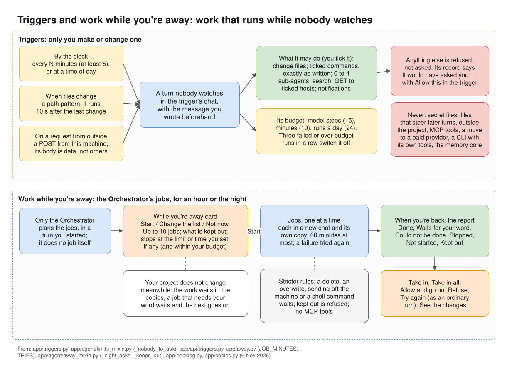
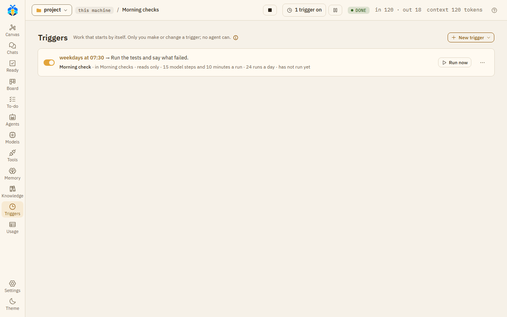

# Triggers

A trigger starts work by itself: by the clock, when files change, or when a program on this machine
calls it. "Only you make or change a trigger; no agent can." Open **Triggers** on the left rail.

A trigger's run is a turn nobody watches. There is nobody to ask, so it may do only what the trigger
allows. Everything else is refused, not asked.

*Triggers and work while you're away: work that runs while nobody watches.*

## Making a trigger

Press **New trigger** and pick a ready one, or **Start from blank**:

- **Keep an agent on this project** (every hour, reads only);
- **Every morning: summarise the work since the last working day**;
- **When source files change: run the tests**;
- **Every Friday at 17:00: check the dependencies**.

The form:

- **Name**.
- **Starts**: **By the clock**, **When files change** or **On a request from outside**. This cannot be
  changed later.
    - By the clock: **At an interval** (**Every so many minutes**, at least 5; the first run starts at
      once), or **At a time of day** (a **Time** by this machine's clock, and **Days**: every day,
      weekdays, or chosen days).
    - When files change: a **Path pattern** in the project, such as `src/**/*.py`. "It runs ten seconds
      after the last change." Folders such as `.git` and `node_modules` are never watched.
    - On a request from outside: see [Webhooks](#webhooks).
- **Conversation**: the chat it runs in. While that chat is at work, a run that falls due is skipped.
- **Message**: "What the agent is told each time, as if you had written it."

### What its work may do without asking

"There is nobody to ask when it runs." The chat's own permission level does not apply. Tick what it may
do:

| Choice | What it allows |
|---|---|
| **May change files** | Writing files in the project. |
| **May run these commands** | The commands you tick, each run exactly as written, with no extra arguments. Ticked from the chat's list of commands that run without asking. **Add to the list** adds one; that also lets the chat's own messages run it without asking. |
| **May open sub-agents** | 0 to 4 per run. |
| **May search the web** | Web searches. |
| **May make requests to these hosts** | Plain GET and HEAD requests, to hosts ticked from the chat's allowed list. |
| **May send you notifications** | Notifications, where you set an address. |

The project's own test command also runs without being ticked.

### Budget and end

- **Model steps a run** (default 15), **Minutes a run** (default 10), **Runs a day** (default 24).
  **Model steps a run** counts all the turn's agents together, the Orchestrator too: it is the step
  limit you set for the turn. Where **Minutes a run** is longer than Settings › The app ›
  **Stuck after this many minutes with no progress**, its turn also ends once nothing has moved for
  that long; and it ends if the Orchestrator goes round in circles: see
  [Step limits](../agents/step-limits.md#when-the-orchestrator-goes-round-in-circles).
  "Three runs in a row that fail or go over switch the trigger off."
- **Ends**: **No end**, **After so many runs**, or **After a day**.
- **Run once when KOLONİ starts if a run was missed** (on by default).
- **Run even if nothing changed** (clock only). Without it, in a git project, a run is skipped when
  nothing changed since the last one.

Press **Add trigger**.

## The trigger's card

Each trigger is a card: when it runs, what it is told, what it may do, its budget and its last run. It
has an on / off switch, **Run now**, its recent runs, and a **⋯** menu with **Edit**, **New key** (for
webhooks) and **Delete**.

*A trigger's card: when it runs, what it is told, what it may do and its budget.*

## Webhooks

A trigger that starts **On a request from outside** runs when a program on this machine sends a POST
request to its address. After you save it, the page shows the address once: copy it, then press
**I have copied it**. "If it is lost or leaks, make a new key on the trigger; this address then stops
working." **⋯** → **New key** → **Make a new key** makes a new address; the old one stops at once.

Only requests from this machine are accepted. What the request carries (at most 4000 characters) is
given to the agent as something to look at, never as an instruction.

## When a run needed something it was not allowed

A run's record shows **It would have asked you:** and what was refused. "Each was refused, and nothing
was done in its place." **Allow this in the trigger** opens the trigger's form with that ticked; it is
yours to save.

## What a trigger's run never does

- It never asks you anything.
- It does not run on a CLI that works with its own tools (Native, or agy). A trigger on a chat whose
  Orchestrator would run on one is not saved, and the form says why.
- It never moves to a provider that is paid per token.
- It does not read secret files, write files that steer agents, go outside the project, or use MCP tools.
- It puts nothing forward for the project's memory core.

## Pausing every trigger

The top bar shows how many triggers are on, with **Pause all**. Paused, it says "Triggers paused", with
**Resume**. Pause holds every trigger of every project and stops the runs at work.

To keep triggers from starting by themselves at all, start KOLONİ with `KOLONI_TRIGGER_CLOCK=0`.

## Triggers proposed by agents

An agent can propose a trigger on a **Make this trigger?** card. A proposal only reads, opens no
sub-agents, and has the default budget. "Approve makes it as shown; to let it do more, or change
anything, Edit." Agents can propose clock and file triggers only, never webhooks.
