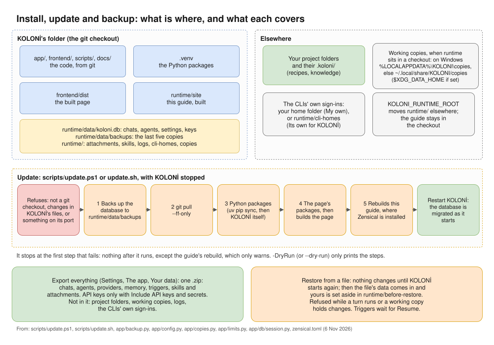

# Backup and update

[](diagrams/install-update.svg)

*What is where, what the update script does in order, and what Export and Restore cover. ([full size](diagrams/install-update.svg))*

## Backups KOLONİ makes by itself

Before a new version changes the database, KOLONİ copies it to `runtime/data/backups/`. It keeps the
last five copies. The update script's own backup goes in the same folder and counts among those five.

Backups hold your API keys, in plain text, like the database itself. Keep `runtime/` private.

## Export everything

Settings › The app › **Your data** › **Export**: "Everything KOLONİ keeps, in one .zip: chats, agents,
providers, memory, triggers, skills and attachments. Your project folders stay where they are."

Not in the file: your project folders (with their `.koloni/` folders and Knowledge), working copies,
logs, and the CLIs' own sign-ins.

- **Include API keys and secrets (keep this file safe)**: without it, the keys KOLONİ stores in its
  settings are left out. A key that was ever written in a chat, an agent's output or a command stays in
  the file either way.
- **Export everything** downloads the file.

## Restore

"Restore only a file you exported yourself: it decides which programs KOLONİ may start."

1. Settings › The app › Your data › **Restore from a file…**, and choose the `.zip`.
2. Nothing changes yet. Close KOLONİ and start it again; the restore happens at that start. Until then
   you can **Cancel** it.
3. Your data as it was is set aside in `runtime/before-restore/`, not deleted.
4. "Triggers and backlogs wait until you press Resume."

If the file had no keys, the page lists what needs its key again. A restore is refused while a turn is at
work, or if the file is not a KOLONİ export, comes from a newer KOLONİ, or is damaged. If a restore fails
at the start, your old data is put back, and the page says so.

## Updating

Stop KOLONİ first (Ctrl+C in its window). Then, in its folder:

=== "Windows (PowerShell)"

    ```powershell
    ./scripts/update.ps1
    ```

=== "macOS and Linux"

    ```bash
    ./scripts/update.sh
    ```

It refuses if the folder is not a git checkout, if you have uncommitted changes in KOLONİ's files, or if
something answers on KOLONİ's port. Otherwise, in order:

1. backs up the database to `runtime/data/backups/`;
2. pulls the new version (`git pull --ff-only`);
3. updates the Python packages;
4. updates the page's packages and builds the page;
5. where Zensical is installed, rebuilds this guide (see
   [This guide inside KOLONİ](getting-started/install.md#this-guide-inside-koloni)).

It stops at the first step that fails: "nothing after it ran". Only the guide's rebuild is different: if it
fails, it warns and KOLONİ is updated all the same. At the end it says "Restart KOLONİ; the
database is migrated when it starts", and where the backup is. `-DryRun` (Windows) or `--dry-run`
prints the steps without running them.

For Docker, see [Install](getting-started/install.md#docker).
