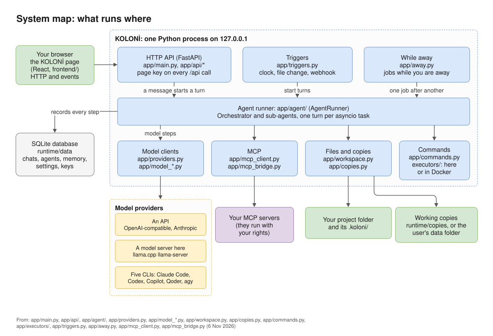
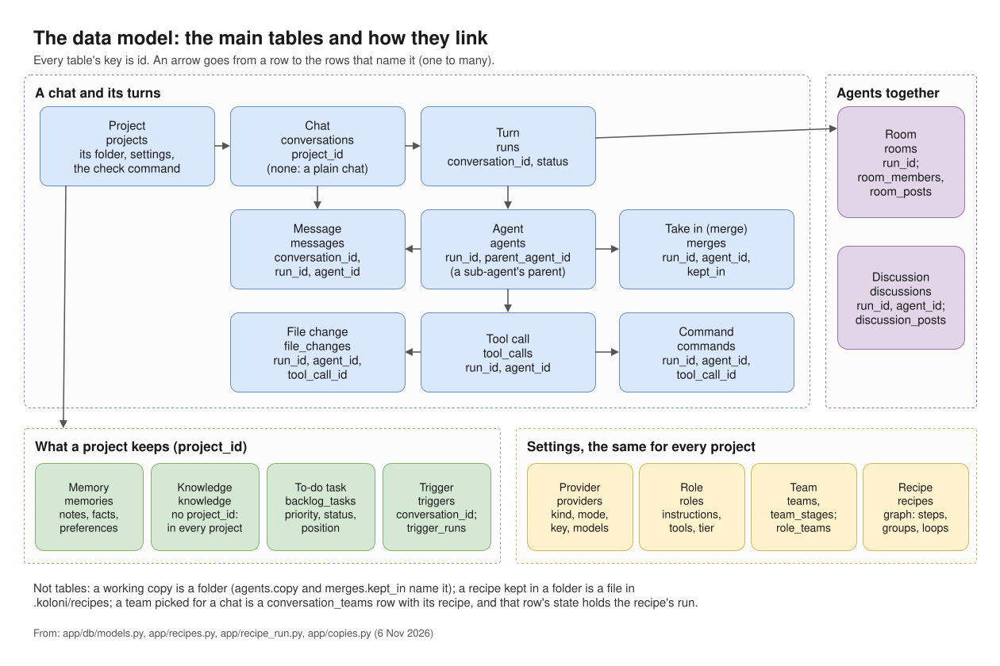

# Architecture

KOLONİ is one Python process that serves a React page and an HTTP API on `127.0.0.1`, keeps its data in
SQLite, and runs agents as asyncio tasks.

*What runs where. The diagrams' sources are in `docs/diagrams/`, with a README on editing them.*

## Backend (`app/`)

- **`main.py`** builds the app. At the start it applies a staged restore, backs up and migrates the
  database, tidies it, marks work that was cut off as interrupted, seeds the built-in roles and the first
  providers, and sets the page key. It serves the built page from `frontend/dist` on the same origin.
  FastAPI's own docs pages are switched off.
- **`api/`**: the HTTP routes, all under `/api`.
- **`agent/`**: the agent runner. `AgentRunner` runs one turn per asyncio task. It is split into mixins
  (spawning sub-agents, cards and approvals, memory, limits, rooms, discussions, work while you're away and more); the
  package docstring lists them.
- **Model clients**: `model_client.py` (OpenAI-compatible), `model_anthropic.py` (the Anthropic Messages
  API), `model_cli.py` (a CLI as one step per model step), `model_session.py` (a CLI session whose only
  tools are KOLONİ's, over MCP), `model_native.py` (a CLI with its own tools), `model_agy.py` (agy).
  `providers.py` chooses which one runs a role.
- **`db/`** and **`alembic/`**: SQLAlchemy models and migrations. The database is backed up before a
  migration.
- **`workspace.py`**: file access confined to the project folder and the folders the user opens.
- **`copies.py`**: each sub-agent works in its own copy, outside the project; its changes come back by a
  three-way merge.
- **`commands.py`**, **`command_runner.py`**, **`executors/`**: which commands ask, and running them on
  this machine or in Docker.
- **`triggers.py`**: clock, file-change and webhook turns.
- **`mcp_client.py`**: the client for the user's MCP servers. **`mcp_bridge.py`**: the small program a CLI
  starts as its MCP server, which relays to KOLONİ's own tools.

## Frontend (`frontend/`)

React, Vite, React Flow (the canvas) and Zustand (the store, `src/state/store.ts`).
`src/api/generated.ts` holds the API's types, generated from the backend's schema by
`scripts/export_openapi.py`; after changing an API shape, run `npm run generate:api` in `frontend/`.

## How the page talks to the API

Every `/api` request carries the page key in the `X-KOLONI-Key` header (or `?key=` for event streams and
downloads). The page takes the key from the link KOLONİ prints, or swaps a one-time code for it, and keeps
it in the browser's local storage. A few doors need no key: the health check, webhooks, Claude Code's
status line, and the one-time code exchange.

Events reach the page over server-sent events, per conversation.

## How a turn flows

1. The page posts a message to the conversation.
2. The server records it and starts a run as an asyncio task.
3. The Orchestrator (the Lead role) works with its tools and may open sub-agents, each in a working copy.
4. Anything that needs the user becomes a card; the run waits for the answer.
5. A finished sub-agent's changes are taken into the project, or put before the user on a card first.
6. Every step is recorded, and the canvas draws the turn from that record.

The same turn, step by step: where it waits for you, and how the page hears of each step.

*A message's journey, from Send to the chat and the canvas. ([full size](../diagrams/message-flow.svg))*

## The data model

The database is SQLite, its tables in `app/db/models.py`. A project has chats; a chat has turns (runs);
a turn has agents, and an agent has messages, tool calls, file changes, commands and take-ins (merges).
Memory, knowledge, to-do tasks and triggers belong to a project; providers, roles, teams and recipes are
the same for every project. Working copies are folders, not rows.

*The main tables, their keys and how they link. ([full size](../diagrams/data-model.svg))*

## Inside the agent runner

`app/agent/` holds `AgentRunner`, built from mixins, one per part. A turn picks its model by tier, then
loops: in step mode KOLONİ builds the history (compacting it when it is too long), asks the model, and
runs each tool call it asks for. A CLI in session or native mode keeps the loop itself. Limits, slots,
observing, recording and the rest work around every step.

*The agent runner's parts and how a step flows through them. ([full size](../diagrams/runner.svg))*
