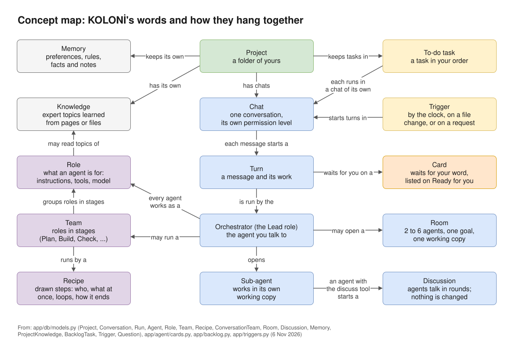

# KOLONİ in 5 minutes

KOLONİ's words, each in two or three sentences, with a link to the page that goes deeper. The map shows
how they hang together.

*KOLONİ's words and how they hang together.*

## Where you work

**Project**
: A folder of yours that agents work in. Each project has its own settings, memory, knowledge and
  To-do list. To only talk, with no files and no commands, choose **No folder · a plain chat**.
  See [Quick start](quick-start.md#3-choose-a-folder).

**Chat**
: One conversation with the Orchestrator, in a project. Each chat has its own permission level, and
  other folders can join it, read only or read & write. While agents work, a new message waits in a
  queue. See [Chat and canvas](../use/chat-and-canvas.md).

**Turn**
: Everything that happens for one message: the Orchestrator's answer, the agents it opened, their
  tools, commands and changes. The canvas draws one turn at a time, from what really happened.
  See [Chat and canvas](../use/chat-and-canvas.md).

## Who does the work

**The Orchestrator (Lead)**
: The agent you talk to in a chat. It does small jobs itself and hands separate parts to sub-agents.
  Behind the scenes its role is named Lead. See [Roles](../agents/roles.md).

**Sub-agent**
: An agent that the Orchestrator, or another agent, opens for one part of the work. It changes files
  in its own working copy, not in your folder. Opening one can ask you first (Settings › This project ›
  Asking and away › **Opening a sub-agent**). See [Permission levels](../use/permissions.md#sub-agents).

**Role**
: What an agent is for: a description, instructions, the tools it may use and, if you like, its own
  model. KOLONİ comes with roles such as Coder, Reviewer, Tester, Planner and Product owner, and you can
  add your own on the Agents page. See [Roles](../agents/roles.md).

**Tier**
: How strong you say a model is: **fast**, **balanced** or **strongest**, set for each model on the
  Models page. A role or a job can ask for a tier instead of one model; a model with no tier is only
  ever picked by name. See [Tiers and Agents may use](../models/tiers.md).

## Working together

**Team**
: A named group of roles, set out in stages: Plan, Build, Check, and Write & keep up. KOLONİ comes with
  teams such as Web app, Backend / API, Docs and Quality. **Teams for this chat** on the canvas decides
  whether the Orchestrator picks teams, you pick them, or no teams are used. See [Teams](../agents/teams.md).

**Recipe**
: The drawn steps of a piece of work: who does each step, what runs at once, where it loops back and
  how it ends. A team runs by a recipe, such as **Feature**, **Bugfix** or **Evolve**. See
  [Recipes and candidates](../agents/recipes.md) and the [Recipe cookbook](../agents/recipe-cookbook.md).

**Room**
: Two to six agents working on one goal at the same time, in one working copy. They share the work out
  first, each file has one holder, and the room has a budget. Open one with **Work together…** under
  **More**. See [Rooms](../agents/rooms.md).

**Discussion**
: Several agents talking one question through in rounds, while nobody changes anything. An agent with
  the `discuss` tool starts it (the Orchestrator has it); you can join in or end it. See
  [Discussions](../agents/discussions.md).

## Your say

**Working copy and Take in**
: A sub-agent changes files in a copy of your project, outside your folder, so your folder does not
  change until you say so. Its work comes back on a card: **Take in** or **Discard**. A team's recipe keeps
  its work in one copy until you press **Take in**. See
  [Working copies and Take in](../use/workspace.md).

**Ready for you (cards)**
: A card is a box that waits for your answer, such as "Run this command?" or a file change. Everything
  that waits is listed in the **Ready for you** panel (the pill in the top bar) and on the **Ready**
  page. The card where a recipe's work ends is **Teams' work is ready**, with **Take in**,
  **Fix the findings** and **Ask for changes**. See [Ready and approval cards](../use/ready.md).

**Permission levels**
: What agents may do without asking: **Ask before changes**, **Auto-edit files** or **Full auto**.
  Each chat has its own. Harmful commands, secret files and files that steer agents ask at every level,
  with a few exceptions for CLIs run with their own tools ([Known limits](../reference/known-limits.md#secrets)).
  See [Permission levels](../use/permissions.md).

## What it remembers

**Memory**
: What a project remembers between chats: your preferences, the project's rules, facts you approved,
  and notes agents wrote while they worked. Your preferences and rules reach every agent; a fact reaches
  an agent whose task names its subject; notes are found only when an agent looks. See
  [Memory](../memory.md).

**Knowledge**
: What agents can look things up in: a docs site, files, a repository or a topic, read once and turned
  into a short guide. A role uses a knowledge only if you give it to the role. Memory is what the project
  learned; knowledge is reading you hand to agents. See [Knowledge and experts](../knowledge.md).

## Work that starts by itself

**To-do**
: A project's tasks, in your order. Each task runs in a chat of its own, by hand or one after another;
  agents can propose tasks, and you decide when a task is done. See [To-do](../automation/todo.md).

**Trigger**
: Starts a turn by itself: by the clock, when files change, or on a request from outside. Nobody watches
  that turn, so it may do only what the trigger allows; everything else is refused. For work while you are
  away, the Orchestrator can also plan a list of jobs. See [Triggers](../automation/triggers.md) and
  [Work while you're away](../automation/overnight.md).

## Next

- [Which way to work](../agents/which-way.md): a single agent, a team, a room, a trigger?
- [Glossary](../reference/glossary.md): every word KOLONİ uses on screen.
