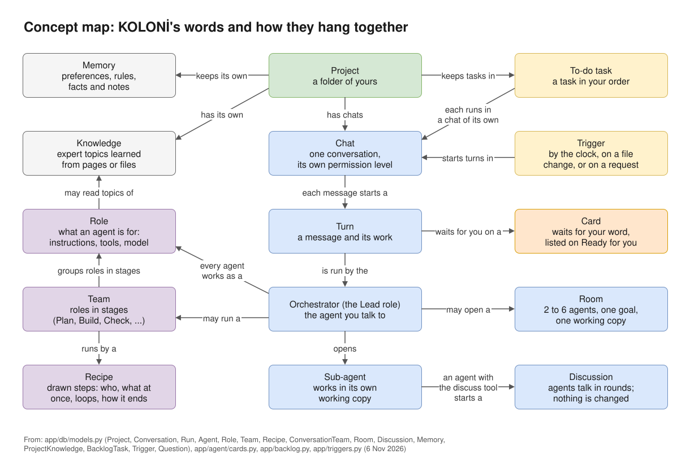

# KOLONİ

KOLONİ is an agent workspace that runs on your own machine.
You chat with an agent, the Orchestrator, in a folder of yours. It reads, searches, edits and runs commands there.
It hands parts of the job to other agents (Coder, Reviewer, Tester and more) when that helps.
The agents run on models you add: an API key, a model server of your own, or a CLI you are signed in to (Claude Code, Codex, GitHub Copilot CLI, Qoder, agy).
A canvas beside the chat draws each turn from what really happened. Before anything risky, an agent asks you on a card.

KOLONİ listens only on `127.0.0.1`, on your own machine. It sends no telemetry.

*KOLONİ's words and how they hang together. Each is explained in the [Glossary](reference/glossary.md).*

## Start here

- [Quick start](getting-started/quick-start.md): from install to your first approved change.
- [Install](getting-started/install.md): Windows, macOS, Linux and Docker.
- [Permission levels](use/permissions.md): what agents may do without asking you.
- [Memory](memory.md): what a project remembers, and how agents use it.
- [Settings](settings.md): every setting for the app and for a project.
- [Glossary](reference/glossary.md): KOLONİ's own words.
