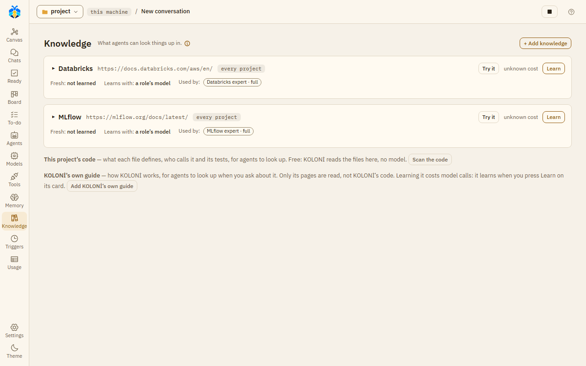

# Knowledge and experts

Knowledge is "what agents can look things up in": documentation, files or a topic that KOLONİ reads
once and turns into a short guide. A role uses a knowledge only if you give it to the role. Open
**Knowledge** on the left rail.

## The Knowledge page

Each knowledge is a card. Its header shows its first source, and buttons to **Try it** and to
**Learn** (later **Learn more** or **Learn again**), with what learning may cost beside it. The card
also says when it was last read (**Fresh:**), how much it spent (**Spent:**), which model it learns
with (**Learns with:**) and which roles use it (**Used by:**).

*The Knowledge page, with this project's code and KOLONİ's own guide offered below the cards.*

Click the topic to open the card. Its tabs are **Guide**, **Pages**, **Not known yet**, **Settings**
and **Copy**.

## Adding knowledge

Press **+ Add knowledge**. Pick what it is:

| Kind | What it reads |
|---|---|
| **A docs site** | A web address. Only the pages under the path you give are read. |
| **Files here** | A folder or a file in this project. |
| **A repository** | A public GitHub repository's address: its code and its docs ([below](#a-repository)). |
| **A folder on this machine** | A folder outside this project, by its full path, read as a repository is ([below](#a-folder-on-this-machine)). |
| **Research a topic** | A topic to research on the web. |

Then:

- **Topic**: its name, at most 40 characters. "How agents and the canvas name it."
- The sources, one a line, at most 10.
- **Learn again weekly** (web sources only).
- **Agents may search the web when it has no answer**.
- **At most this much a learning (USD)**: 0.5 unless you change it. It holds only where the model's
  price is known. On a CLI or a plan the price is not known, so the caps below are what bound a
  learning.
- **Learn with**: the model that writes the guide. By default, the model of a role that uses it. If no
  role uses it and you pick no model, learning stops and says to choose one.
- Under **More**: **At most this many pages (a safety cap)**, 500 unless you change it. For a
  repository or a folder on this machine, also **At most this many code files a learning**, 100
  unless you change it; 0 writes no guide to its code.

Press **Add and learn**, or **Add without learning** to learn later.

## What learning does

KOLONİ reads every page under the sources, up to the page cap, and keeps their text in the project's
`.koloni/knowledge/` folder. A model then writes a guide: what the subject offers, ready functions,
short examples and pitfalls, each marked as official, from a single source, or unsure.

The pages read are other people's documents, so KOLONİ keeps them out of the project's git. The guide
itself is kept in the folder.

Web pages are read only from public addresses, following the site's `robots.txt`, and never from
another site the page redirects to. Reading stops after 10 minutes.

**Learning again** reads only what changed. If nothing changed, no model is asked.

**This project's code** has its own card. "Free: KOLONİ reads the files here, no model." Press **Scan the
code**.

**Try it** asks a question as an agent would, and shows the answer.

## A repository

A repository is learned from three things:

- **Its docs**: its README and its other Markdown files, read for a guide as any source's pages are.
- **How the code works**: a second part of the guide, written by the model from its code files, the
  most central first: where a program starts (`main`, `cli`, `app`, `index`, `__init__`…), then the
  files most imported by others. Tests, vendored code and examples are left out. It says what the
  project does, its main flow, its modules, its key types and functions, and where to start reading.
- **A code map**, free: KOLONİ scans its Python, JavaScript and TypeScript files with no model, so
  agents can ask where a name is defined and who calls it, as for **This project's code**. The code
  guide is written from these files too.

On **Learn**, KOLONİ clones the repository into a temporary folder outside your project, and
deletes that folder once it has read it. Only its last commit on its default branch is fetched, over
https only, with no tags, submodules or Git LFS files. Nothing of it is run: no hooks, filters or
settings of the repository's, and none of your own git settings or credentials. Its files are
counted before they are written out: a repository of more than 50,000 files or 300 MB is refused,
and so is a clone where less than 2 GB is free (more, for a higher size limit). Both limits are
yours to change for every project, in **Settings › The app › Agents**: **Knowledge reads at most
(files)**, from 100 to 1,000,000, and **(MB)**, from 1 to 10,240. A learning keeps the limits it
started with. Cloning and reading together stop after 10 minutes.

What stays in your project is text, in the knowledge's folder `.koloni/knowledge/<topic>/`: its
guide, its pages, and its code under `code/`: the code map, and each code file the map read as
`code/files/<path>.md`, line for line. Test runners and builds look for code files, not `.md`
ones, so they do not pick these up unless set to read Markdown. Files under hidden folders (`.github/`, `.claude/` and the like) are not kept. The code map reads at
most 4 MB a file and 64 MB in all. Agents read the code there with `read_file`, at the file and
line lookup names; what they read there is marked as data, not instructions.

What the knowledge keeps is kept out of git, **Take in**, search, the list of changes and triggers.
A working copy links to it rather than copying it, so an agent there reads it too.

Each **Learn** clones the repository again and reads its docs, the code files already in the guide,
and then the next ones, up to the code-file cap. Learning stops at that cap, the page cap, the
reading time or the money limit, whichever comes first. The card shows **N of M code files in the
guide**, what stopped it, and **Learn more** while some are left. With nothing new and nothing
changed, a Learn asks no model.

Removing a repository's knowledge deletes its code and pages from the folder; its guide stays.
So does making it another kind of source. A knowledge cannot be changed while it learns.

Only GitHub repositories, `https://github.com/<owner>/<name>`, can be added for now.

## A folder on this machine

A folder that is not on GitHub, with git or without, is learned as a repository is: its docs, how
its code works and a free code map, the same caps and **Learn more**. Give its full path, as
`folder: C:\work\mylib`. It is its knowledge's only source.

On **Learn**, KOLONİ first counts the folder where it is, against the same limits as a repository
(50,000 files and 300 MB unless you change them in Settings); over one, the learning stops and keeps
nothing new. The count goes into no link or junction, no hidden folder (`.git`, `.github`,
`.vscode`…) and no dependency, build or cache folder, in any case (`node_modules`, `.venv`, `venv`,
`__pycache__`, `build`, `dist`, `target`, `.next`, `.tox`, `htmlcov` and the test and type-check
caches). Files that are in the cloud alone (OneDrive's, not on this disk) are skipped, not
downloaded. Then only the files it counted are read: one added after the count waits for the next
Learn.

Nothing is copied into your project but the same text a repository leaves, and nothing is ever
written into the folder. Nothing in it is run, not even git: its `.git` folder is not read.

Only you add one, on the Knowledge page: an agent cannot add or change a folder source, and its
expert never learns it by itself. A path is refused if it is not a full path, not a folder, a link
or a junction, a drive's root, your home folder or a folder holding it, a hidden folder of your home
(`.ssh`, `.claude`, `.config`…), its `AppData` (on a Mac, its `Library`), a folder named as secrets are (`.ssh`),
this copy of KOLONİ's folder or its `runtime/`, another KOLONİ's runtime or checkout (one with
`data/koloni.db`), or this project or a folder in it or around it (use **This project's code**, or
**Files here**, for those). It is checked again at each Learn.

## KOLONİ's own guide

**Add KOLONİ's own guide** adds this guide as a knowledge called **KOLONİ guide**. Its source is
`koloni-guide:`. KOLONİ reads only the Markdown pages of its own `docs/` folder and keeps them in the
project, as for any source. Its code, its `.env` and `runtime/` are never read, and agents read only
the kept pages, never KOLONİ's folder.

Adding it learns nothing, because learning costs model calls. Press **Learn** on its card when you
want it; the cost stands beside the button, as for any knowledge. An expert in it never learns it by
itself. Give it to a role, and a chat can then ask "what does Summarise a long context at do?" and be answered
from the guide.

To remove a knowledge, use the link on its **Settings** tab. "Its guide stays in the folder." A
repository's kept code and pages are deleted.

## Giving knowledge to a role

On the Agents page, open a role and its **Knowledge** tab. Switch a knowledge on, then choose:

- **Map**: "its guide, read when its work touches it". Any role can use Map.
- **Full**: "its whole guide at each step". Only for your own roles that only read. A role is Full in
  one knowledge of a project: choosing Full for another of the same project turns the first one to
  Map. A knowledge of another project, or of every project, stays as it is; where a role is Full in
  both the project's own and one of every project, the project's own is what it is an expert in.
  If the role's description is still the one **Create expert** wrote, it then names the new topic;
  its name stays. Copying a knowledge to a project where the role is already Full gives it Map.

A role with knowledge can look things up in it while it works.

## Experts

An expert is a role that knows one topic and only advises. To make one: Agents → **New role** →
**An expert**. Fill in **Knows** (the topic) and its sources, and press **Create expert**. "It reads its
sources once, writes a short guide in the project, and answers from it: it advises and reads only."

The role is named "*topic* expert". An expert changes nothing: it reads, and answers from its guide.
The Orchestrator, or a team's lead, opens it when a job needs it.

**When its guide has no answer**, an expert with **Agents may search the web when it has no answer**
on may search the web. Below Full auto, an expert's search always asks you first. Without that option,
it asks you whether to search. After it finds something on the web, a card asks whether to add it to the
guide (**Add** / **Not now**); it is added the next time the knowledge learns.

## Project notes

At the end of a turn, KOLONİ may ask **Add to Project notes?** It lists findings that were fixed and
changes to the project's `docs/`, at most 8. Tick the ones to keep and press **Add**, or **Not now**.

What you add goes into a knowledge called **Project notes**, made the first time you add. KOLONİ writes
its guide itself, with no model.

Project notes and Knowledge are not the project's [Memory](memory.md).
