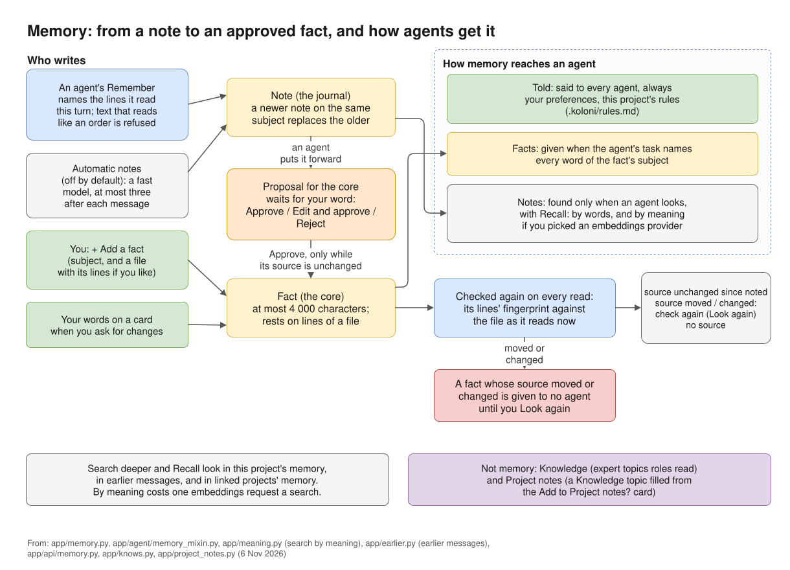
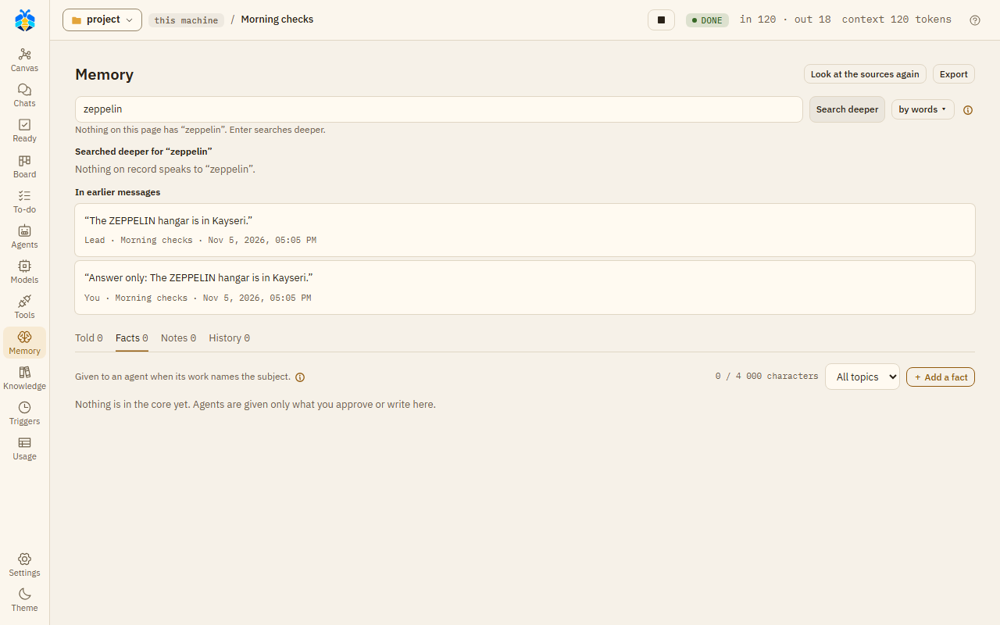

# Memory

Memory is what a project remembers between chats: your preferences, the project's rules, facts
you approved, and notes agents wrote while they worked. Open it with **Memory** on the left rail.
Each project has its own memory.

KOLONİ never shows a memory as surer than it is. A fact rests on lines of a file, and KOLONİ
checks those lines again each time it reads the fact.

*From a note to an approved fact, and how agents get it.*

## The kinds of memory

| Kind | Who writes it | Where you see it |
|---|---|---|
| **Your preferences** | You. One text, used in every project. | **Told** tab |
| **This project's rules** | You. Kept in the folder's `.koloni/rules.md`, so they go into git with the project. | **Told** tab |
| **Facts** (the core) | You, or an agent's proposal that you approved. | **Facts** tab |
| **Notes** (the journal) | Agents, while they work, and KOLONİ's own note-taker if you switch it on. | **Notes** tab |

A fact has a subject (a few words, such as `test command`) and usually a source: a file and a
range of lines. The core holds at most 4 000 characters of facts; the **Facts** tab shows how much
is used.

KOLONİ may also suggest a preference. It shows under **Your preferences** with a "suggested" tag
and the buttons **Add** and **Reject**.

## The three ways memory reaches an agent

The page has four tabs. The first three are the three ways memory reaches an agent:

1. **Told**: "Said to every agent, always." Your preferences and the project's rules are put in
   every agent's briefing.
2. **Facts**: "Given to an agent when its work names the subject." When every word of a fact's
   subject appears in the agent's task, the fact is given to it. The agent is also told how many
   other facts exist, so it can look them up. A fact whose subject is too general to match is
   only found by looking it up.
3. **Notes**: "Found only when an agent looks." Notes are never given by themselves. An agent
   finds them with its **Recall** tool ("look in memory").

The fourth tab, **History**, shows decisions and what was removed.

While an agent works, KOLONİ keeps checking what it was given. If a fact it was given changes or
is removed during its work, the agent is told.

In an agent's window, under **Details** › **Every step as recorded**, you can see what that agent got:
**Given from memory** and **Looked up in memory**.

## Sources and evidence

Most facts and notes point to a file and its lines. KOLONİ keeps a fingerprint of those lines and
compares it each time memory is read. Next to each one you see what it found:

| What you see | What it means |
|---|---|
| **source unchanged since noted** | The lines read exactly as they did when the record was written. |
| **source moved since noted: check again** | The same lines are now somewhere else in the file. |
| **source changed since noted: check again** | The lines are different now, or gone. |
| **no source** | The record does not point to a file. |

"Source unchanged" only means the file lines read as they did. It does not mean the record is
right.

**A fact whose source changed or moved is given to no agent until you look at it again.** Open
it with **Look again**. You see the lines as they read now, and you can choose:

- **These are the same lines** (only when they moved): the fact now points to the new place.
- **Correct**: rewrite the fact.
- **Remove**: take it out of the core.

**Look at the sources again**, at the top of the page, checks every source again.

A record written in a turn nobody watched (a trigger's turn) is tagged "written with nobody
watching".

## Who writes what

**Agents write notes.** An agent with the **Remember** tool ("note what it found") adds a note to
the journal. A few rules apply:

- A note about a file must name the lines, and the agent must have read those lines in this turn.
- Text that reads like an instruction is refused.
- A newer note on the same subject replaces the older one.

**Agents propose facts; you approve them.** An agent can put a note forward for the core. Nothing
enters the core unless you approve it. Waiting proposals show above the tabs, with a line such as
"1 fact waits for your word". For each one you can choose **Approve**, **Edit and approve**
(then **Approve as edited**) or **Reject**. If it would replace a fact on the same subject, you
see both side by side.

A proposal can be approved only while its source is unchanged, and not if the file was changed
in the same turn the note was written. A note on a subject the core already has a fact on waits
for you too; until you decide, no agent is given it and **Recall** does not find it.

**You write facts yourself.** On the **Facts** tab, **＋ Add a fact** asks for the fact, its
subject and, if you like, a file with its first and last line. **Add to the core** saves it. It
replaces any fact on the same subject. A fact's **⋯** menu has **Correct** and **Remove**. A
note's **⋯** menu has **Remove** and **Make it a fact**.

**Your words on a card become a fact.** When you ask for changes on a card and say why, that text
is kept as a fact, shown as "said by you at a card, asking for changes".

**Preferences and rules are yours alone.** No agent writes them.

**Automatic notes** are off by default. Switch them on under Settings › This project › Memory and web ›
**Note what the work found, by itself**. After each message's work, a fast model writes at most
three notes of what it found. That is one more model request after every message, on your plan or
your bill. These notes go into the journal, signed as that model's. They never go into the core
by themselves and never replace an agent's note or a fact.

**In a turn nobody watches**, agents can still write notes, but nothing is put forward for the
core.

## Searching memory

One search box sits above the tabs: "Search everything this project remembers".

- **Typing** filters what is on the page. Every word must match.
- **Search deeper** (or Enter) runs the same search an agent's **Recall** does. It looks in the
  project's memory, in earlier messages, and in the memory of linked projects. Results are grouped
  under "In earlier messages" and "In linked projects".

***Search deeper** finds the word in earlier messages, with who said it and when.*

Earlier messages means your messages, the Orchestrator's last answers, sub-agents' reports and
closed To-do tasks. Tool output is not searched.

You can also start a deep search from Ctrl+K with **Search in messages**.

**Search by words or by meaning.** The **by words ▾** button opens "Search by meaning with". Pick
a provider that has a server address, and an embedding model (`text-embedding-3-small` unless you
change it). Search then also finds records that mean the same thing in other words, tagged
"by meaning". With **off: by words alone**, only words are matched. If the provider fails, the
results say that search by meaning is off, and why.

Search by meaning costs one embeddings request to that provider for each search, on your plan or
your bill. That request also carries up to 50 notes, facts or earlier messages that were not read
yet. Nothing is sent when a note or fact is written.

**Memory of other projects.** Under Settings › This project › Memory and web › **Also look in the memory of**,
tick other projects. Their records are found by **Search deeper** and **Recall**, but never given
to an agent at its start.

## Project notes and Knowledge are not memory

- **Knowledge** (its own page on the rail) holds expert topics learned from web pages or project
  files. Roles use them while they work. See [Knowledge and experts](knowledge.md).
- **Project notes** is a Knowledge topic that KOLONİ fills from what you tick on the
  **Add to Project notes?** card at the end of a turn.

Neither is on the Memory page. Memory is short facts and notes, each checked against its source.
Knowledge is longer material an expert reads.

## History and Export

The **History** tab says "Decisions and what was removed. Nothing is deleted."

- **Recent decisions** lists the latest decisions, such as "Approved into the core", "Corrected",
  "Rejected" or "Removed".
- **Removed / replaced** lists what was removed or replaced. Any of these can be brought back with
  **Take back**.

Correcting a fact keeps the old one as replaced. Removing or rejecting never deletes a record.

**Export**, at the top of the page, downloads the core as `MEMORY.md`: each fact with its subject,
who wrote it and when, and its source with its status now. Only facts are exported, not notes. The
file is a copy to read; editing it does not change the memory.

To take everything KOLONİ keeps, memory included, use **Export everything** under
Settings › The app › Your data. See [Settings](settings.md).

## FAQ

**Why didn't an agent use a fact I approved?**
A fact is given only when the agent's task names every word of its subject, and only while its
source is unchanged. Check the fact's status on the **Facts** tab. The agent can still find it with
**Recall**.

**A fact says "source changed". Is it wrong now?**
Not necessarily. Its lines changed, so KOLONİ stopped giving it to agents until you look. Open
**Look again** and correct, confirm or remove it.

**Can an agent change the core without me?**
No. Agents write notes and proposals. Only your approval, or your own words, put a fact in the
core.

**How do I make agents always follow something?**
Write it in **This project's rules** (for this project) or **Your preferences** (for every
project). Both are told to every agent.

**Does memory leave my machine?**
Memory is given to the models your agents run on, as part of their work. Search by meaning sends
text to the provider you picked for it.

**Can I delete a memory for good?**
Not from the page. Removing hides it from agents and keeps it in History, where you can take it
back.
