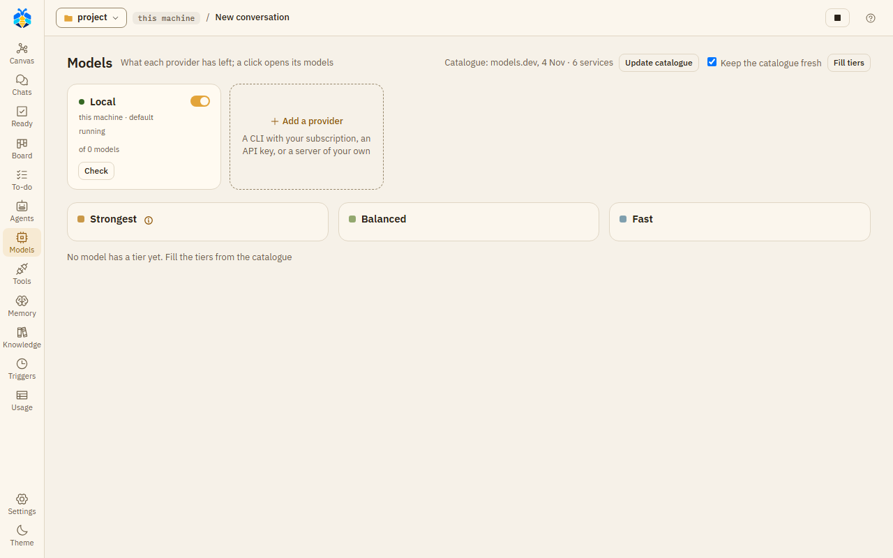
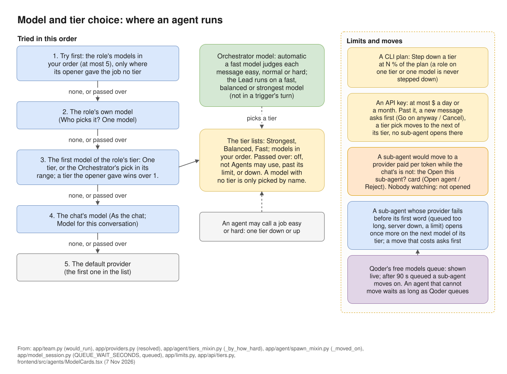

# Providers

A provider is where your agents' models run. Open **Models** on the left rail to see them. Each
provider is a card that shows how it is paid for (**subscription** for a CLI, **this machine** for a
server on your own computer, **API key** otherwise) and what it has left. A click on a card opens
its window.

*The Models page with one provider, a model server on this machine.*

## Kinds of provider

| Kind | What it is |
|---|---|
| **OpenAI-compatible server** | A server that speaks the OpenAI API and supports tool calls, such as llama.cpp's `llama-server` or a hosted API. Other OpenAI-compatible servers (Ollama, …) should work but are not tested. |
| **Anthropic API** | Anthropic's API, with your key. |
| **Claude Code (CLI)**, **Codex (CLI)**, **GitHub Copilot CLI**, **Qoder (CLI)**, **agy (CLI)** | A CLI on this machine that you are signed in to. It runs on your plan with that vendor. |

## Adding a provider

Press **Add a provider** ("A CLI with your subscription, an API key, or a server of your own").
Give it a **Name** and a **Kind**, then:

- For a server: its **Address** and, if it needs one, an **API key**. "Keys are kept in plain text in
  KOLONİ's local database on this machine."
- For the Anthropic API: an **API key** and a **Default model**.
- For a CLI: **Path to the command**, if it is not found by its name. KOLONİ never signs in for you.
  If the CLI is missing or not signed in, the window shows the command to install it or to sign in,
  with links to the vendor's docs.

Press **Add provider** to save it.

## The provider window

The window has the tabs **Models**, **Connection** and **Limits**. A server on this machine also
has **Server**.

**Connection** holds what you filled in when you added it, and:

- **Default model**: the model used when nothing else names one.
- **At most this many agents at once**: how many agents may run on this provider at the same time.
- **How it runs** (CLIs only):

| Option | What it means |
|---|---|
| One session per agent, with KOLONİ's tools (recommended) | One CLI session per agent, using KOLONİ's tools and cards. |
| One run per model step, with KOLONİ's tools | The CLI runs once per model step: slower, and the answer arrives all at once. |
| Native: its own tools, in the project | The CLI uses its own tools in your folder, and asks KOLONİ before each one. |
| Reads with its own tools; started without leave to write or run | agy only: it reads, and cannot change anything. |

- **Sign-in** (Claude Code and Codex): **My own** uses the sign-in in your home folder; **Its own for
  KOLONİ** keeps a separate one, and the window shows the command to log in to it. "KOLONİ never sees
  the token."

The buttons at the bottom:

- **Save** saves the changes.
- **Test** checks the provider. For a CLI it only says whether the command was found: "It was not
  run, so sign-in is not checked." For the Anthropic API it asks for the model's details, which spends
  nothing. For an OpenAI-compatible server it sends one small request ("Call the ping tool.") to see
  whether the model can use tools; on a paid service that costs a few tokens. It then says "Reachable"
  and the model.
- **Try a real run** (CLIs): runs the CLI once on a one-word question. This counts against your plan.
- **Make default**: makes this provider the default, the first one in the list.
- **Remove key**: shown when a key is saved.
- **Delete provider**: deletes it at once, without asking. The last provider cannot be deleted ("At
  least one provider is needed"). Chats and roles that used it go back to having no choice.

## Switching a provider off

Each provider has an **on / off** switch, on its card and at the top of its window. "Off: nothing new
starts on it - no chat, no agent, no learning; its key and settings stay. A turn already running goes
on until it ends; Stop ends it now." Its card then says "switched off".

## The models of a provider

The **Models** tab lists the models that agents and you can pick, at most 30. Each row has:

| Column | What it does |
|---|---|
| **Tier** | How strong the model is: fast, balanced or strongest. See [Tiers](tiers.md). |
| **Context**, **Max output**, **Thinking** | What the model can take in, write out, and its thinking levels. |
| **Price in / out (1M)** | The price per million tokens; "plan" for a CLI. |
| **Agents may use** | On: agents may pick this model by themselves. Off: only you pick it. |
| **On** | Off: the model is not used. |

Open a row for more, such as **Its note for agents** (what the model is for, up to 120 characters)
and **Used in 30 days**. Each change saves at once.

**Add a model** adds one by name. **Fill from the catalogue** proposes a list: your rows first, then
what the provider lists with your key, then the bundled models.dev catalogue's models, with their
details; nothing changes until you press **Save these models**. At the top of
the page, **Update catalogue** downloads a newer catalogue, and **Keep the catalogue fresh** lets
KOLONİ do that by itself.

## Which model a chat uses

The model button under the message box opens **Model for this conversation**: a **Provider** (the
first option is the default) and a **Model name**. **Use this model** applies it from the next turn.
"A role with its own model keeps it."

An agent's model is chosen in this order:

1. the models the role lists under **Try first**, in your order, unless the agent that opens it gave the job a tier;
2. the role's own model (**One model**);
3. the first model of the role's tier, or of the tier the opener gave the job;
4. the chat's model;
5. the default provider, the first one in the list.

A model past its limit, down, switched off or not one agents may use is passed over, and the next is
tried. Roles and their models are set on the Agents page.

*Where an agent runs: the full order, tiers, limits and moves. See also [Tiers](tiers.md) and [Limits](limits.md).*

## Plan meters

For Claude Code, Codex, agy and Copilot, the top bar shows how much of the plan is used, from what
each CLI last reported. Click a meter to open Usage. On a provider's card, **Read now** reads the plan
again; for Claude Code that is one short request.

## A model server on this machine: the Server tab

For an OpenAI-compatible server on this machine, the **Server** tab starts and stops your llama.cpp
`llama-server`. Set **Program** to the full path of `llama-server` in your llama.cpp build (the one on
PATH is filled in when there is one), choose the **Model** from the `models` folder next to it, set the context, GPU layers and the other
values, then press **Start**. **Server output** shows what the server prints. "It starts only when you
press Start, and stops when KOLONİ closes. No agent can start it; Start runs exactly what is shown
here."
