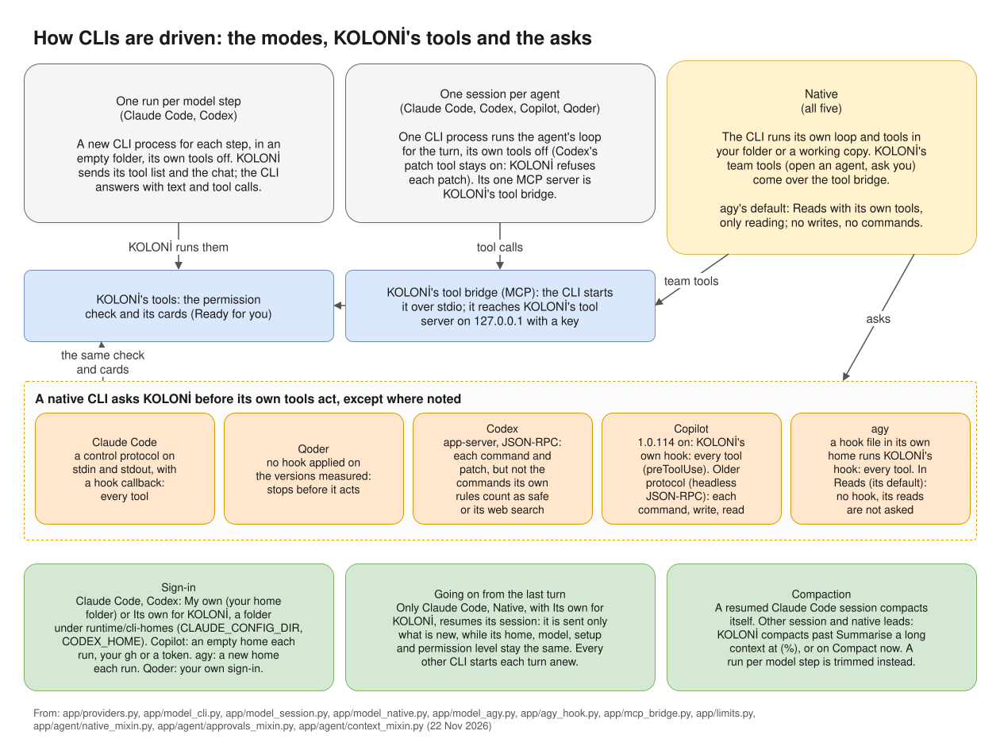

# Set up a CLI

A CLI provider runs an agent CLI that you installed and signed in to yourself: Claude Code, Codex,
GitHub Copilot CLI, Qoder or agy. It runs on your plan with that vendor. KOLONİ never installs a CLI and
never signs in for you. Read [Subscription rules](subscription-rules.md) first.

## Steps

1. **Install the CLI** in your own terminal. If it is missing, the provider's window shows the install
   command for your system, with a link to the vendor's install docs.
2. **Sign in** in your own terminal (see the table). If it is not signed in, the window shows the sign-in
   command.
3. Models → **Add a provider**, and pick its **Kind**. Set **Path to the command** only if KOLONİ does
   not find it by its name.
4. Choose **How it runs** (see below), and press **Add provider**.
5. **Test** only checks that the command is found; it does not run it. **Try a real run** runs it once
   on a one-word question, on your plan.

At the first start, KOLONİ adds Claude Code, Qoder, Codex and agy by itself if they are installed. It
never adds Copilot by itself. It adds agy switched off: Google's terms forbid using Antigravity through
another app (see [Subscription rules](subscription-rules.md)). Its card on the Models page, switched on
or off, says "Google's terms forbid using Antigravity through another app; your Google account may be
suspended." KOLONİ adds providers only at the first start, so an agy already on the Models page is left
as it is.

## The CLIs

| Kind | Command | Sign in |
|---|---|---|
| **Claude Code (CLI)** | `claude` | `claude auth login` |
| **Codex (CLI)** | `codex` | `codex login` |
| **GitHub Copilot CLI** | `copilot` | `gh auth login`, or a GitHub token |
| **Qoder (CLI)** | `qodercli` | Qoder's own sign-in |
| **agy (CLI)** | `agy` | agy's own sign-in |

## How it runs

| CLI | Choices (the first is the default) |
|---|---|
| Claude Code | One session per agent · One run per model step · Native |
| Codex | One session per agent · One run per model step · Native. As a session its own patch tool cannot be switched off: KOLONİ refuses every patch it asks to make, and it writes with KOLONİ's write_file and edit_file instead. Unlike Native, it runs wherever the other sessions run: triggers, To-do, While you're away, recipe steps and comparisons. The default since 7 Nov 2026; a Codex provider added before keeps the way it was saved with. One added with a model server of your own starts as One run per model step, since its session there is not yet measured. |
| Copilot | One session per agent · Native |
| Qoder | One session per agent · Native. Set a model name if Qoder's own default model does not answer. |
| agy | Reads with its own tools · Native |

- **One session per agent** and **One run per model step** use KOLONİ's tools and cards, with the CLI's
  own tools off.
- **Native** uses the CLI's own tools in your folder. Claude Code and agy ask KOLONİ before every tool
  they use; Codex before each command and patch, except the commands its own rules count as safe, which
  it runs without asking; Copilot before every tool it uses (on its newer protocol, 1.0.114 on, through
  KOLONİ's own hook; on the older one, before each command, write and read). The Qoder versions measured so
  far do not apply KOLONİ's hook, so a native Qoder turn stops before Qoder does anything and says to
  run it as a session; how a Qoder that applies the hook works natively is not measured.
- **Reads with its own tools** (agy): it reads, and is started without leave to write or run.

A trigger never starts a CLI that works with its own tools (Native, or agy's reads): with nobody watching,
only an agent that works with KOLONİ's tools runs.

*The modes, KOLONİ's tool bridge, and how each CLI asks. ([full size](../diagrams/cli-modes.svg))*

## Going on from the last turn

Claude Code and Codex, run **Native** with **Sign-in: Its own for KOLONİ**, and GitHub Copilot CLI, run
**Native**, go on in their own session from one turn to the next: each is sent only what is new, and compacts
that session itself (Codex's: see [Codex](#codex)). They go on only from the same topic's previous turn, run with the same model, folder, permission level
and setup: **New topic** starts a new session ([Topics](../memory.md#topics)). Copilot's session is kept in a
folder of its own under KOLONİ's runtime ([Data and privacy](../security/privacy.md#where-your-data-is));
where Copilot cannot go on in it (the session is gone, or Copilot is older than 1.0.114's protocol), it starts
a new one sent the whole chat, and the agent's record says so once. When Copilot compacts its session, its
record says so too, with the size before and after: from then on what it knows of the earlier turns is its
own summary, so a brief should say again what matters. Its tokens and AI credits are counted per turn, not as
the session's growing total. A Copilot session costs more past its models' price step (100,000 tokens of prompt;
one 553,000-token message cost 34.6 AI credits in a measurement), so KOLONİ does not let one grow that far: once
it holds **Summarise a long context at (%)** of 100,000 tokens - or of the window set on its role, or with none
set there of Copilot's own window, where that is smaller: a larger window on the role does not lift the bound - or
did not say its size, the next turn starts a new
session sent the chat as KOLONİ keeps it, which KOLONİ summarises - and the agent's record says so. The same holds
in a trigger's topic. While it works, the agent's details show how full Copilot says its session is; once a
Native CLI's turn is over no fill is shown, since its tokens in are its turn's model calls added up. Every other
CLI lead starts each turn anew and is sent the whole chat. KOLONİ compacts that, as it does for an API model, past
**Summarise a long context at (%)** of the window set on its role, or with none set there, of the window the
catalogue has for its model (Claude Code's, Codex's and Copilot's models; none for Qoder's or agy's, where only
**Compact now** compacts it). Against a catalogued window this is seldom reached: what is measured is the chat
KOLONİ sends, with its older tool outputs already left out past about 240,000 characters, so only a chat whose own
words are very long gets there; what the CLI reads by itself during a turn is not counted. To have it summarised
sooner, set a smaller window on its role. A CLI run **One run per model step** is never compacted: each step is
sent a trimmed history.

When the context of a lead on a CLI fills during a turn in a chat you are in and it was working alone, KOLONİ
summarises its earlier work and starts the turn again from the summary by itself, once, with a line in the chat
saying so; **Stop** stops that too, and what the summary costs counts in the turn (the CLI's refused start reports
no tokens). If its context fills again, the turn fails and says so: use **Compact now** or set a smaller context
window on the role. Where nothing of its earlier work is left to summarise - a single message larger than its
model takes, say - nothing is started again, and the failure says that after the CLI's own line: send a shorter
message, or use a model with a larger context window. Where the lead had opened sub-agents, a room or a team's recipe, the turn is not started
again: KOLONİ summarises its earlier work after it and the failure says so - send your message again and it goes
on from the summary. A plan, a To-do task's turn, a night's job and a trigger's turn are neither started again nor
summarised this way. (A lead on an API model is summarised and asked once more inside its step, as before.)

KOLONİ knows such a refusal only by the CLI's own error, never by words its model may have written. GitHub Copilot
CLI's wordings are known: one seen in a live refusal ("Request exceeds the model's prompt budget …", CLI 1.0.107),
the others taken from its package and not yet seen live. That refusal gave Copilot's own limit for gpt-6-luna on
the default context tier as 272,000 tokens of prompt; KOLONİ's catalogue has a larger window for that model
(1,050,000). Run **Native**, Copilot says its session's own window as it works (272,000 for gpt-6-luna,
872,000 for claude-haiku-5.5, measured): the agent keeps that one, at most 100,000 (its price step), from its
first turn, where its role sets none, and it is what the agent's context is measured against; a kept session is
held to 100,000 whatever the role's window. Run as a session, set the role's window to what your tier takes. Claude Code and Qoder report a
failed turn in a text that can be their model's words, so theirs is not recognised yet, and the other CLIs' own
wordings are not known. Where the failure says nothing of a summary, use **Compact now** and send the message
again.

**Compact now** is in the top bar's **context** button (see
[Chat and canvas](../use/chat-and-canvas.md#the-context-button)).

## Qoder's free models

Qoder puts a free model's request in a queue when it is busy. In tests the wait was about 1 to 3 minutes,
once longer. While it waits, the agent's window says so, for example "Qoder: in the model's queue for 2 min
43 s (waits up to 60 min)", and its box on the canvas says "queued 2 min". A sub-agent still queued after 90
seconds is moved to the next model of its tier, where KOLONİ picked its model and the tier has another; a
move that may cost money is asked on a card first (see [Ready and approval cards](../use/ready.md)). In
a turn you watch, a lead, or a sub-agent that cannot be moved, waits as long as Qoder keeps it queued -
for the Orchestrator, after 90 seconds a card asks whether to keep waiting or stop and pick another model
(see [Step limits](../agents/step-limits.md#when-the-orchestrators-model-is-slow-to-answer)); in
a trigger's or a job's turn while you're away it gives up after 90 seconds. Run **Native**, Qoder shows no queue line,
and is not moved.

## Sign-in for Claude Code and Codex

**Sign-in** offers **My own** (the sign-in in your home folder) or **Its own for KOLONİ**: a sign-in
folder for this provider alone, so that several accounts can run side by side. For its own, save the
provider, then the window gives the command to log in to it in your own terminal. "KOLONİ never sees the
token." Run **Native**, a provider on its own sign-in goes on in its session (Claude Code's) or thread (Codex's)
from a topic's previous turn; on yours, the default, each turn starts anew and is sent the whole chat.

Claude Code and Codex can also **Use a model server of your own instead (optional)**: a **Model server
address** on this machine or your network.

## Codex

**Going on in its thread (only with Sign-in: Its own for KOLONİ).** **Sign-in: My own** stays the default and
needs no sign-in of KOLONİ's: Codex runs Native as before, each turn a new thread that is not written to disk and
is sent the whole chat. A Codex provider set to **Its own for KOLONİ** and run **Native** goes on in its own thread
from the topic's previous turn, as Claude Code does: each turn starts a new `codex app-server` that resumes the
thread with this turn's folder, permission level and sandbox given again, and is sent only what came since its
last answer. The thread is kept by Codex itself in the provider's sign-in folder,
`runtime/cli-homes/<provider id>/sessions/…/rollout-…-<thread>.jsonl` - never in your own `~/.codex` ([Data and
privacy](../security/privacy.md#where-your-data-is)). Choosing it means a login of its own: on the **Models**
page set the provider's **Sign-in** to **Its own for KOLONİ**, save, press **Log in to Codex for this provider**
and run the command it gives in your own terminal (it sets `CODEX_HOME` to that folder and runs `codex login`),
finish the login in your browser, then press **Check again**: the provider shows "signed in" once Codex's own
`codex login status` says so. KOLONİ never sees the token. Until it is logged in, that provider does not run.

**Not yet tried with a real Codex.** Going on in a thread is built on measurements of Codex 0.164 (a thread resumed
in a new app-server remembers) and tested with a stand-in only. On Codex 0.164 a new, empty KOLONİ folder also
answered **read-only** when asked for its workspace-write sandbox (a turn is then refused before Codex acts), so a
role that writes or runs commands might not run on such a provider until this is measured on a newer Codex.

- A new topic, another model, folder, permission level or what the role may do (its sandbox's mode with it)
  starts a new thread. Where Codex cannot go on in the kept one (it is gone, or Codex refuses), it starts a new
  thread sent the whole chat, and the agent's record says so once.
- Its tokens are counted per turn: Codex reports its thread's running total, and a turn counts the difference.
- KOLONİ does not let a thread grow until Codex compacts it by itself, since Codex's summary is not readable:
  once it holds **Summarise a long context at (%)** of 166,000 tokens (about 124,500 by default), or of the
  window set on its role where that is smaller, the next turn starts a new thread sent the chat as KOLONİ keeps
  it, which KOLONİ summarises - and the agent's record says so. 166,000 is the largest size a Codex thread was
  measured to reach without compacting itself (on a 258,400-token window); where Codex compacts by itself is not
  measured yet. When Codex does compact its thread, the agent's record says so, and the next turn starts a new
  thread the same way.
- The thread of another topic is removed when a turn of yours starts in another topic, with its chat or
  project, and at KOLONİ's start for one no agent goes on in; so is one whose turn failed or was stopped,
  and one that is not gone on in.

**A call still running when Codex answers.** Codex has been seen to give its final answer, and end its turn,
while one of KOLONİ's tools it called was still at work (a 120-second command, "It is still running"). The
turn then waits for that call to end by its own limit - a command's time limit, a sub-agent's run - and
Codex's answer ends with a line saying so: what the call comes to is on its record, not in the answer.
**Stop** ends the wait, and the call with it, at once. A question to you that is still open (ask_user,
a folder or a secret asked for) is not waited for: nobody would read its card once the turn is over, so it
closes with the turn, as before. Why Codex answered early is not known yet.

## GitHub Copilot CLI

- **API key**: leave it empty to use your own GitHub sign-in (`gh`), or give a fine-grained GitHub token
  with the Copilot Requests permission. A token has not been tried on a real account yet.
- **Thinking**: KOLONİ sends Copilot's levels Off to Max (Off as `none`), whether it runs as a session or
  Native; the Models page shows "Off–Max". A level the model does not take gives no error.
- **Model `auto`**: Copilot picks the model for each request. It is in Copilot's model list (tier fast)
  and takes no thinking level, so KOLONİ sends none. Pick a model for Copilot, `auto` or another: with no
  model and Medium thinking, Copilot's default spent 7.12 AI credits for the same short answer that `auto`
  answered for 0.18 (measured once, 7 Nov 2026, Copilot CLI 1.0.105). The agent's node and window, and in
  the chat the Orchestrator's turn head and the model button, show the model `auto` picked
  (`auto → gpt-6-luna`); Copilot's reason is on a quiet line under the turn head, in the button's tooltip
  and in the agent's **Details**. An agent that goes on from it asks for `auto` again. `fusion` (Copilot
  Fusion, only on plans that have it) runs each turn on several models and keeps one; its pick shows the
  same way (`fusion → gpt-6-luna`) and an agent goes on with `fusion`. It takes no thinking level either,
  and has no tier, so agents never pick it by themselves.
- **Routing** (`auto` and `fusion` on your GitHub account): on the model's row of the **Models** tab, beside
  its **Context**, and in the chat's model panel under **Thinking**. Auto: **Efficiency**, **Balance**,
  **Intelligence** or **Fast**; Fusion: **Standard** (as Auto Balance), **High** or **Max** - High and Max
  cost more than `auto`. Once your account was asked, only the tiers it offers can be chosen, by Copilot's
  own names ([Copilot on your GitHub account](copilot.md#routing)). **Default** sends none: Copilot's own.
  It is saved on the model's row, so every chat and agent on that provider and model uses it; for two chats
  to differ, add a second Copilot provider. Run live on 1.0.114: Copilot keeps the tier and says the model
  it picked and why. On a plan without a tier Copilot refuses the turn, and KOLONİ says to pick another
  routing.
- **Your account's models**: KOLONİ asks Copilot which models your account offers, and switches off the
  ones it does not list - see [Copilot on your GitHub account](copilot.md).
- **Versions**: KOLONİ asks Copilot its version and protocol as it starts it, the way a run starts it.
  Copilot updates itself when you run it yourself, and KOLONİ then runs that version too. On the newer
  protocol (1.0.114 on) it runs **Native** through KOLONİ's hook, and each PowerShell command starts in the
  project folder. On the older protocol only a version measured with KOLONİ (1.0.91, 1.0.103, 1.0.105) runs
  **Native** - its run asks again, in case Copilot changed since; any other version, a Copilot that does not
  say its version, or a protocol KOLONİ does not know runs as **One session per agent**, and the provider's
  card on the Models page says why.
- **Changes on models other than Claude**: Copilot gives such models (gpt-6-luna, mai-code-2-flash) its
  `apply_patch` tool instead of `create` and `edit`. Run **Native**, each file of a patch is asked about on
  its own card, as a write is; refusing one refuses the whole patch.
- **Usage**: Copilot's tokens and AI credits (or premium requests) are counted from its usage checkpoint,
  run as a session as in **Native**. As a session that was measured with `copilot -p` (CLI 1.0.103), not yet
  seen in a live session. See [Usage and budgets](../money/usage.md#the-usage-page).
- Copilot can also use a model server of your own, with **Server type**, **Most prompt tokens** and
  **Most output tokens**. **Never connect to GitHub** then means no sign-in, telemetry or update check,
  and web tools are off.

## Plan meters

For Claude Code, Codex, agy and Copilot, the provider's card shows what is left of the plan, and
**Read now** reads it again (for Claude Code, one short request). For Claude Code, the **Limits** tab also
offers **Keep it fresh from your Claude Code sessions**: a status line you add to your own Claude Code
settings, so that your sessions report what is left of your plan.

See [CLIs](../reference/cli.md) for what has been measured.
