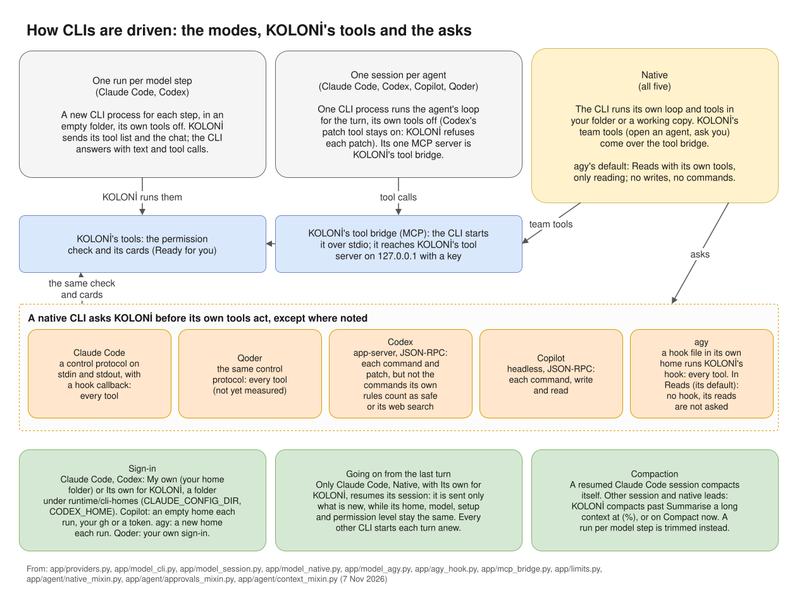

# Set up a CLI

A CLI provider runs an agent CLI that you installed and signed in to yourself: Claude Code, Codex,
GitHub Copilot CLI, Qoder or agy. It runs on your plan with that vendor. KOLONİ never installs a CLI and
never signs in for you. Read [Subscription rules](subscription-rules.md) first.

## Steps

1. **Install the CLI** in your own terminal. If it is missing, the provider's window shows the install
   command for your system, with a link to the vendor's install docs.
2. **Sign in** in your own terminal (see the table). If it is not signed in, the window shows the sign-in
   command.
3. Models → **Add a provider**, and pick its **Kind**. Set **Path to the command** only if KOLONİ does
   not find it by its name.
4. Choose **How it runs** (see below), and press **Add provider**.
5. **Test** only checks that the command is found; it does not run it. **Try a real run** runs it once
   on a one-word question, on your plan.

At the first start, KOLONİ adds Claude Code, Qoder, Codex and agy by itself if they are installed. It
never adds Copilot by itself. It adds agy switched off: Google's terms forbid using Antigravity through
another app (see [Subscription rules](subscription-rules.md)). Its card on the Models page, switched on
or off, says "Google's terms forbid using Antigravity through another app; your Google account may be
suspended." KOLONİ adds providers only at the first start, so an agy already on the Models page is left
as it is.

## The CLIs

| Kind | Command | Sign in |
|---|---|---|
| **Claude Code (CLI)** | `claude` | `claude auth login` |
| **Codex (CLI)** | `codex` | `codex login` |
| **GitHub Copilot CLI** | `copilot` | `gh auth login`, or a GitHub token |
| **Qoder (CLI)** | `qodercli` | Qoder's own sign-in |
| **agy (CLI)** | `agy` | agy's own sign-in |

## How it runs

| CLI | Choices (the first is the default) |
|---|---|
| Claude Code | One session per agent · One run per model step · Native |
| Codex | One session per agent · One run per model step · Native. As a session its own patch tool cannot be switched off: KOLONİ refuses every patch it asks to make, and it writes with KOLONİ's write_file and edit_file instead. Unlike Native, it runs wherever the other sessions run: triggers, To-do, While you're away, recipe steps and comparisons. The default since 7 Nov 2026; a Codex provider added before keeps the way it was saved with. One added with a model server of your own starts as One run per model step, since its session there is not yet measured. |
| Copilot | One session per agent · Native |
| Qoder | One session per agent · Native. Set a model name if Qoder's own default model does not answer. |
| agy | Reads with its own tools · Native |

- **One session per agent** and **One run per model step** use KOLONİ's tools and cards, with the CLI's
  own tools off.
- **Native** uses the CLI's own tools in your folder. Claude Code, Qoder and agy ask KOLONİ before every
  tool they use; Codex before each command and patch, except the commands its own rules count as safe,
  which it runs without asking; Copilot before each command, write and read.
- **Reads with its own tools** (agy): it reads, and is started without leave to write or run.

A trigger never starts a CLI that works with its own tools (Native, or agy's reads): with nobody watching,
only an agent that works with KOLONİ's tools runs.

*The modes, KOLONİ's tool bridge, and how each CLI asks. ([full size](../diagrams/cli-modes.svg))*

## Going on from the last turn

Only Claude Code, run **Native** with **Sign-in: Its own for KOLONİ**, goes on in its own session from one
turn to the next: it is sent only what is new, and compacts that session itself. Every other CLI lead
starts each turn anew and is sent the whole chat. KOLONİ compacts that, as it does for an API model, past
**Summarise a long context at (%)** of the window set on its role; with no window set there, only **Compact now**
compacts it. A CLI run **One run per model step** is never compacted: each step is sent a trimmed history.

**Compact now** is in the top bar's **context** button (see
[Chat and canvas](../use/chat-and-canvas.md#the-context-button)).

## Qoder's free models

Qoder puts a free model's request in a queue when it is busy. In tests the wait was about 1 to 3 minutes,
once longer. While it waits, the agent's window says so, for example "Qoder: in the model's queue for 2 min
43 s (waits up to 60 min)", and its box on the canvas says "queued 2 min". A sub-agent still queued after 90
seconds is moved to the next model of its tier, where KOLONİ picked its model and the tier has another; a
move that may cost money is asked on a card first (see [Ready and approval cards](../use/ready.md)). In
a turn you watch, a lead, or a sub-agent that cannot be moved, waits as long as Qoder keeps it queued; in
a trigger's or a job's turn while you're away it gives up after 90 seconds. Run **Native**, Qoder shows no queue line,
and is not moved.

## Sign-in for Claude Code and Codex

**Sign-in** offers **My own** (the sign-in in your home folder) or **Its own for KOLONİ**: a sign-in
folder for this provider alone, so that several accounts can run side by side. For its own, save the
provider, then the window gives the command to log in to it in your own terminal. "KOLONİ never sees the
token."

Claude Code and Codex can also **Use a model server of your own instead (optional)**: a **Model server
address** on this machine or your network.

## GitHub Copilot CLI

- **API key**: leave it empty to use your own GitHub sign-in (`gh`), or give a fine-grained GitHub token
  with the Copilot Requests permission. A token has not been tried on a real account yet.
- **Thinking**: KOLONİ sends Copilot's levels Off to Max (Off as `none`), whether it runs as a session or
  Native; the Models page shows "Off–Max". A level the model does not take gives no error.
- **Model `auto`**: Copilot picks the model for each request. It is in Copilot's model list (tier fast)
  and takes no thinking level, so KOLONİ sends none. Pick a model for Copilot, `auto` or another: with no
  model and Medium thinking, Copilot's default spent 7.12 AI credits for the same short answer that `auto`
  answered for 0.18 (measured once, 7 Nov 2026, Copilot CLI 1.0.105). The agent's node and window show
  the model `auto` picked (`auto → gpt-6-luna`), and its **Details** say why; an agent that goes on from
  it asks for `auto` again.
- **Usage**: Copilot's tokens and AI credits (or premium requests) are counted from its usage checkpoint,
  run as a session as in **Native**. As a session that was measured with `copilot -p` (CLI 1.0.103), not yet
  seen in a live session. See [Usage and budgets](../money/usage.md#the-usage-page).
- Copilot can also use a model server of your own, with **Server type**, **Most prompt tokens** and
  **Most output tokens**. **Never connect to GitHub** then means no sign-in, telemetry or update check,
  and web tools are off.

## Plan meters

For Claude Code, Codex, agy and Copilot, the provider's card shows what is left of the plan, and
**Read now** reads it again (for Claude Code, one short request). For Claude Code, the **Limits** tab also
offers **Keep it fresh from your Claude Code sessions**: a status line you add to your own Claude Code
settings, so that your sessions report what is left of your plan.

See [CLIs](../reference/cli.md) for what has been measured.
