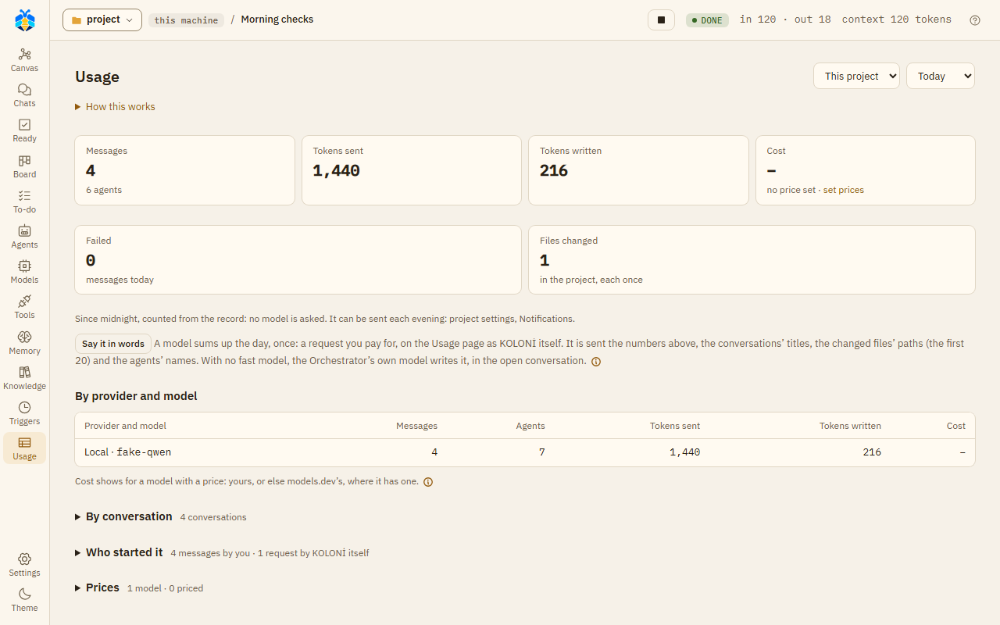

# Usage and budgets

## The Usage page

Open **Usage** on the left rail. Choose **This project** or **All projects**, and a period: **Today**,
**7 days**, **30 days** or **All**.

*The Usage page, counted from the record: no model is asked.*

At the top: **Messages**, **Tokens sent**, **Tokens written** and **Cost**. Below:

- **By provider and model**: messages, agents, tokens and cost for each model.
- **By conversation**.
- **Who started it**: **You**, **A trigger, with nobody watching**, or **KOLONİ itself** (requests
  KOLONİ makes outside a message, such as a real run of a CLI from the Models page).

"Nothing is estimated": tokens are only what the models reported, and what was not reported shows as
"–".

**GitHub Copilot CLI** reports what it spent in its usage checkpoint: its tokens, and its own unit,
AI credits (or premium requests, its older unit). They show on the agent's context line, under
**Details** in its window, such as "1,200 in / 300 out · 0.42 AI credits". Run as a session, they are
counted from that checkpoint as in **Native**: measured with `copilot -p` (CLI 1.0.103), not yet seen in a
live session.

## Where the money comes from

KOLONİ shows money only from prices:

1. your own price for a model, if you set one;
2. otherwise the price in the bundled models.dev catalogue, in USD.

A CLI on a plan has no price for a token, so it never has a cost here. Neither does an API key marked
**This key is a plan: count no money**. A cost shown with "≥" means part of it has no price. Amounts in
different currencies are never added together.

### Prices

The **Prices** fold lists the models and their prices per million tokens sent and written, and
optionally for cache reads and writes. Type a price and a currency, then **Save price**. "A price
belongs to the model's name, whichever provider runs it." **Use models.dev's** goes back to the
catalogue's price.

## A project's monthly budget

Set it under Settings › This project › Limits and money › **Monthly budget**, in the currency of your prices (else
USD). It covers this calendar month, by this machine's clock.

- At 80%, KOLONİ tells you once, and the top bar shows it.
- At 100%, a new message asks first: "Over this month's budget. Send it anyway?" Press **Go on anyway**
  or **Cancel**. Triggers start none.
- Work on a model with no price is not counted.
- If your prices are in more than one currency, the budget is not enforced, and the page says so.
- A plain chat (no folder) belongs to no budget.

The Usage page shows **This month's budget**, how much is used, and **Change in Settings →**.

## A limit per message

Settings › This project › Limits and money › **Stop the work on a message over this many tokens**. KOLONİ checks it
before each model step and stops the work once a message's work goes over it.

## Providers' own limits

Each provider can have a limit in dollars a day or a month, or step down a tier when a plan runs low.
See [Limits](../models/limits.md).

## Plan meters

For Claude Code, Codex, agy and Copilot, the top bar shows how much of the plan is used, from what each
CLI last reported. Near the limit (90%), KOLONİ tells you. On the Usage page, **Plan limits** shows the
same with **Check now**: "These are the limits of the account the CLI on this machine is signed in to."
