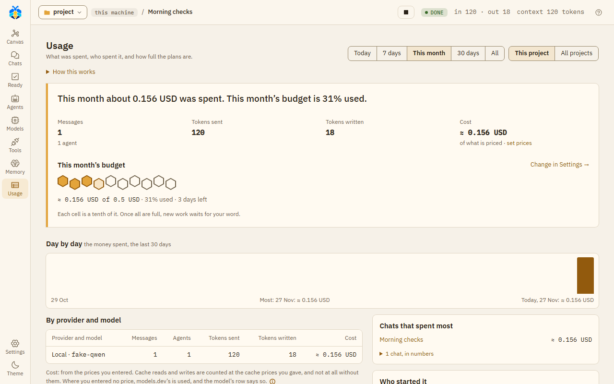

# Usage and budgets

## The Usage page

Open **Usage** on the left rail. Choose a period - **Today**, **7 days**, **This month**, **30 days** or
**All** - and **This project** or **All projects**. **This month** is the calendar month, as the budget counts it.

*The Usage page, counted from the record: no model is asked.*

The page reads from the top:

- **A sentence** on the period, such as "This month about 23.40 USD was spent. This month's budget is 46%
  used. Claude Code has used 62% of the week." The budget's part shows with **This project** where the project
  has a monthly budget; the plan's part is the plan window used most, as the CLIs last said it. With nothing
  priced it says "no money was counted". Under it: **Messages**, **Tokens sent**, **Tokens written** and
  **Cost**, with **set prices**. **Messages** says how many agents worked in them and, apart, KOLONİ's own
  requests outside a message: "12 agents", "1 request by KOLONİ itself".
- **This month's budget** as ten cells, each a tenth of the budget: honey as it fills, a red-orange rim on what
  is left from 80%, all red-orange once it is over, with the amount, the share used and the days left in words beside them. Once all are full, new work waits
  for your word (see [A project's monthly budget](#a-projects-monthly-budget)).
- **Plan limits** beside it: a bar for each window of a plan, with **Check now** (see [Plan meters](#plan-meters)).
- With **This project** and **Today**, the day's own numbers: **Failed** and **Files changed**, and **Say it in
  words**.
- **Day by day**: the last 30 days in one strip, whatever the period, a bar a day. It is money where any of it is
  priced, else the tokens the models reported. A day that ran with nothing known has a dashed stub, never a zero.
  Under it: the first day, the day that spent most, and today.
- **By provider and model**: messages, agents, tokens and cost for each model. A CLI on a subscription, or an API
  key marked as a plan, says **plan** instead of a cost; Copilot's AI credits stand beside it, such as "plan · 41
  AI credits". A model's **Agents** count KOLONİ's own requests to it outside a message too, and the line under
  the table says how many there were: 12 agents and 1 request are 13 there.
- **Chats that spent most**: the top three, each opening its chat. **All N chats, in numbers** unfolds the full
  table, which every column sorts.
- **Who started it**: a bar each for **You**, **KOLONİ itself** (requests KOLONİ makes outside a message, such as
  a real run of a CLI from the Models page) and **A trigger, with nobody watching** (a turn before 0.1.10, when
  triggers were removed). **In numbers** unfolds its table. A night's work while you are ☾ Away counts as yours.
- With **This project**, one line on the period's decisions: "12 decisions were made for you this month, 2 of them
  you haven't seen.", with **Open in Ready for you**, where **Decided for you** lists each. See
  [Decisions](../use/decisions.md).

A chat's or a day's cost is its models' costs added up, as the budget adds them. Where none of them has a price,
or the costs are in more than one currency, the chats, the starters and the strip are compared by their tokens
instead, and a sum of only part of them says "≥".

"Nothing is estimated": tokens are only what the models reported, and what was not reported shows as
"–".

**GitHub Copilot CLI** reports what it spent in its usage checkpoint: its tokens, and its own unit,
AI credits (or premium requests, its older unit). They show on the agent's context line, under
**Details** in its window, such as "1,200 in / 300 out · 0.42 AI credits", and added up by model on the
Usage page, beside its cost. Run as a session, they are
counted from that checkpoint as in **Native**: measured with `copilot -p` (CLI 1.0.103), not yet seen in a
live session.

## Cards

Usage's **Cards** section, which counted the command cards asked by why and suggested a delete rule,
was taken out in 0.1.10. What was decided for you, and why, is on Ready for you under **Decided for
you** ([Decisions](../use/decisions.md)).

## Where the money comes from

KOLONİ shows money only from prices:

1. your own price for a model, if you set one;
2. otherwise the price in the bundled models.dev catalogue, in USD.

A CLI on a plan has no price for a token, so it never has a cost here. Neither does an API key marked
**This key is a plan: count no money**. A cost shown with "≥" means part of it has no price. Amounts in
different currencies are never added together.

### Prices

The **Prices** fold lists the models and their prices per million tokens sent and written, and
optionally for cache reads and writes. Type a price and a currency, then **Save price**. "A price
belongs to the model's name, whichever provider runs it." **Use models.dev's** goes back to the
catalogue's price.

## A project's monthly budget

Set it under Settings › This project › Limits and money › **Monthly budget**, in the currency of your prices (else
USD). It covers this calendar month, by this machine's clock.

- At 80%, KOLONİ tells you once, and the top bar shows it.
- At 100%, a new message asks first: "Over this month's budget. Send it anyway?" Press **Go on anyway**
  or **Cancel**. **Learn** on a knowledge asks the same way.
- Work on a model with no price is not counted.
- If your prices are in more than one currency, the budget is not enforced, and the page says so.
- A plain chat (no folder) belongs to no budget.

The Usage page shows **This month's budget** as ten cells, how much is used, the days left in the month, and
**Change in Settings →**.

## A job's budget

Settings › This project › Limits and money › **Stop the work on a message over this many tokens**, in sight next to the
monthly budget. A job is the work on one message: yours, a To-do task's, or a job's while you're away. KOLONİ checks
it before each model step (and as a CLI session's messages arrive) and stops the job once all its agents together
have gone over it: "this turn used N tokens, over the project's limit of M". It counts tokens, not money, so it holds a
CLI on a plan too, where the CLI reports them. A job tried again, or a message that goes on with it, starts from zero.

The limits few change - how many agents work at once, Continue's steps, a discussion's tokens - are under **More
limits** in the same section.

## Providers' own limits

Each provider can have a limit in dollars a day or a month, or step down a tier when a plan runs low: its **Limits**
tab on the Models page. See [Limits](../models/limits.md).

## A night's limits

On the **Go away** card: **Until** a time, and **spend at most** an amount. A night with a monthly budget is held to
what the month has left too. See [Work while you're away](../automation/overnight.md#going-away).

## Plan meters

For Claude Code, Codex, agy and Copilot, the top bar shows how much of the plan is used, from what each
CLI last reported. Copilot's chat requests and premium requests show apart
([Copilot on your GitHub account](../models/copilot.md#plan-limits)). Near the limit (90%), KOLONİ tells you. On the Usage page, **Plan limits** shows the
same with **Check now**: "These are the limits of the account the CLI on this machine is signed in to." Where
a subscription steps down a tier (its **Limits** on the Models page), a line on its bar marks that share; past it
the bar turns orange and its row says so: "Past 80%: a model picked by tier on it is one tier lower".
