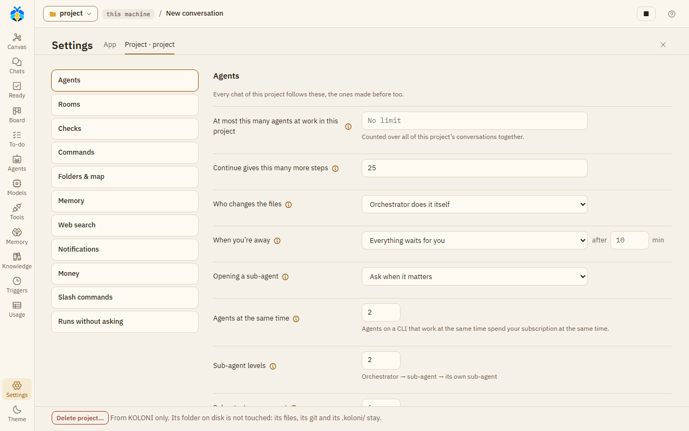

# Settings

The Settings page holds everything you set for one chat, for one project and for KOLONİ as a whole.

## Opening Settings

- Press **Settings** (the gear) at the bottom of the left rail. It opens on **This project**, or on
  **The app** for a chat with no folder. Press it again, or the close button, to close the page.
- Or press Ctrl+K and choose **Settings**. Ctrl+K also lists each section by name (the app's with
  "(the app)" after it), and opens Settings right at it.
- Under the message box, **Chat** (the gear at the end of the model's line; under **More** in a narrow
  chat) opens this chat's short sheet; its
  **All settings** opens Settings at **This chat**.

Choosing another page on the rail closes Settings. The chat under it stays as it was, so a
message you were typing is kept.

## Three levels

The levels are listed on the left, always in this order, each with its sections under it:

| Level | What it covers |
|---|---|
| **This chat** | The open chat's own settings. Shown while a chat is open. |
| **This project** | The project of the open chat. Shown only when the chat has a folder. Every chat of the project follows it, the ones made before too. |
| **The app** | The whole app, in every project. Always there. |

A chat takes what it does not set from its project, and the project from the app. Each setting is set
at one level only: This chat shows what it takes from the project, read only, with a link up.
What you type at one level is kept while you look at another.

## Saving

Each section has its own **Save** button. It is on only when something changed and every value is
valid. After saving, the button says "Saved".

A section with changes you have not saved shows a **not saved** tag next to its name in the list.
You can move between sections without losing those changes. Three sections have no Save button for
the whole section and save each row on its own: **Runs without asking**, **Slash commands** and
**This folder**. This chat's settings take effect as you change them.

## This chat

The same rows as the sheet under **Chat** under the message box:

| Setting | What it does |
|---|---|
| **Teams** | Who picks this chat's teams, and the ones picked. Set with the Teams button over the canvas. |
| **Folders** | Where this chat's agents work, and its other folders. Set with the folder button. |
| **Page scripts** | **Ask each time** or **Always run in this chat**, for a page an agent shows in the Workspace. Also offered over the page's preview. |
| **Runs without asking** | A project's chat: how many rules it has, and a link to This project › Runs without asking. A chat with no folder keeps its own list here. |

Its permission level, **Plan first** and its model stay under the message box. Under them, **From**
*the project* lists what the chat takes from its project (who changes the files, opening a sub-agent,
when you're away, the agents' limits, money, where commands run) with **Change in This project**, and
**Change in The app** leads to the app's. A chat with no folder says that its sub-agents use KOLONİ's
defaults: ask when it matters, 2 at the same time, 2 levels, 6 per request.

## This project

The sections are listed on the left, in this order.

*Settings › This project, at its first section, **Agents**.*

### Agents

"Every chat of this project follows these, the ones made before too."

| Setting | What it does |
|---|---|
| **Who changes the files** | **Orchestrator delegates the work**: it plans, asks and checks; sub-agents change the files. **Orchestrator decides**: a small change (one or two files, a few lines) it makes itself, bigger work goes to a sub-agent. **Orchestrator does it itself**: it changes the files itself, and may still hand a part to a sub-agent. |
| **Finish only when the tests pass** | An agent on Claude Code that changed files is sent back to work, at most twice, while the tests fail. KOLONİ runs the tests where this project's commands run, by itself only in Full auto or under an Always run rule. |
| **Have a model look over each sub-agent's report** | The Observer role's model reads each sub-agent's report, the diffs and the test output, and says what the record shows. One more model request per report. The Orchestrator takes its words as an opinion, not a fact. |
| **Suggest follow-up tasks after each turn** | On by default. After a turn that did something, the Assistant PO proposes at most three [follow-up tasks](automation/todo.md#follow-up-tasks) for the To-do list; they wait for your **Add**, **Edit** or **Reject**. One small model request per such turn, made once the turn is over, and at Full auto in a turn you started one more for the Orchestrator's decision. **Follow-up tasks from** picks the tier: **Fast tier** (the default), **Balanced tier** or **Strongest tier**. |

### Asking and away

| Setting | What it does |
|---|---|
| **Opening a sub-agent** | **Ask when it matters**, **Always ask** or **Never ask**. With Never ask, sub-agents open on their own in every chat of this project. |
| **When you're away** | **Everything waits for you**, or **The Orchestrator answers what it safely can**, after a number of minutes (0 to 1440). With the second, once you haven't answered for that long (or the away card is on), the Orchestrator picks, says why, and you see it under "Decided for you". It opens a sub-agent on its role's own model unless that model is at its limit, out of credit, or over this month's budget; a move onto another model that may cost money, commands it may not run, deleting, reaching outside and Take in still wait. An Orchestrator on a CLI uses one request of your plan for each answer. |

### New chats start with

"A new chat of this project starts with these; each chat then sets its own."

| Setting | What it does |
|---|---|
| **New chats' teams** | **Orchestrator decides**, **Manual** or **No teams**. With Manual, the teams a chat kept with **Use for new chats in this project**. |
| **Other folders** | The folders a new chat starts with, besides the project. Remove one here; add one from a chat's folder button with **Keep for this project**. |

**A room's limits**: "What a room opened in any chat of this project may spend, unless you say
otherwise as you open it. Empty: no limit." This is their one place: **Work together…** sets a room's
own.

| Setting | What it does |
|---|---|
| **Posts, at most** | 1 to 1000. |
| **Minutes, at most** | 1 to 1440. |
| **Tokens, at most** | A token budget for the room. |
| **Tokens, at least** | 60,000 by default. A room an agent opens with a smaller token budget gets this many, because one member's step takes about 8,000 to 9,000 tokens. If it is higher than **Tokens, at most**, the room gets the most. Empty: an agent's room gets what it asks for. |

### Limits and money

| Setting | What it does |
|---|---|
| **At most this many agents at work in this project** | Counted over all of this project's chats together. A new agent waits for a free place. Empty: no limit. |
| **Agents at the same time** | The most agents at work at once for one message. 1 to 32. Each provider has its own limit too. Above 8 the page warns that this may strain this machine and your subscription. |
| **Sub-agent levels** | How deep sub-agents may open their own, from 1 to 4. |
| **Sub-agents per request** | The most sub-agents opened for one message outside a recipe. 1 to 20. |
| **Continue gives this many more steps** | How many more steps **Continue** gives an agent that stopped at a step limit, on its card or on its kept work's card. 25 unless you change it, 1 to 200. A go on by message gives a new step limit instead. The step limit itself is the app's: **Steps an agent may take**, a link away. See [Step limits](agents/step-limits.md). |
| **Stop the work on a message over this many tokens** | Empty: no limit. |
| **A discussion's tokens, at most** | A token budget for each discussion. Empty: no limit. See [Discussions](agents/discussions.md#when-it-ends). |
| **Monthly budget** | For this calendar month's messages, in the currency of your prices (else USD). At 80% you are told. At 100% a new message asks before its work starts, and triggers start none. Work on a model with no price is not counted. |

### Commands and secrets

Heading: "Run commands on".

| Setting | What it does |
|---|---|
| **This machine** | Commands use the project's own tools as they are. They are not isolated. The page also says which shell commands run in. |
| **Docker container** | A fresh container for each command, with this folder mounted. Only the folder is kept. Needs Docker running. Then: **Image** (for example `python:3.12`, never pulled for you) and **Allow network access**. On Linux and macOS a command runs as your user, not as root, so the files it makes are yours, except under rootless Docker. |
| **Hide secret files from commands** | On by default. Covers commands in Docker and in Copilot's sandbox. |
| **Secret variables commands may see** | Environment variables with secret names are held back from commands and CLIs. Name the ones they may see, separated by commas, for example `OPENAI_API_KEY, NPM_TOKEN`. The page lists what is held back. Copilot's commands never get `GH_TOKEN`, `GITHUB_TOKEN` or `COPILOT_*`, whatever you name here: it signs in its own way. |
| **Planted test key (canary)** | On by default. Each message's commands get a made-up key that no agent is told of. A command, web request, browser or MCP call that would send it out is refused and the work stops: something the agent read may have told it to. |

### Runs without asking

- **Sites agents open**: the agents' own browsers open these in every chat of this project without
  asking, unless marked **Ask first**. Add one with **Allow site**.
- **Commands and requests, by chat**: the rules made with **Always run** on a card, grouped by
  chat. Remove one with its ✕. You can also allow plain GET requests to a host for a chat.

See [Permission levels](use/permissions.md) for what a rule can and cannot cover.

### Checks and git

Heading: "When a sub-agent's work is added".

| Setting | What it does |
|---|---|
| **Test before adding** | A command run on a sub-agent's changes in its working copy, for example `python -m pytest -q`. Only an exit code of 0 passes. Empty: no test. |
| **Measure command** | A command whose last line of output is a score from 0 to 100, for example `python measure.py`. Recipes use it to pick the best of several candidates. |
| **Save each sub-agent's work as a git commit** | One commit per piece of work, offered on the card once the changes are in, and only where this folder is the top of a git repository. It is always your click, never made by itself, and nothing is pushed. |
| **How a team's finished branch reaches yours** | **Merge here** or **Open a pull request**. If you have not chosen, the first finished branch on a GitHub project asks. |

### Memory and web

| Setting | What it does |
|---|---|
| **Note what the work found, by itself** | After each message's work, a fast model writes at most three notes of what it found. One more model request after every message. Off by default. See [Memory](memory.md). |
| **Search by meaning with** | The provider whose server embeds the memory for the search by meaning, and its **Embedding model**; off, the search goes by words alone. One embeddings request for each search. The Memory page sets it too. |
| **Also look in the memory of** | Tick other projects. Agents' look-ups and your deep search find their memory too. |
| **Search address (SearXNG)** | Your own SearXNG server, for example `http://localhost:8888`. An agent's web search asks it first; turn on its JSON format. When it does not answer, the search goes on as below and says so. |
| **Otherwise search with** | **The built-in search first, then a CLI** or **A CLI first, then the built-in search**. |
| **Let agy search too** | Lets agy search the web. While it searches, agy is not held to its search tool: it may read files on this machine or open pages unasked. |

### Notifications

| Setting | What it does |
|---|---|
| **Notification address** | A webhook address KOLONİ posts to. Once set, it is not shown again; type a new one to replace it. |
| **Post it as** | `JSON {"text": …}` (Slack, Mattermost), `JSON {"content": …}` (Discord) or Plain text (ntfy). |
| **Show a desktop notification** | Windows only. |
| **Remove the notification address** | Shown when an address is set. |
| **Send the day's summary at** | A time of day, by this computer's clock, for a daily summary: the Board's Today numbers as text, counted from the record; no model is asked. Needs an address or desktop notifications. If KOLONİ is closed then, it sends the summary late, when it next opens, and only for the last day it missed. |

### Slash commands

Your own commands for the message box. Each has a **Name**, **What it does**, the
**Text it puts in the box**, and can **Hand it to a role**. Tick **In every project** to use it
everywhere. **Add command** saves a new one; **Edit** and **Delete** change the list.

### This folder

**Project map** is a table of the project's parts: Folder, Language, Files, AGENTS.md and
Test command. You can change a part's test command and save that row; **Use guess** puts back
the one KOLONİ found.

**This folder's rules** are shown when the folder has `.koloni/rules.md`. Read-only here; you change
the rules on the Memory page.

#### Delete project

Under This folder, **Delete project…** removes the project from KOLONİ: its chats with
their messages, agents' work and usage, its memory, knowledge, To-do tasks, triggers and work while you're away. The
dialog counts what goes, offers **Export first** (the same .zip as **Export everything**, without API
keys), and deletes only once you type the project's name. It cannot be undone.

The folder on disk is not touched: its files, its git and its `.koloni/` stay. Opening the folder again
makes it a new, empty project. What KOLONİ kept of its chats under `runtime/` goes, as a chat's delete
takes it: their attachments and their CLI sessions.

While anything of the project is at work (a turn, a sub-agent, a room, a trigger's or the To-do's turn,
jobs while you're away), while a command it started still runs (such as a dev server), while finished work waits for
**Take in** or **Discard**, or while its knowledge is learning, the delete is refused and says why.

## The app

### Agents, in every project

| Setting | What it does |
|---|---|
| **Answer in** | The language the agents write in, in every project. **Auto** means the language you write in. Pick one from the list (English, Türkçe, Deutsch, Español, Français, Italiano, Português) or type another. KOLONİ's own screens stay in English. |
| **Steps an agent may take** | The most model steps one agent takes on a job before it stops: 25 unless you change it, a whole number from 5 to 200. Coordinators and the Orchestrator get more for their recipes and teams. What **Continue** gives on top is each project's: This project › Limits and money, a link away. What happens at the limit, and who may give more: [Step limits](agents/step-limits.md). |
| **Summarise a long context at (%)** | Once an agent's context passes this much of its model's window, the older part is summarised before its next step. A whole number from 50 to 95. It does not apply to a CLI run step by step, nor to Claude Code run natively with its own sign-in for KOLONİ, which compacts its own session. Any other CLI starts each turn anew: KOLONİ compacts it, against its role's window. See [Set up a CLI](models/setup-cli.md#going-on-from-the-last-turn).|
| **Knowledge reads at most (files)** | Knowledge from a repository or a folder on this machine stops before it reads more files than this: 50,000 unless you change it, a whole number from 100 to 1,000,000. A learning keeps what it started with. See [Knowledge](knowledge.md#a-repository). |
| **Knowledge reads at most (MB)** | The same, in MB: 300 unless you change it, from 1 to 10,240. |

### Voice

This browser's, for every chat: **Auto-read reads** (the whole answer or a short summary), the
**Dictation language**, **Read aloud with** the browser's own voice (its **Rate** and **Pitch**) or
**Read aloud with Gemini** (a **Gemini API key**, and **How Gemini says it**), and **How the Orchestrator
speaks**. **Dictate** and **Read aloud** stay beside the message box. See [Voice](use/voice.md).

### Your data

**Export**: your KOLONİ data in one `.zip`: chats, agents, providers, memory, triggers, skills and
attachments. Not in it: your project folders (their `.koloni/` knowledge too), working copies,
logs, previews, the CLIs' own folders and the database's upgrade backups.

- **Include API keys and secrets (keep this file safe)**: without this, the keys KOLONİ stores in
  its settings and secret files you attached to a chat (a `.env`, a key file) are left out. A key that
  was ever written in a chat, in another file you attached, an agent's output or a command stays in
  the file either way, so keep the file private.
- **Export everything** starts the download.

**Restore**: "Restore only a file you exported yourself: it decides which programs KOLONİ may
start."

- **Restore from a file…** takes a `.zip` you exported.
- Nothing changes at once. The restore replaces your data the next time KOLONİ starts: close
  KOLONİ and start it again. Until then you can **Cancel** it. Your data as it was is set aside,
  not deleted.
- After a restore, triggers and to-do work wait until you press **Resume**.
- If the file had no keys, the page lists the providers that need theirs again.

Under them: how much space KOLONİ's database, backups, working copies and logs take, and
**Always blocked**, the places no agent ever opens, in every project; the list is KOLONİ's own and
cannot be changed here.

## Settings kept in the folder

A few project settings are also written to the folder's `.koloni/settings.json`, so they travel
with the project in git: where commands run (this machine or Docker), the Docker image, Docker's
network access, and the web search order. The first time, the page says
"Saved in .koloni/ in this folder (kept in git)". Secrets, your addresses and this machine's
folders stay in KOLONİ only. Everything under The app stays in KOLONİ too.

When a folder's settings differ from KOLONİ's (for example, after a `git pull` from another
machine), the top of This project asks whether to use them, with **Use them** and **Not now**.
