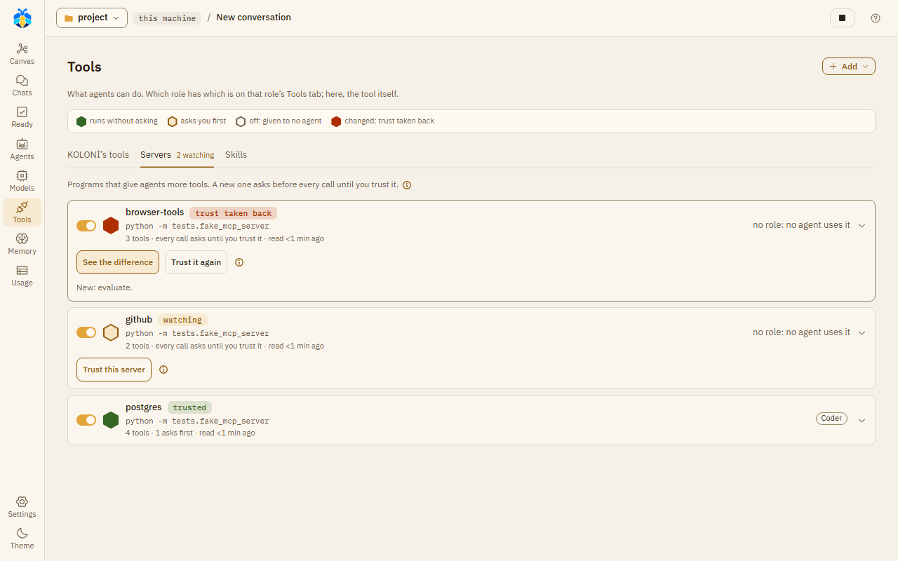
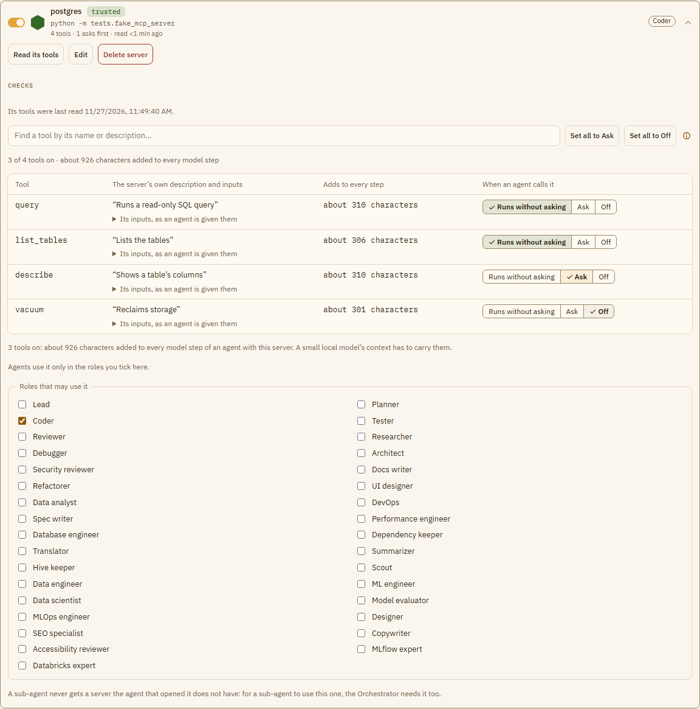

# MCP servers and trust

An MCP server is a program on this machine that gives agents more tools. "A server runs with your
rights on this machine": it can read and write files anywhere you can, and reach the network.
KOLONİ's cards do not stand between a server and your machine; they stand between an agent and the
server's tools.

Servers are on the Tools page, tab **Servers**: "Programs that give agents more tools. A new one asks
before every call until you trust it." The tab says how many servers are watched ("2 watching").

Each server is a card. Its head has its on / off switch, its [cell](built-in.md#the-cells) - how far its
tools may go without you -, its name and state (**trusted**, **watching**, **trust taken back** or **could
not be read**), its command, how many tools it has and when they were read, and the roles that may use
it. Click its name to open it under its head; one is open at a time.

| Cell | The server |
|---|---|
| Green | Trusted, and at least one of its tools runs without asking. |
| Honey rim | Watched: every call asks. Or trusted, with every tool on Ask. |
| Empty | Off, not read yet, or none of its tools on. |
| Red-orange | A reading on this page took its trust back. |

## Adding a server

Press **Add** and choose:

- **A server, ready-made** (from KOLONİ's list): Filesystem, GitHub, Browser (Playwright), Fetch, REA,
  Context7, Chrome DevTools and Git. A card only fills in the form for you.
- **A server, from its page**: paste the setup text from the server's page. KOLONİ reads an
  `mcpServers` block, a single server, VS Code's `servers`, or a `claude mcp add` line, and shows what it
  read. Tokens are kept secret. Press **Add** for the servers, or **Edit before adding**. Servers
  reached by a web address are not accepted.
- **A server, by hand**: a **Name** (it cannot be changed later; agents see its tools as
  `name__tool`), the **Command** with one argument a line, and any variables (**Add a variable**). Press
  **Add server**.

Variable values are kept in plain text in KOLONİ's local database and never shown again. "Other
programs on this machine can see the arguments of the command: put a secret in a variable."

A server gets its own variables and, of this machine's environment, only what programs need to run
(`PATH`, the home and temp folders, `APPDATA` and the like): none of KOLONİ's or a CLI's sign-in
variables. What it needs beyond that goes in its own variables: `npm_config_*` or `UV_*` (a
private registry or index), `NODE_OPTIONS`, `HTTPS_PROXY` or `NODE_EXTRA_CA_CERTS` (a proxy, its own
certificates), on Linux `DISPLAY`, `WAYLAND_DISPLAY` and `XDG_RUNTIME_DIR` (a browser with a window),
`DOCKER_HOST` or `DOCKER_CONTEXT`, and `SSH_AUTH_SOCK`.

A project's own `.mcp.json` is not read.

## Reading its tools

A new server offers no tools until it is read. Open its card and press **Read its tools**.

If the command may download a package first (`npx`, `uvx` and the like), a card says so before it
starts. **First look for it in osv.dev's known-malware records** is on by default: a package osv.dev
lists as malware is not started. If osv.dev cannot be reached, the server starts anyway.

**What does it do?** looks inside an `npx` or `uvx` package before you run it: it downloads the
package, checks it, and reads it as text without running it. It lists what the package may reach
(files, programs, the network, a port, the system), the addresses and variables it names, and what runs
when it is installed. Its dependencies are not read. "This is where to look, not a verdict."

## Trust

A server you have not trusted is **watching**: its cell is a honey rim and its card says "every call
asks until you trust it". Every call of its tools asks you on a card, at every level, Full auto too. The
card shows the server's own description of the tool.

After its tools are read, **Trust this server** on its card's head trusts it - the card can be closed.
Before the first reading there is nothing to trust and the button waits. If the package has no fixed
version, the page warns that it updates itself and that trust covers future versions.

Trust is taken back by itself when the command or its variables change, or when a new reading finds
new or changed tools. When a reading you start on the page takes a trusted server's trust back, its cell
turns red-orange and its state says **trust taken back**: **See the difference** lists what the reading
found new, changed or gone - by name: a tool's words before are not kept - and **Trust it again** trusts
it as it is now. The page knows this only while it is open: opened anew, such a server shows as
watching.

## When a tool runs

Each tool has three choices side by side under **When an agent calls it**; the one it has is checked:

| Choice | What it does |
|---|---|
| **Runs without asking** | For a trusted server, it runs at every level. A watched server's still asks. |
| **Ask** | A card asks you first, at every level, Full auto too. |
| **Off** | No agent is given it. |

A choice is saved as it is made. New tools come in as **Ask**. A tool whose description or inputs change goes back from **Runs without
asking** to **Ask**. **Set all to Ask** and **Set all to Off** change every tool of the server at once.

## Giving a server to roles

Under **Roles that may use it**, tick the roles whose agents get its tools. Every tool's description is
sent to the model at every step, so a server with many tools makes each step bigger: the page says by
about how much.

Servers are not offered to CLIs that work with their own tools, or to projects
whose commands run in Docker.

## Switching off and deleting

Each server has an on / off switch ("off: given to no agent"). **Delete server** removes it, and takes
it from every role.

See [Adding an MCP server safely](../examples/mcp-safely.md).
