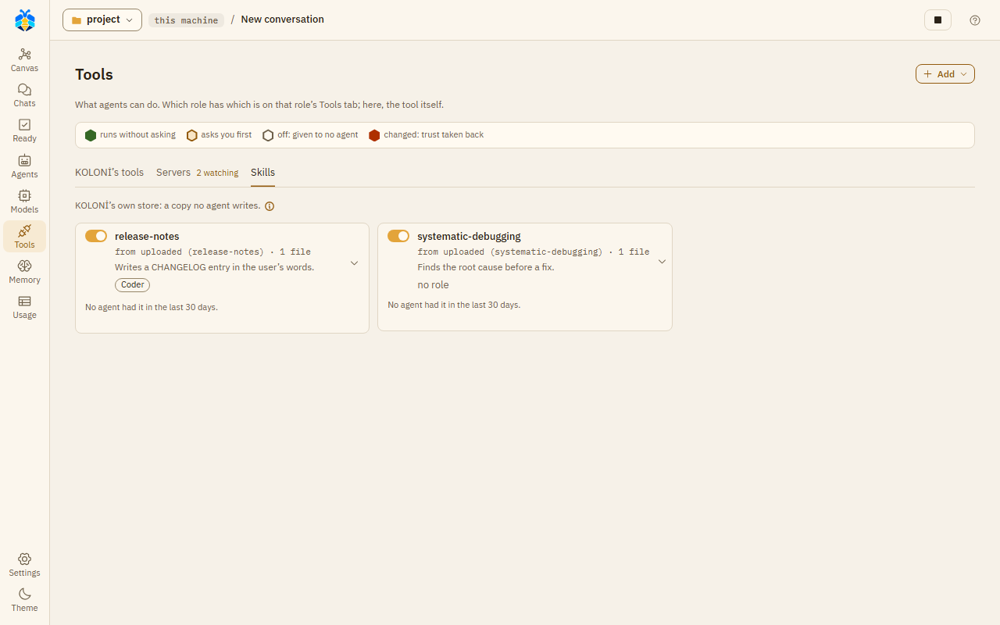

# Skills

A skill is a folder with a `SKILL.md`, in the form Claude Code reads: a name and a description at the
top, instructions below, and files beside it. A role that has a skill is told its instructions and can
use its files.

Skills are on the Tools page, tab **Skills**: "KOLONİ's own store: a copy no agent writes."

Each skill is a card: its on / off switch, its name, where it came from ("from …") and how many files it
has, its line, the roles it is given to (✗ before one that cannot run it there) and the last 30 days
(see [How a skill did](#how-a-skill-did)). Click its name to unfold it across the page; skills that
agents proposed are above the cards ([When an agent proposes a
skill](#when-an-agent-proposes-a-skill)).

## Adding a skill

Press **Add** → **A skill · from a folder or GitHub**. Then:

- **Skill folder**: type the folder's full path and press **Read the folder**. Or **Choose folder…**
  (at most 5 MiB) or **Upload .zip…** (at most 25 MiB) from your browser.
- **From GitHub**: a public repository, or a folder in it, such as
  `https://github.com/owner/repository/tree/main/folder`. Press **Read from GitHub**. First only the list
  of files, the `SKILL.md`, the licence and the scripts are read; the rest is downloaded when you add it.

KOLONİ keeps its own copy. Secrets and links in the folder are not copied.

Before you add it, a card shows what the skill holds: its licence (or that it is unknown), its files,
which files run as programs, what was not copied, and a look at its scripts. **Show SKILL.md** shows its
text. Press **Add skill**, or **Replace skill** if a skill of that name is kept already.

## Example: skills from superpowers

[superpowers](https://github.com/obra/superpowers) is a public set of skills under the MIT licence;
each is a folder under `skills/`. To add its test-driven-development skill for the Coder:

1. Press **Add** → **A skill · from a folder or GitHub**.
2. In **From GitHub**, type `https://github.com/obra/superpowers/tree/main/skills/test-driven-development`
   and press **Read from GitHub**.
3. Read its `SKILL.md` on the card (**Show SKILL.md**), then press **Add skill**.
4. Open the skill's card and tick the Coder under **Roles that may use it**.

Some of them may fit these built-in roles:

| Skill | May fit |
|---|---|
| `test-driven-development` | Coder |
| `systematic-debugging` | Debugger |
| `verification-before-completion` | Coder, Tester |
| `receiving-code-review` | Coder |
| `requesting-code-review` | Coder; the Reviewer may use its template |

Don't give them to the Orchestrator: its own way of working is KOLONİ's, and a workflow skill there
(`brainstorming`, `writing-plans`, `using-superpowers`) makes it plan and decide in your place.

Several are written for Claude Code's own way of working: they name its tools, worktrees, sub-agents
and a browser companion. These fit KOLONİ's roles poorly: `brainstorming`, `subagent-driven-development`,
`using-git-worktrees`, `executing-plans`, `dispatching-parallel-agents` and `using-superpowers`. A
skill's card says when a role lacks a tool its `allowed-tools` line lists; tools named only in its text
are not checked. `brainstorming` and `systematic-debugging` hold scripts: on the card, before **Add
skill**, untick **Run the scripts of … without asking** unless you have read them.

A skill steers every agent that has it, so give each one only to the roles that need it.

## Scripts

Files ending in `.py`, `.js`, `.mjs`, `.cjs`, `.sh` or `.ps1` count as scripts. **Run the scripts of …
without asking** is on by default. "Saying yes to this is agreeing to run them. Any other command is
asked about as before, and once a file of the skill has changed since it was added its scripts are
asked about too."

A skill's scripts need the role to be able to run commands, and they do not run in projects whose
commands run in Docker.

## Giving a skill to roles

Open the skill's card and tick **Roles that may use it**. If a role lacks a group of tools the skill
needs, the card says so and offers to give it.

A skill's text is what the agents that have it are told, so a skill from elsewhere can steer them. Read
it before you give it to a role.

## When an agent proposes a skill

An agent can propose a skill. The **Add this skill?** card shows the same things as above, and which
roles it would be given to. Press **Add skill** or **Reject**.

While it waits, the **Skills** tab lists it too, under **Proposed by agents**, with a honey cell ("waits
for your word"), its line and its roles; the tab says how many ("1 proposed"). Its yes is not given there:
**Open on Ready for you** goes to its card, which shows its text and its scripts first.

## How a skill did

A skill's card shows the last 30 days at a glance: each model and role it was given with, and how many of
their agents read it ("read in 4 of 6"), with a bar once there are 5 jobs or more. Up to three rows; the
rest are under it, unfolded. With no agent given it: "No agent had it in the last 30 days". While the
record cannot be read, the card says nothing of it.

Open a skill's card: **Did lately** shows the last 30 days, one row per provider, model and role that had
the skill. Its bars show **Taken in**, **Cost** or **Steps**, once there are 5 jobs or more. Each row says
how many of those agents read the skill whole ("read in 2 of 6"), or "given, not read", in grey: then its
numbers say little of the skill. An agent that cannot read a skill itself (it has no `use_skill`) is given
its skills in full in its brief instead.
The row counts those too, as "given in full in its brief in 3 of 6", not as "given, not read".

## Switching off and deleting

Each skill has an on / off switch. **Delete skill** removes it: "Every role that has it loses it, and
KOLONİ's copy of it is removed."
