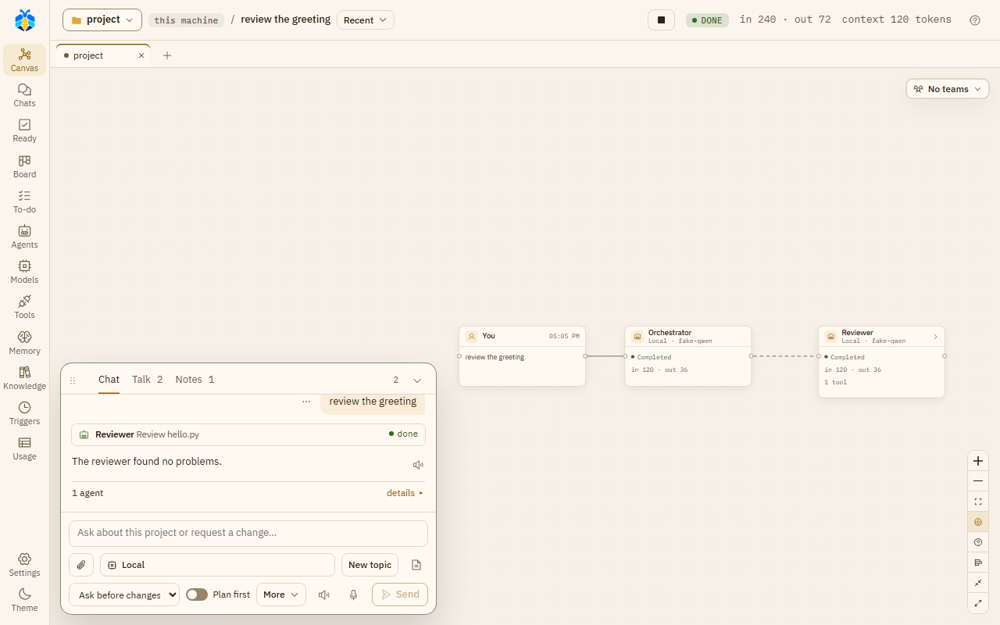
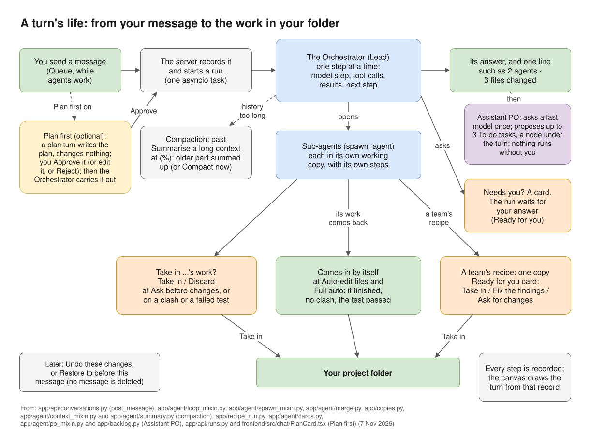
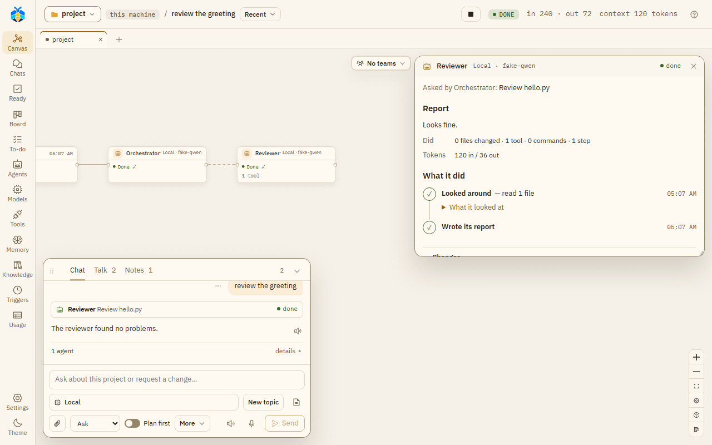

# Chat and canvas

The chat is where you talk to the Orchestrator. The canvas behind it draws each turn from what was
recorded: the agents, their tools, commands and the files they changed. Nothing on it is simulated.

*A turn on the canvas, with the chat beside it.*

*A turn's life, from your message (and its plan, with [Plan first](plan-first.md)) to the work in your folder, and the [Assistant PO](../automation/todo.md#follow-up-tasks) after it.*

## The chat

The chat panel has three tabs:

- **Chat**: "Your conversation with the Orchestrator".
- **Talk**: "What the agents say to each other, to hand work on or ask one another".
- **Notes**: "A shared notebook: you and the agents leave notes here, kept from message to message and
  given to new agents".

**Hide chat** (or Esc) folds it to one line that says how many messages are unread and how many things
wait for you. Drag its grip to move it, and its top edge to resize it.

### Writing a message

- While agents work, **Send** becomes **Queue**: your message waits and runs after the current work.
  A queued message can be removed. **Stop** stops the work.
- **Stop everything**, in the top bar on every page, stops every turn in every chat and holds what
  starts by itself: triggers, To-do lists that run by themselves, and work while you're away. It asks first, saying
  what runs and what will be held. Then the button reads **Held · Resume**; its panel lists the chats it
  stopped and what is held, with **Resume**. Your own messages still run while it holds. After
  **Resume**, a trigger waits for its next time: the times missed meanwhile are skipped.
- On **Stop** or **Stop everything**, an agent on a branch of its own keeps its work committed there, and
  a team's recipe keeps its copy for **Take in**, and so does a job while you're away (see
  [Work while you're away](../automation/overnight.md)). A sub-agent's plain working copy with changes is kept on a
  card for **Take in** or **Discard**. See
  [Working copies and Take in](workspace.md#when-an-agent-stops).
- Pasted code becomes a code block by itself, with **Paste as plain text** to undo that.
- **New topic** starts a new topic with the next message.
- Under the box, two lines. The first is what the message runs on: the model button, **New topic**,
  **Workspace** and **Chat**. The second is how far it may go, and Send: **Attach**, the permission level
  (see [Permission levels](permissions.md)), **Plan first** (see [Plan first](plan-first.md)), **More**
  (Compare and Work together) and **Send**.
- **Chat** (the gear, at the end of the first line; under **More** in a narrow chat) opens this chat's own settings: its teams and folders (each opens its own panel),
  its page scripts, what runs without asking in it, and, read only, what it takes from its project. Its
  **All settings** opens [Settings](../settings.md#this-chat) at This chat.
- In a narrow chat the model button ends in "…": its tooltip and its window say the whole name. Buttons
  keep only their icon, and Auto-read and Dictate go under **More** (a dot on it says so). The level
  always shows its short name ("Ask", "Auto-edit", "Full auto"); its tooltip says the full one.
- Type `/` for slash commands: `/new`, `/room`, `/stop`, `/model`, `/mode`, `/plan`, `/compare`, a role's
  name to hand it a task, and your own commands (Settings › This project › Slash commands).

### What the chat shows

- Two or more tool calls in a row by the same agent fold into one line, such as "Read 4 files, listed 4
  folders". Failed or rejected calls are always shown.
- Under a turn that did something, one line sums it up, such as "2 agents · 3 files changed", with what is
  left open. **details ▸** shows the files, sub-agents, tokens and known cost.
- A message's **⋯** menu has **Copy**, **Restore to before this message** and **Show its work on the
  canvas**. The **↺** button on a message whose work changed files is **Undo these changes**.

### Undo and restore

**Undo these changes** reverts a turn's file changes. **Restore to before this message** goes back to
before a message. Both show first what will be reverted and what will be skipped. "The chat stays as it
is: no message is deleted." What commands did, and notes put in memory, are not taken back.

### The context button

The top bar has a **context** button for the turn, such as "context 62%". It opens what each agent of the
turn holds, of its model's window, with **Compact now** for a lead that KOLONİ compacts: its older part is
summarised now, as it would be once past **Summarise a long context at (%)** in Settings.
The button is there for every turn, as "context –" where nothing was measured. Which CLIs KOLONİ compacts
is in [Set up a CLI](../models/setup-cli.md#going-on-from-the-last-turn).

## Tabs above the canvas

Each open folder (project) is a tab; a chat with no folder is under **No folder**. A tab's dot turns orange
while a chat in that folder waits for you. **+** goes to another folder; closing a tab closes no chat.

## The folder button

At the top left. Its panel, **This chat's folders**, shows the main folder ("agents work here, commands
run here") with **Change**, and offers **Open a folder…** and **No folder · a plain chat**. A chat that
has messages keeps its folder; picking another opens a new chat there.

**Also in this chat** lists other folders the chat's agents may use, each **read** or **read & write**
(click to switch). **+ Add a folder** adds one, read only at first. **Keep for this project** and **Save
as this folder's default** keep the list.

## The canvas

Every agent is a small box of at most three lines: its name and model, its state, and what it did,
counted. Its tools, commands and files are in the Inspector and its window (below). Lines show work
handed to a sub-agent, agents that talked, findings handed on, and an agent waiting for a file another
holds. **Canvas legend** explains every line and sign.

Click an agent that talked and **What *X* said and was told** opens on the right, under the Teams
button: its messages and findings as a short conversation. Click a line between two agents and the same
box shows what they said to each other, titled "*A* ↔ *B*". Drag it by its title, or move it with the
arrow keys on its grip. This browser keeps one place for it, the same in every chat. A double click on
its title, or Enter on its grip, puts it back.

A plan turn (see [Plan first](plan-first.md#on-the-canvas)) shows a small **Plan** node. In the work
turn of an approved plan, the plan stands over the Orchestrator, on a dashed line down to it.

In a turn with teams, each team has a frame. Discussions and rooms between teams stand in a lane of their
own, outside every frame; a room opened with two teams' leads stands there too. A member's dotted line
runs from its team's frame to the lane; the legend calls it "A member's line to its discussion or room
(between teams, from its frame to the lane)".

Where the **Assistant PO** was asked after the turn, a small **Assistant PO** box stands under the turn,
on a dashed line down from the Orchestrator. It shows the model asked, how many tasks it proposed and
dropped ("2 proposed · 1 dropped"), at Full auto how many the Orchestrator added ("Orchestrator added
1"), its tokens ("–" where not reported) and **To-do →**. Click it for why each one was dropped; a double
click, or **To-do →**, opens the To-do page. A turn where it was not asked has no such box. The legend
has a row for its dashed line. See [Follow-up tasks](../automation/todo.md#follow-up-tasks).

A step that runs in rounds, such as a review loop or **Evolve**'s tries, folds each earlier round into
one line, such as "Round 2 · 4 reviewed · 2 blocking" or "Round 1 · Coder, Coder 2 · ✓ 2". Click it to
open that round's agents in place.

The controls: **Collapse all** / **Expand all**, **Follow running**, and the **Recent** button, which lists
the last five turns (and older ones that wait for you) to pick which turn is drawn.

Click an agent to open the **Inspector**, a short report card. From the top:

- if it failed, why, in red, with the one thing to do about it;
- a tag where its CLI works its own way: "reads only" (started without leave to write or run) or "works
  with its own tools";
- anything it waits for you on (a command to run, its changes, a question). It is the same card as in the
  chat, and answering in one place answers it everywhere;
- who asked it what, on one line;
- its **Report**, or while it works "No report yet" and what it is on now. A long report is cut at six
  lines, with **Show all**;
- **Changes**: the files it changed, each with **View diff**, which opens the file in the Workspace;
- what it did, counted, and its tokens. A number its provider did not report is "–".

Its model, how full its context is, and **Compact now** are in its window's **Details**.

**Open window** opens the agent's whole story. Read from the top:

- its report;
- **What it did**, told in a few plain steps. Reads in a row are one step ("Looked around — read 6 files,
  searched 1 time"), and so are edits ("Changed a.py +17 −1") and commands ("Ran the tests — passed").
  Each step shows what the agent said before it. Unfold a step to see its files or its
  commands, with **Stop** on one that runs. While something waits for you, it is the last step, with its
  card;
- its **Changes**, **Earlier work** and **Sub-agents**;
- **Details**, folded: its model and who chose it, its times, how full its context is, **Compact now** and
  its working state, its tools, **Copy raw**, and **Every step as recorded** (the raw list of every call).

*An agent's window, opened from the Inspector with **Open window**.*

## Preview

An agent can start a dev server that keeps running, on this machine only, and show its page. At most
three run in a chat. They are listed under **Previews** in the Workspace; a preview has **Reload**,
**Open in browser** and **Stop**.

See [Working copies and Take in](workspace.md).
