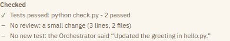
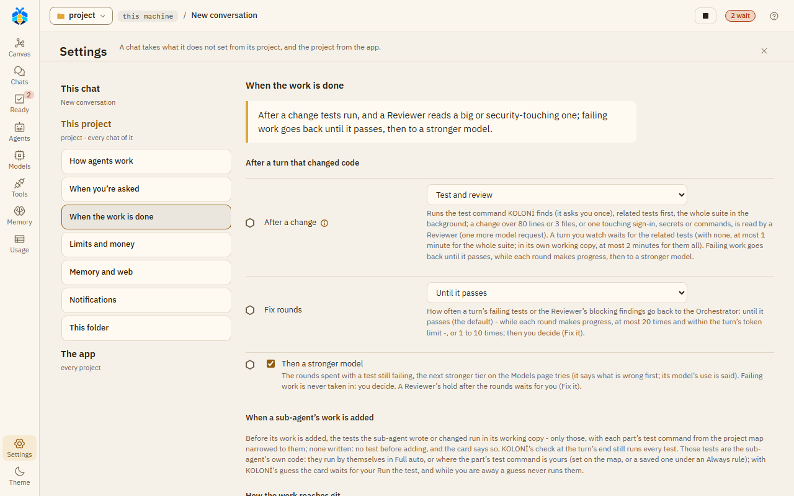
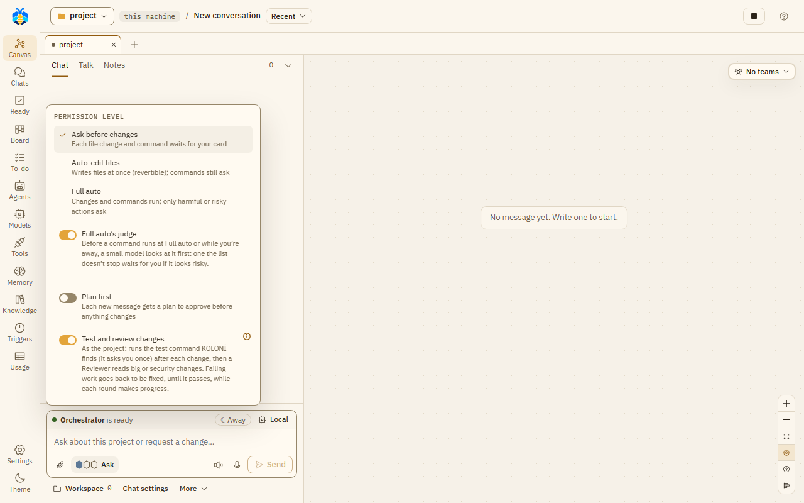
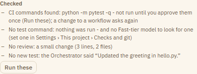
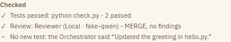
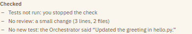
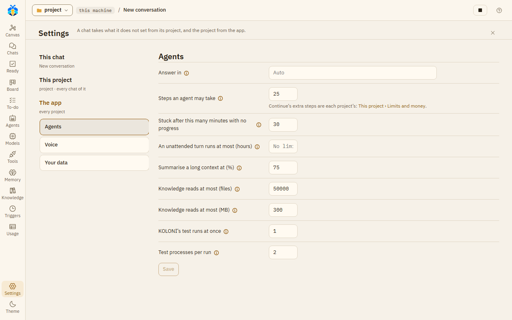
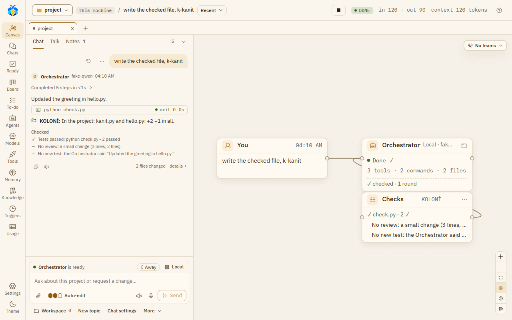
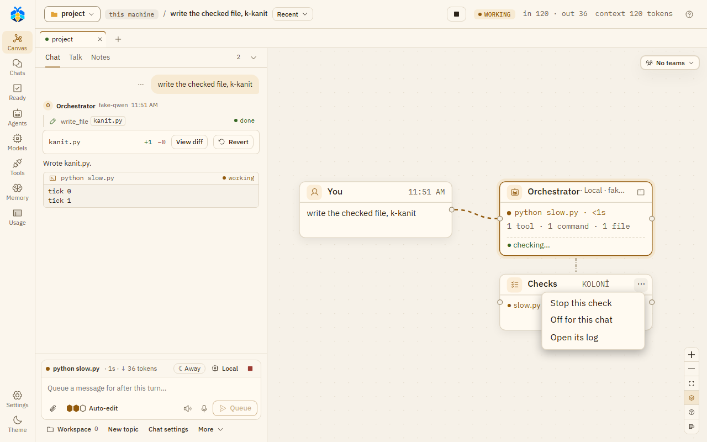
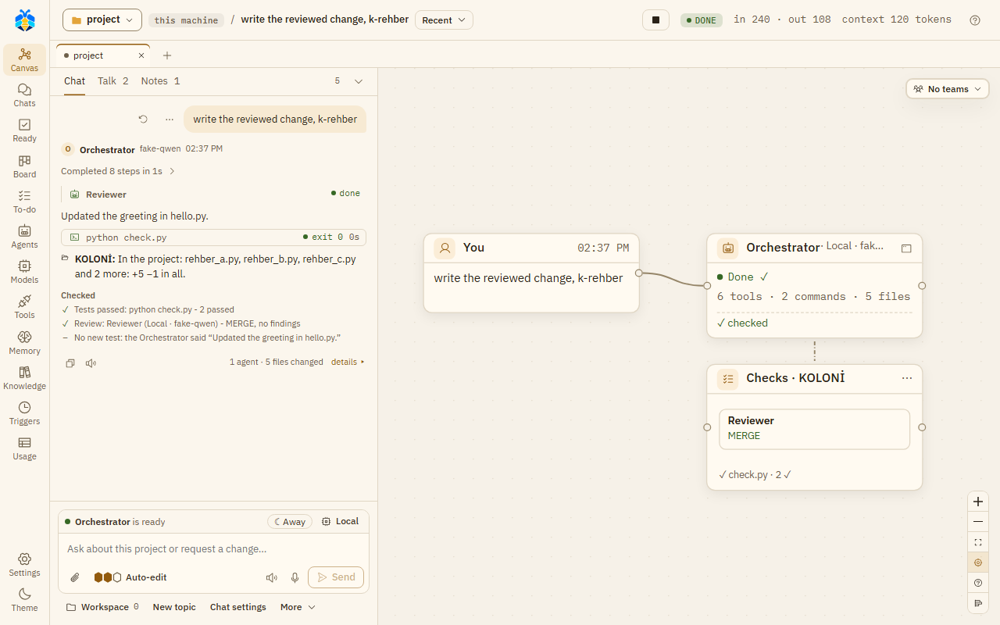

# Checked

A turn that changed code does not end on the model's word. Before the Orchestrator's answer
ends the turn, KOLONİ runs the project's tests once on the work as it now stands. Under the
answer a **Checked** section says what ran, how it went, and what was not checked. KOLONİ
writes it from its own records, not from the model's words, and no model is asked for it.

It works the same for every model and CLI.



[](../diagrams/proven-finish.svg)

*What KOLONİ checks at a turn's end, and where you set each part. ([full size](../diagrams/proven-finish.svg))*

In order, the first check that sends work back ends the pass, and the Orchestrator's next answer is
checked again:

1. **The tests** - the ones related to the change first, the whole suite after the answer
   ([Which tests](#which-tests), [Asking](#asking), [How long it waits](#how-long-it-waits)). What
   is not this turn's - a flaky test, one failing before - is told apart
   ([Not this turn's](#not-this-turns-flaky-tests-and-failures-from-before)).
2. **What it wrote besides code** - documents, diagrams, data, slides
   ([Documents, diagrams, data and slides](#documents-diagrams-data-and-slides)), and a changed
   page opened in KOLONİ's own browser at a phone's, a tablet's and a desktop's width
   ([Pages](#pages)).
3. **A Reviewer's look** at a big or security-touching change ([The review](#the-review)); long
   documents are read once against your request
   ([Documents read against your request](#documents-read-against-your-request)).
4. **The live try**, once a turn: a changed command-line tool is asked for its `--help`, and a big
   change of screens is tried by a Tester on the chat's preview ([The live try](#the-live-try)).
5. **A test for the change**, asked once where code changed and no test did
   ([A test for the change](#a-test-for-the-change)).

A failure goes back to the Orchestrator until it passes - while each round makes progress - or
as many times as **Fix rounds** says ([When the tests fail](#when-the-tests-fail)); then a stronger
model tries, and failing work is
never taken in ([A stronger model](#a-stronger-model)). **Checked** under the answer says it all,
line by line ([What each line means](#what-each-line-means)), and the canvas's **Checks** node
shows it ([On the canvas](#on-the-canvas)). A recipe's turn follows the recipe's own **Checks**
step ([The Checks step](../agents/recipes.md#the-checks-step)).

## When it runs

- After a turn in a project folder that changed a file. A turn that changed nothing, a plain
  chat, a plan, and a side of a comparison get no Checked section. A change made only by a
  command (`python -c "open(…).write(…)"`, `sed -i`, a heredoc to a file, a redirection into one
  - `cat a > b`, `git show HEAD:f > f`, not `2>&1` or `> /dev/null` -, a formatter,
  `black . && pytest -q`, a test run that writes - `jest -u`, `pytest --snapshot-update`,
  `--junitxml=a.py` -, a line handed to a shell that does) is on no record, so KOLONİ runs the tests all the same and says "A
  command of this turn may have changed files KOLONİ did not record: …", with "No review: changes
  made by a command are not recorded". In a git project such commands count only where git lists
  a file written since the first of them began, or one committed during the turn, and the line
  names them ("… did not record: gen.py - python gen_it.py"): a `python main.py` that only
  answered changes nothing. A tracked test file such a command deleted is said "Test removed", as
  one deleted on record is. A turn whose commands only read or ran tests is still a turn that
  changed nothing.
- Where the work now is: in the project, or in the Orchestrator's own working copy (a team's
  branch, or a job while you're away). Work that waits in **Ready for you** is not part of it.
- Once, after the turn's work is in: the agents run only the tests near their change while
  they work, and KOLONİ runs the whole test command at the end, like a pull request's CI - in a
  turn you watch, the tests related to the change first and the whole suite after, in the
  background (see [How long it waits](#how-long-it-waits)).
- KOLONİ runs one such test run at a time across the app, unless Settings say more (see
  [How many run at once](#how-many-run-at-once)). A second turn that ends meanwhile waits for
  the first. A run whose card waits for your yes holds up no other: it takes its turn once you
  answer.

**Settings › This project › Checks and git › After a change** turns it on or off for the
project:

- **Test and review** (the default) runs the tests, and has a big or security-touching change
  looked over by a read-only Reviewer (see [The review](#the-review)).
- **Tests only** runs the tests and nothing more.
- **Nothing** runs nothing and sends nothing back. The Checked section still says that nothing
  was checked, and names the last test run an agent made in the turn.



The line under the choice says what it does in this project now, from its real state - for
example "Runs python -m pytest -q in ./ (found by KOLONİ), related tests first, the whole suite in
the background; a change over 80 lines or 3 files, or one touching sign-in, secrets or commands,
is read by a Reviewer (one more model request). Failing work goes back until it passes, while
each round makes progress." It names
your check command; else each test command you set for a part on the project map ("npm test in
web/"), then what KOLONİ saved for any other folder - and changes as you save one there. Before a
test command is known it says KOLONİ finds one and asks you once. Its ⓘ leads here.

### For one chat



**Test and review changes**, in the permission level's menu beside **Plan first**, turns it on
or off for this chat only. Its line says what this chat's changes get: "As the project: runs
python -m pytest -q after each change, then a Reviewer reads big or security changes. Failing work
goes back to be fixed, up to 2 times.", "Off for this chat: nothing is tested or reviewed; each
answer says “Not checked”.", or "On for this chat · the project's is Nothing: runs …" (on in a
project at Nothing is Test and review for this chat). Its ⓘ leads here. Off, the level's button
says "· no checks", no Checks node is drawn for its turns, the Checked section says "Not checked:
off for this chat" and the Orchestrator's box "not checked · off for this chat". Other chats go
on with the project's setting.

It is free at every level. At **Full auto** with it off, the menu says so under it: "Full auto
with no checks: nothing checks this chat's changes". A turn that runs a team's recipe follows
the recipe's **Checks** step, not this switch: the project's setting, unless the recipe sets its own
- a recipe you picked may check less, one the Orchestrator picked only adds checks
([The Checks step](../agents/recipes.md#the-checks-step)).

A project that had turned off the old **Finish only when the tests pass** switch is on
**Nothing**, and Settings says so under the setting.

## Which tests

1. The project's own **Test before adding** command, if it has one - and then only it: nothing is
   guessed, found or saved beside it.
2. Otherwise each part's test command from the project map (yours, or the map's guess), run in
   that part's folder. A part you set to no test is never guessed.
3. Otherwise the test command KOLONİ saved before (below).
4. Otherwise a command KOLONİ guesses from each part's files, in any language: `python -m pytest
   -q` (a `pyproject.toml`, `pytest.ini` or `tests/`), `npm test` (a test script in
   `package.json`), `go test ./...` (`go.mod`), `cargo test` (`Cargo.toml`), `mvn test`
   (`pom.xml`), `./gradlew test` or `gradle test` (`build.gradle`), `dotnet test` (a `.sln` or
   `.csproj`), `bundle exec rspec` (a `Gemfile` and `spec/`), `composer test` or
   `vendor/bin/phpunit` (`composer.json`), `mix test` (`mix.exs`), `swift test`
   (`Package.swift`), `ctest --test-dir build` (`CMakeLists.txt`), `make test` (a `test:` target
   in the `Makefile`).
5. Otherwise a test command an agent ran in this turn that really ran tests, in a turn you are
   there for (not while you're away, not a trigger's).
6. Otherwise KOLONİ asks the project's **Fast** tier's model once, in a turn you are there for,
   where its tests are. KOLONİ shows it the project's parts and languages, its test files and the
   start of its README, CONTRIBUTING and Makefile (never a secret file, nor one reached through a
   link), with no tool. It answers with command lines, which are read as data. The request shows
   in Usage. It is asked again only when the project's parts change; until then the commands it
   named are tried again. With no Fast-tier model the section says so.

A line an agent ran (5) or the model named (6) is tried only if it is one of the commands in 4,
or `pytest`, `npx vitest run`, `npx jest`, `yarn test`, `pnpm test`, `bun test`, `tox`, `nox` or
`ctest` - with at most `-q` or `-v` after it, in a folder of the project. Any other line (more options, a wrapper, a chain) is never run: the look's row says
how many it named that were not tried.

A guessed command is tagged **guessed**. If nothing can be found, the section says "No test
command: nothing was run"; after the look found no tests at all, "No tests in this project".

### From your CI

Where the project has GitHub Actions workflows (`.github/workflows/*.yml`), KOLONİ reads their
lint, typecheck and test lines - `ruff`, `eslint`, `mypy`, `ty check`, `tsc`, `pytest`, `vitest` and
the like, each in its step's `working-directory` (or the job's or workflow's `defaults.run`). Each
line must be one plain command of at most 500 characters: a line that chains, pipes, redirects
or substitutes (`pytest; curl …`, `npm test && …`, `cd web && npm test`, `pytest $(…)`) is not
taken. It never takes an e2e step, nor a step with a `${{ … }}` expression, a secret or an install
in it, one whose `shell:` is another language, or one whose folder is outside the project. The
workflow files are read with limits - at most 50 files, 256 KB each and 1 MB in all, no links, no
YAML aliases; a file past them is not read. What was left out is said beside the lines it offers
or runs ("e2e not run: …", "CI step Tests: not run: not a plain command", "CI file not read: …");
where no line is taken, nothing of the CI is said.

It asks once a project: the section lists them - "CI commands found: ruff check app, python -m
pytest -q - not run until you approve them once (Run these)" - and **Run these** approves exactly
the lines that row shows.


 If the workflow files changed since, or another turn offered other lines,
nothing is approved and they are offered again after the next change. From the next change on they are the turn's test run, one line each, said "(from
CI)". Until you approve them they are not run - at **Full auto** and while you're away too. A
change to a workflow file asks again; a workflow changed in the turn itself is not used ("CI
commands not used: a workflow changed in this turn"). Your own **Test before adding** command wins
over them. Each still goes through KOLONİ's reading of commands: a harmful one is asked as your
level says. An approved line runs as your own command does: `make test`, `npm test` or `tox` run
the project's own Makefile, package scripts or tox file, whatever they hold. A trigger's turn runs
one only with the trigger's own leave for that line.

A line is offered only in a form that checks. One that changes files (`ruff check --fix`, `ruff
format`, `eslint --fix`, `tsc --build`, a test run's `-u` or `--junitxml=…`), downloads or installs
(`npx`, `uv run --with`, `mypy --install-types`), sends (`--pastebin`), does not end by itself
(`ruff server`, `--watch`), runs code of its own beside the tool (`pylint --init-hook`, `pytest -p
x`, `go test -exec`) or runs a file in place of the tool by its name (`./pytest`, `lint.cmd`,
`python -m lint`) is not, and its step says why: "CI step Fix: not run: it changes files".

A file git tracks that changed while one of KOLONİ's own runs went on is said: "Changed while
KOLONİ's run of ruff check . went on: calc.py". The end check's runs - the related tests, then the
whole suite, in the turn or gone on after the answer - are looked at against one look taken before
the first of them, on one row. It may be a run's doing (a check that formats, a test that rewrites
a data file) - or yours, saved in your editor meanwhile, or another chat's: KOLONİ never puts it
back by itself. **Put back** on that row does, for each file still as the run left it: as it was
when the run started. One changed before the run comes back byte for byte; one that was as
committed comes back from its commit through git's own filters, so its line ends are git's (CRLF
where `core.autocrlf` is on) - `git diff` shows nothing, though the bytes may differ from before
the run. One changed again since is not put back, and says so; while a test run of the turn still
goes on, Put back waits ("put back once it ends"). A file the run made that git does not track (a
report, a cache), and one an agent wrote on record meanwhile, are not listed; nor is a secret file
(`.env`, a key) - KOLONİ keeps no copy of one, so putting it back is yours. What Put back keeps
goes once nothing of the run waits, and after three days.

### Saved by KOLONİ

The first time a guessed command really runs tests (its runner counted some that passed or
failed), KOLONİ saves it as this project's test command for that folder, with no question. The
section says "Saved as this project's test command - change it in Settings". A guess that ran no
test, or no test tool, is never saved, and a command of yours is never replaced.

Settings › This project › Checks and git shows each saved command under **Found by KOLONİ** as
soon as it is saved, where it came from and when. **Forget it** clears them; they are found again
at the next change. A saved command runs as the project's for this check only, and below **Full
auto** on a card until you say **Always** on it (see [Asking](#asking)). It is not your **Test before adding**:
it does not check a sub-agent's work before it is taken in, and agents and triggers do not get to
run it unasked. To make it yours, set it there.

Where KOLONİ reads a count from the runner's summary (pytest, jest, vitest, go, cargo, dotnet,
Maven, Gradle, RSpec, PHPUnit), the line gives it. Any other runner is judged by its exit code
alone, and the line says so: "Tests passed (by exit code, no count)". Coloured output -
`--color=yes` in the project's pytest settings, or `FORCE_COLOR` where KOLONİ was started - is
read as plain: its counts still show, a run that only skipped tests is no pass, a failure it prints
is one even where its exit is hidden, and a guessed command whose coloured run really ran tests is
saved like any other.

A turn whose changes are all documents, slides, diagrams or data runs no tests and says so.
A change to a configuration file (`requirements.txt`, `package.json`, a CI workflow, a
`Makefile`) counts as code: the tests run.

## Asking

KOLONİ's test run is asked about as the Orchestrator's own command would be:

- Your own command (the check command, or a part's test command you set) runs without a card.
- A guessed command at **Ask before changes** or **Auto-edit files** waits on one command card.
  Your yes holds for the rest of the turn, for that command in that folder only: the same command
  in another part of the project is asked again. At **Full auto**, or under an **Always run**
  rule, it runs by itself.
- A command KOLONİ saved (see [Saved by KOLONİ](#saved-by-koloni)) is not a
  leave of yours: at **Ask before changes** and **Auto-edit files** it waits on a card like a
  guess. **Always** on that card (or on the guess's card before it was saved) keeps it as yours
  for that very line in this project: from then on it runs without a card, in every chat, and
  while you're away. An **Always run** rule you gave another command's card (`python -m pytest`)
  lets it run without a card in that chat only. **Forget it** forgets that too. At **Full auto**
  it runs by itself.
- While you're away (a job of **Away**, or a To-do task's turn while Away runs) a guessed
  command is not run: the section says "Tests not run: a guessed command, you were away", and the
  job finishes. Nor is a saved command you have not said **Always** to: "Tests not run: a saved
  command no Always rule covers, you were away". Your own command still runs. A To-do task you
  run from the screen asks as any turn does.
- In a trigger's turn it runs only where the trigger allows that very command. Otherwise the
  section says "Tests not run" with the trigger's words.

The run shows in the turn like any command, as KOLONİ's own. The Orchestrator does not see it
in its history: it is told the result when the tests fail.

## When the tests fail

The Orchestrator is told that the tests failed, with the end of their output, and goes on to fix
what fails, by itself or with an agent that writes code. It is told never to delete or skip a
test to make it pass. Then KOLONİ runs the tests again.

How often is **Settings › This project › Checks and git › Fix rounds** - one count with the
Reviewer's findings and the other checks:

- **Until it passes** (the default): it goes back while each round makes progress. It stops - and
  says why - where a round changed nothing (the same tests failing, or the same blocking findings
  by who found them and the file each names, two rounds in a row), at the turn's token limit or
  the project's monthly budget, or after 20 rounds at most: "Sent back to fix: round 3 (until it
  passes, 3 failing → 1)", "Stopped after round 4: no progress in two rounds - you decide (Fix
  it)". An answer to a round that changes nothing is no progress either.
- **1 to 10**: at most that many rounds; after them the turn ends, and the section says "Still
  failing after 2 fix rounds: you decide (Fix it)".

A project still on the old default, 2, moved to Until it passes with 0.1.6; a number you had chosen
is kept. **Fix it**, on the newest turn, sends a new message that asks for the fix. Nothing starts
until you click it.

Rounds never stack: where a recipe of the turn has already run its own test-and-fix rounds to
the end (a recipe's **Test it** back to **Fix it**), KOLONİ does not send the Orchestrator round
again on top of them. A recipe's review loop that ran out leaves KOLONİ's own rounds. The section says "Still failing
after the recipe's fix rounds: you decide (Fix it)".

The check before a sub-agent's work is taken in (**Test before adding**) is a separate check with
its own two rounds. A turn can have both.

### Not this turn's: flaky tests and failures from before

Before a failure goes back, KOLONİ tells what is not this turn's:

- **Flaky.** The failing tests run once more, alone. One that passes then failed in the full run
  and passed alone: "Flaky: `test` failed in the full run and passed alone (noted in this
  project's memory)". It is not sent back. The project's memory gets a note on it, "Failed in a
  full run and passed alone (date); seen 2 times", counting each time. A run alone that ran no
  test (it only collected them, say) tells nothing: no test is called flaky by it.
- **Failing before.** What still fails runs on the code as it was before the turn: a throwaway
  copy of the work with each file the turn changed written back byte for byte as it was. Tests that fail there
  too were failing before: "1 were failing before this turn, 1 new". Only the new ones go back,
  and the Orchestrator is told the others are not its to fix. The copy is deleted after, its
  linked folders (`.venv`, `node_modules`) let go of first, never emptied.
- **A lint, format or type check failing before.** A line such as `ruff format --check .`,
  `ruff check .`, `eslint .`, `mypy app` or `tsc --noEmit` - from your CI or your own - that fails
  only on files the turn did not change (by the file each finding names: `old.py:1:3`, "Would
  reformat: old.py") runs once on the old code too. Where each finding - every line that reads
  like a problem, an error or a code such as `TS5023`, as many times - is there as well: "Were
  failing before this turn: old.py (from CI: ruff format --check .)" - not sent back, and no
  stronger model is called for it. A file the turn changed named anywhere in the output, a
  finding the old code does not have (a type error the turn caused in a file it did not touch, a
  config option it broke), output that names no file, or a name that is no file of the project:
  the turn's, as before.
- Where a command of the turn may have changed the project (one that is not a test run and not a
  mere read), what it changed is not on record: "Not checked against the old code: a command
  changed the project this turn …", and every failure counts as new.
- A run that would ask its card again is not run again: "… not re-run alone or on the old code:
  it would ask again".
- A test's name comes from what the run printed, and KOLONİ runs these lines without asking - so
  only a plain name goes on one: letters, digits, `_ - . / \ :` and `[ ]`, inside the folder (no
  leading `-`, `/` or drive, no `..`). Any other is not run again, and it counts as new: "Not
  re-run alone or on the old code: an unusual test name (…)". The same holds for a bug fix's new
  test file.
- A command whose last run by KOLONİ, in an earlier turn, failed and passes now: "1 were failing
  at the last run (date), 0 now".

### The last green state

When a whole suite passes, KOLONİ keeps what it counted - the tests that ran and the skipped ones
- as the project's last green state. A later pass with fewer tests, or more skipped ones, is a
failure unless the Orchestrator's answer says why - in one sentence that says it removed, deleted,
dropped or skipped them and names the tests (test, tests, skip, xfail; for more skipped ones, skip
or xfail): "Tests went from 214 to 210 (4 removed)", "Skipped rose from 3 to 9" - sent back like a
failing test. Said why, it is still shown, as a note quoting that sentence - "Tests went from 4 to
3 (1 removed) - the answer says why: “I removed the obsolete test of the old parser”" - and the
new counts are the green state from then on. Where the
green run listed its passes (pytest with `-v`, jest's and vitest's files), KOLONİ keeps those
names too (at most 5 000): a test that passed then and fails now is named, "Regression: `test`
passed at the last green run and fails now" - never one added since. Where it listed none, the
counts are kept and a failing test in a file the turn did not add is named "… (by file)".

### A bug fix

In a turn that fixes a bug (the request says fix, bug, broken, crash, error, hata, düzelt …) and
adds a test beside a change of the code, the new test runs alone on the old code (a throwaway copy
that keeps the new test). It must fail there: "The new test fails on the old code ✓"; one that
passes there too is said - "The new test passes on the old code too: it may not catch the bug".

In a recipe, the **Reproduce it** step must leave a test run of its own that failed - of a test
file it wrote, where it wrote one: a test of that file named failing (by its file, or, where the
runner names none - jest, go - by its name in that file). A run that failed because the file did
not even load (a syntax error, collecting) shows no bug. One that did not is held, and the recipe stops at Ready for
you: "Reproduce did not show a failing test: none of the tests it wrote failed (…)", or "… no test
run of its own on record failed".

## A stronger model

When the **Fix rounds** are spent and a test still fails - until it passes: where a round made no
progress, or after 20 -, KOLONİ hands the fix to the next stronger tier on the Models page (fast,
then balanced, then strongest), the same role on that tier's model, for the same number of rounds
(until it passes: while each of its rounds makes progress - "big-model's rounds stopped: no
progress in two rounds" - and within the turn's 20 rounds in all, the first model's counted).
Rounds stopped by the turn's token limit or the budget are not handed on, and a stronger model's
stopped so tries no tier more. Each tier
tries at most once a turn, and its model's use is always said: "Handed to `model` (Strongest)
after 2 rounds by `model`". A tier whose provider is over its limit is skipped ("Strongest
skipped: over its limit"), and none is tried where the project's month budget or the turn's
token limit is spent. Switch it off in **Settings › This project › Checks and git › Then a
stronger model**; then the work waits after the first model's rounds.

Before the stronger model's rounds, KOLONİ looks at what is not this turn's: a flaky test and one
that was failing before the turn are said, not handed on (see Not this turn's above). Then the
stronger model first says what is wrong, in one line of its own, before it changes anything:

- **fix-incomplete** - the fix is not finished: it goes on from the work as it is.
- **test-wrong** - the test asks for something the request does not: it may change the test, only
  with its reason in the request's words - never deleting or loosening one silently. The section
  says "Test changed: `why`", and the Reviewer reads that change too.
- **approach-wrong** - the way the work went cannot pass: where the work is in its own working
  copy, what it changed there is dropped and the work starts again from the start state in a
  fresh copy, the stronger model told only what was tried and why it failed - "Started over in a
  fresh copy: `why`". Work already in the project (which KOLONİ never reverts), or on a branch of
  its own, goes on from the work as it is, and the section says so.

A line that only looks like a verdict - in the work itself, in a quote or a code block of its
answer - is not one; with none, or two different ones, it goes on as fix-incomplete. A test-wrong
without the request's own words in quotation marks goes on as fix-incomplete too.

Each of its rounds is judged on the whole test run's own verdict, run to its end there and then -
never one that goes on after the answer. A new test it adds is fine; a test it changed or deleted,
or a file that steers the tests (a `conftest.py` that leaves one out), without a test-wrong is no
pass: "Not a pass: `model` changed a test without leave (`file`)", and that test is not listed as
one of the turn's new tests. A round whose work fails the project's own check before Take in stays
in its copy: "Not taken in: `model`'s round - the project's check failed on it before Take in".

Failing work is never taken in, at any level - Full auto and while you're away too. Where nothing
passes after the strongest tier (or none is set, or the switch is off), the work stays in its
copy and the section says "Not taken in: 2 tests still fail after rounds by `A` and `B`", with
what the stronger model found as one question to you, and two buttons on that line: **Take in
anyway** and **Fix it**: your answer to the question starts a turn that goes on in the kept
work's copy - what was done there holds - and it goes into the project at that turn's end when
its tests pass. Where the kept work was decided since, Fix it says so and Take in anyway is left.
An Away job ends
there, and its report lists it. Work that is already in the project (no copy) gets the stronger
model's rounds, then the failing line: "Still failing after rounds by `A` and `B`". A recipe whose
own check ran nothing still waits on its Ready for you card, as before - never taken in unasked.
A Reviewer's hold at the end of the Fix rounds is not handed to a stronger model yet: the user
decides, as before (Fix it).

The order is always the same: KOLONİ's checks first, on the work where it is (a recipe's copy), then
**Ready for you**. Its card, or Full auto's own Take in, comes only after the Checked section - never
for work the checks left failing. A fix round there sends the recipe back to work, as a wordless
Ask for changes would: its own roles fix it in its copy, and its end checks it again.

## Documents, diagrams, data and slides

Under **Test and review**, a turn that wrote documents, diagrams, data or slides gets KOLONİ's
checks of them, with no model and nothing installed: each file its own line under the answer.
They come after the tests and before the review. A turn that wrote only such files runs no tests
("No tests: only documents, slides, diagrams or data changed") and gets these checks. Under
**Tests only**, **Nothing**, or where checks are off for the chat, they do not run.

| Kind | Checked | Said, not failed |
|---|---|---|
| Documents (`.md`, `.docx`, `.txt`, `.rst`) | a relative link or image that leads to no file (a site's page name, `guide` for `guide.md`, counts as found; a link in code does not count); a Word file that does not open | an anchor not found, a heading that skips a level, two top headings, a link out of the project, the sections you listed in your message (`- results`, `1. costs`) that no heading names, "Spelling: not checked" |
| Diagrams (`.drawio`, `.svg`, `.mmd`, `.puml`) | a draw.io file (a compressed page too) or an SVG that does not parse; an edge that points at nothing; PlantUML without `@startuml` … `@enduml` (or `@startmindmap` … `@endmindmap` and the like) | labelled shapes on one box, shapes not connected where the page has edges, a Mermaid type KOLONİ does not know, "drawn: not checked" for Mermaid |
| Data (`.csv`, `.tsv`, `.ipynb`) | rows with another number of fields than the header; a notebook that does not parse, or a cell that ends in an error | cells not run 1, 2, 3 … in order; "not re-run: KOLONİ does not run notebooks"; Parquet and Excel are not read |
| Slides (`.pptx`) | a file that does not open; a slide with no text and no picture | the slides and how many have notes; "overflow and contrast: not checked"; `.odp` and `.key` are not read |

A deck, Word file or other file a command made (a script that writes a `.pptx`) is checked too,
when the turn has a change on record. A checked problem goes back to the Orchestrator as a fix
round, with the lines that failed (at most 20 named): one
count with failing tests and the Reviewer's findings (**Fix rounds**), "(1 problem in what it
wrote)" beside the round. A problem the file had before the turn is said, not sent back: the turn
did not make it. A file KOLONİ cannot read (over 8 MB - or over 8 MB once its zip members or
draw.io pages are inflated, all together, whatever size the file says they are; a deck of over
1,000 slides - outside the project, an XML file that declares a DTD or entities in any encoding, a
CSV field over the reader's limit) is said as not checked; one file gives at most 12 lines. Each kind can be switched off in **Settings › This project
› Checks and git › Check by kind of work**; then its line says "Not checked: slides switched off
for this project". Where the turn ended before the check, or changed such a file after it, the
section says so instead of an old result. On the canvas, the Checks node shows each kind as one
line: "documents · 2 ✓ · 1 ✗".

### Pages

A changed web page (`.html`) is opened in KOLONİ's own headless Chrome or Edge - the browser the
agents' browser tools use, on this machine, never out on the internet - at 375, 768 and 1280 px
(a phone, a tablet, a desktop). Console errors and a page wider than the screen (it scrolls
sideways) are failed, and go back as a fix round with the first error: "index.html: 2 console
errors at 375, 768, 1280 px - error: x is not defined", "index.html: wider than the screen at 375
px". Where it passes: "index.html: no console errors at 375, 768, 1280 px". KOLONİ's browser
never goes out: a load from outside this machine (a CDN's script, a web font) is no error of the
page's, and the page is said to be checked without it; where such a script is missing, the page's
own errors are a note, not sent back (they may come of it). The `favicon.ico` a browser asks every
site for is not counted either. A missing file of the project's own is an error. A changed component or style (`.tsx`, `.jsx`, `.vue`,
`.svelte`, `.css`, `.scss`) is looked at on the chat's preview, where one runs that serves the
work (started from the Preview, or by an agent, where the work is); with none: "Pages not
checked: no preview running". At most three pages a turn, two minutes in all. With no Chrome or
Edge here: "Pages not checked: no Chrome or Edge here". Each page's screenshots, one a width, are
kept for you in the project's `.koloni/tmp/checked/<turn>/` - never shown to a model; what reaches
the Orchestrator of a page is only these lines, as data. **Pages** is switched off with the other
kinds.

## A test for the change

A turn that changed source code (a script of a language: `.py`, `.ts`, `.go`, ...) and no test
is asked, once, for a test: "Not the end yet: `a.py` changed and no test did." The Orchestrator
has one written - by an agent that writes code, or itself; for a bug fix, first a test that fails
without the fix - and KOLONİ runs the tests again on it. Where no test fits (documents, settings, a
one-off script), it says so in one line instead, and that line is quoted under the answer. The ask
comes last, after the tests, the review and the live try, spends no fix round, and is made under **Test and
review** and **Tests only**, never under **Nothing** or where checks are off for the chat. A
turn of a recipe whose steps wrote a test (Bugfix's **Reproduce it**) is not asked. It works the
same while you're away and at Full auto: the Orchestrator writes the test or gives its reason.

A test is known by its name or folder: `test_a.py`, `a_test.go`, `a.test.ts`, `a.spec.js`, a file
under `tests/` or `__tests__/`. A test file the turn deleted is said under the answer as "Test
removed", failed, and under **Test and review** the Reviewer looks at it whatever the change's
size: one removed to make the tests pass is a blocking finding.

While they work, agents that write and run code are told to run only the tests near their change;
KOLONİ runs the project's whole test command once, at the end. The Orchestrator is told so too.

## Coverage

Where the project already measures coverage, KOLONİ says what share of the turn's changed lines
the tests ran: "Coverage: 72% of the changed lines are run by tests (pytest-cov)". It installs
nothing; it uses what the project has:

- **pytest-cov**, named in `pyproject.toml`, `setup.cfg` or a `requirements*.txt`, for a pytest
  run;
- **Vitest's coverage** (`@vitest/coverage-v8` or `@vitest/coverage-istanbul` in `package.json`)
  for a vitest run, or an `npm test`, `pnpm test` or `yarn test` whose script runs vitest;
- **c8**, in `package.json` and in the project's own `node_modules/.bin`, run as
  `npx --no c8 …` around a node test run, which never downloads it.

A part with a test command of its own (see Which tests) is measured from its own folder.

Only the whole suite is measured, never the related tests run first, whether it ends before the
answer or goes on after it (then the line comes when it ends). KOLONİ adds only report flags, and
the report is written under the project's scratch folder (`.koloni/tmp/`), read there (up to
20 MB) and deleted. The run keeps its own command everywhere: its line under the answer, its leave
on your card (an approved command is approved with the flags too) and whether an earlier run of it
still stands. Where the flags fail (the runner does not know them, a coverage threshold of the
project's fails once coverage is on, or the run did not go for another reason than your no or your
Stop), KOLONİ runs it again without them and says "Coverage: not measured (the flags failed)".
Then it does not try them on that command again - "not measured (the flags failed before …)" -
until the folder's coverage settings change (`pyproject.toml`, `setup.cfg`, `.coveragerc`,
`package.json`, the Vitest config, ...) or KOLONİ starts again. A
run that stood from earlier is not measured again; where it was KOLONİ's own measured run on the
same work, its share is said again.

Lines a test could run but none did go to the Reviewer, as data: "New lines no test runs: `a.py`
3, 12-14". A turn with no Reviewer just shows the share.

## The review



Under **Test and review**, once the tests pass, a change of more than **80 lines** or **3 files** of code,
config or screens - or one that touches security - is looked over by the **Reviewer**, an agent
KOLONİ opens itself. A security touch is a path with a word like auth, login, session, token,
secret, password, permission, crypto, cookie or cors as a whole word of a name in it (`auth.py`,
`oauth2/`, `tokens.ts` - not `author.py` or `tokenizer.py`), a `.env`, `.pem` or `.key` file, a
Dockerfile or a CI workflow, or an added line that runs a command (`subprocess`, `shell=True`,
`os.system`, `child_process`), runs or loads code (`eval(`, `exec(`, `pickle.load`, `yaml.load(`),
reaches the network (`fetch(`, `requests.`, `httpx.`, `socket.`), puts HTML in a page
(`dangerouslySetInnerHTML`, `.innerHTML =`), or loosens a check or a file's rights
(`verify=False`, `chmod`, `setuid`). Then the **Security reviewer** looks too, told to try to
refute that the change is safe. Both may look at once. The whole change is read for these,
also what does not fit in the diff the Reviewer is shown.

- They read: the user's request, the turn's change as a diff (cut at 12 000 characters, the files
  left out named; a secret file is named, never shown), KOLONİ's own test lines, and any file of
  the project they open. They get read tools only and no MCP server, whatever their role is
  given: they change nothing. They may run two kinds of command, never asked about: one that only
  reads (`git diff`, `cat a.py`, `ls src`), and the project's approved test command exactly as it
  is set, in its folder - your check command or a part's test command, a saved one an **Always**
  rule covers, or a CI line you approved with **Run these**. Any other (`rm`, `pip install`, the
  test command with an option added) is refused, and they are told which test commands they may
  run; no card is ever opened for a Reviewer's command. One whose model is a CLI that works with
  tools of its own is not opened ("Review not run: …"), as KOLONİ could not hold it to reading.
- For a change a user sees (a screen's file, a command's option) in a project with `docs/`, a
  README or a CHANGELOG, they also check the docs: "Docs not updated for: …" is a suggestion,
  blocking only where the project's own rules say docs must change with it.
- Each ends with **MERGE** (it may stand) or **HOLD** (it must change first) and its findings,
  each blocking or a suggestion. Blocking findings go back to the Orchestrator as a fix round,
  as failing tests do; KOLONİ runs the tests again, and the Reviewer looks again at the new
  change - until MERGE with the tests passing, or the **Fix rounds** are spent. Then the section
  lists the findings and says "Still on hold after 2 fix rounds: you decide (Fix it)"; **Fix it**
  sends a new message asking for them to be fixed, and the Orchestrator is handed the findings
  as data, never as your words.
- Each look is an agent's work on its model: on the canvas, in its window and in Usage. In the
  chat its step reads "KOLONİ's look: Reviewer", not as one of the Orchestrator's. KOLONİ's looks
  - a review, a look again, the live try's Tester, a stronger model's diagnosis and fix - use none
  of the turn's **sub-agents per turn**: their bound is the Fix rounds, and the Orchestrator's
  own sub-agents are counted without them.
- Where a look again cannot be had (it failed, it was refused, the turn's token limit), the hold
  stands and says why: "Still on hold: Security reviewer could not look again (…) - you decide
  (Fix it)".
- In a chat with teams the look is KOLONİ's, not a team's: no team's lead or door holds it, and
  it gets no team's tools (their shared folder, a request for another team's work).
- The Orchestrator may answer the findings without changing anything: the turn ends there, and
  the section says "Still on hold after round 1: not settled by the last look - you decide (Fix
  it)" ("nothing changed" where KOLONİ checked again and found no change).
- A HOLD is a hold: one that marks no finding blocking, or writes its findings as prose, goes
  back with its own words as the finding. The verdict is a line of its own (not one quoted, in a
  code block - ``` or ~~~ - or indented as code): `Verdict: MERGE`, `Final verdict: HOLD`, `1. Verdict: HOLD`, a `## Verdict`
  heading or `Verdict:` with the word on the next line. Its first verdict word decides: HOLD,
  REQUEST CHANGES, REJECT and BLOCK hold, unless a "not" or "no" stands just before it ("MERGE -
  no reason to hold this back", "I'd not block: MERGE" merge); a MERGE negated or said not to be
  ("do not MERGE", "MERGE is not possible yet", "MERGE? No - HOLD", "not ready to merge",
  "MERGE is unsafe") holds, and so does a MERGE on a condition ("MERGE once the SQL injection is
  fixed", "MERGE only after the fix"); NEEDS CHANGES and FAIL hold, APPROVE and LGTM merge. A negation reaches no
  further than a comma, a full stop or a dash: "No. HOLD until the test is fixed" holds. A
  "Previous verdict" line is not this look's. Any HOLD wins; a report with no verdict is "Review
  gave no verdict: not counted".
- **Stop this check** ends a look that runs now too: "Review stopped by you - not checked".
- No look: a small change, **Tests only**, tests that still fail (they are fixed first), a turn
  over its token limit, or a recipe whose own Review step looked already - rounds never stack.
  A recipe without a Review step gets this review at its end.

### Documents read against your request

A turn that wrote more than **80 lines** of documents (`.md`, `.rst`, `.txt`, `.docx`...) and no
code that is looked over has them read once by the Reviewer, against what you asked for: what
your request asks for that they leave out or contradict - and, where it asks for sources, whether
they are there. Its line is "Documents read: Reviewer (…) - MERGE, no findings" or "- HOLD, …";
a blocking finding goes back as a fix round, as a review's does. It is read once a turn: after
that round, the turn's end says "Still on hold after round 1: not settled by the last look - you
decide (Fix it)" where the hold stood. Where code is looked over too, the Reviewer's brief takes
the documents in: one look a turn in all.

## The live try

Under **Test and review**, once a turn, after the tests and the review, KOLONİ tries the change as
a user would:

- **A command-line tool** the turn changed - a script in `bin/`, a `bin` of `package.json`, a
  console script of `pyproject.toml` - is asked for its `--help`, and nothing more: KOLONİ never
  runs it plainly, as a deploy or a sync script would do its work. Only a script that answers
  `--help` by itself is asked: a Python script that imports argparse, click, typer, docopt, fire
  or optparse; a Node script that requires or imports commander, yargs, meow or cac; a shell
  script with its own case for `--help` (`-h|--help)`, `"--help"`) - read outside its comments.
  Another is "Not tried: … it does not answer --help".
  Its line is KOLONİ's own command, asked about as an agent's would be (a card below Full auto
  where one is asked). "Tried python 'bin/tool.py' --help: exit 0, 12 lines" passes; a `--help`
  that fails (or runs on past 30 s) goes back as a fix round. A file name or a module that is not
  plain (letters, digits, `_ . / -`, no part starting with `-`, no `..`) is never put on a line:
  "Not tried: … an unusual name". A console script whose module does not run itself
  (`if __name__ == "__main__"`) is said as not tried.
- **A big change of screens** (more than 80 lines or 3 files of `.tsx`, `.jsx`, `.vue`, `.svelte`,
  `.html`, `.css`...) is tried by the **Tester**, an agent KOLONİ opens itself as it opens the
  Reviewer: it opens the chat's preview in KOLONİ's own browser, goes through what your request
  changed - clicks, types, reads, takes screenshots - reads the console, and ends with MERGE or
  HOLD and its findings: "Tried: Tester (…) on http://127.0.0.1:5173/ - HOLD, 2 findings, 1
  blocking". A blocking finding goes back as a fix round; the try is not made again that turn. The
  Tester gets what the Reviewer gets - its role's read tools, and commands that only read or are
  the project's approved test command exactly, never a card - and its browser tools; it writes
  nothing, and opens the preview it tries alone (that address, nothing else of this machine, no
  file - nor do its pages load from elsewhere); its screenshots are shown to its model only where that model takes
  images (else it is told so, and reads the page's text). Its spawn opens no card at any level.
- **With no preview running**, KOLONİ starts the project's dev server itself - `npm run dev`
  (else `npm start`) of the nearest `package.json` above the changed screens - on a free port
  (`PORT`, for a server that reads it; no browser window of its own), as one of KOLONİ's own runs
  (**Settings › The app**: with them all busy, "Not tried: KOLONİ's own runs fill the machine"),
  and stops it after the try. Starting it is asked below Full auto, as any server is. A preview
  runs in the project itself only: where the work waits in a working copy, "Not tried: the work
  waits in a working copy…".
- Not tried, and said: while the tests still fail, in a turn nobody watches (Away, a trigger, a
  To-do task), or where the Tester's role has no browser tools.

On the canvas the Tester is an agent node after the Checks node; KOLONİ's own runs of the try
(the `--help`, the dev server) are not counted as test runs there.

## How long it waits

A long test suite does not hold up the answer. In a turn you watch, whose work is in the project
itself, the end works like a pull request's CI:

1. **Related tests first.** KOLONİ runs only the tests related to the files the turn changed,
   and the answer waits for those. A failure goes back to the Orchestrator as above. They are
   read from the test command itself, where its runner can name them:

    | Runner | Related tests |
    |---|---|
    | pytest | the changed test files, and the test files named for a changed module (`test_greet.py` or `greet_test.py` for `greet.py`) |
    | vitest | `vitest related --run` with the changed files |
    | jest | `--findRelatedTests` with the changed files |
    | go | `go test` of the changed packages, where the command is `go test ./...` |
    | cargo | `cargo test -p` each changed crate of a workspace |
    | dotnet | `dotnet test` of the one test project of the change |

    The runner must be the command's first word or follow its launcher (`python -m`,
    `uv run`, `npx`, ...): `tox -e pytest` or `make pytest` gets no related step. Where none can
    be named (another runner, a change to a configuration file or to `conftest.py`, a command
    that names its own tests), there is no related step. A guessed command, or a saved one
    you have not said **Always** to, that would need its card has no related step either: one card
    per command.

    A test file named on the command line would get past what you left out of your tests, so
    where you left tests out there is no related step, only the whole suite: for pytest, an
    `--ignore`, `--ignore-glob` or `--deselect` (in the command or in `addopts`), a
    `norecursedirs`, or a `conftest.py` with `collect_ignore` or `pytest_ignore_collect`, and a
    command that picks or overrides pytest's config (`-c`, `--config-file`, `-o`, `--rootdir`,
    `-p`) or a `PYTEST_ADDOPTS` in the environment; for jest, a `testPathIgnorePatterns`. Test
    files under pytest's default `norecursedirs` (`build`, `dist`, `venv`, `node_modules`, a dot
    folder) are never named. pytest's `testpaths` are kept: only test files under them
    are named. vitest's `related` keeps the config's `exclude` itself. An `npm test` with a
    `pretest` script gets no vitest related step (it would skip the `pretest`).

2. **Then the whole suite.** After related tests it goes on in the background at once. Without
   them the answer waits up to **1 minute** for it: one that ends by then is said, and a
   failure goes back as above. One that runs on goes on after the answer. The section says
   "Full tests running: `command` (2:14)", and the line over the message box says
   "Full tests running… (2:14)". When it ends, its line is written again with the result.
   A failure then offers **Fix it**: nothing starts by itself.

    If the related tests fail on the last round, the whole suite is not run: "Full tests not
    run: the related tests fail".

The whole suite's own limit is the commands' 10 minutes. Past it the section says "Tests timed
out after 10 min".

**Stop this check**, under a suite running after the answer, stops it: what finished stays, and
the line says "Full tests stopped by you at 1:02 - not checked" (counted from when it started),
or "before they started" if it was still waiting for the machine. It works at every permission
level. The canvas's Checks node has it too, in its **⋯** menu, also while the answer waits for
the related tests (see [On the canvas](#on-the-canvas)). Stopped while the answer still waits for
them, the line says "Tests not run: you stopped the check".



- A newer turn that changes the same project and runs the same suite stops one still running in
  the background, as a new push stops a pull request's old CI run: "Tests not finished: the
  project changed, and a newer run took their place". A result that comes after the project
  changed beneath it adds "- the project changed while they ran", and a pass then is not shown
  as passed: a change on record (written, taken in or undone) or a command of any turn that may
  have changed files.
- What the suite writes of the files that steer later work (`.vscode/`, `.claude/`, an
  instruction file, `.koloni/`) is taken back when it ends, as for any command; after its turn,
  with no card. What another turn wrote there meanwhile stays. Where its card asks you ("KOLONİ's
  test run wrote `AGENTS.md` without naming it — taken back. Keep it?"), the section says "Full
  tests waiting for your answer on a file the tests wrote: `command`" until you answer, with
  no clock.
- **Stop everything** and putting the chat away stop it too. If KOLONİ closes while it runs,
  the next start says "Tests not finished: KOLONİ restarted".
- A job while you're away, a To-do task's turn and a trigger's turn have nobody waiting for
  the answer, and their fix rounds need the result: they wait for the whole suite, up to the
  commands' 10 minutes, with no related step.
- A turn whose work is in its own working copy (a team's branch) cannot leave its tests running
  after it: the copy is taken in or set aside when the turn ends. There KOLONİ waits at most
  **2 minutes** for the tests, all of the turn's test commands together and another turn's run
  before them. A longer run is stopped, and the section says "Tests not waited for: still
  running at 2:00"; one that never got to start says "Tests not run" and why. Until the run
  takes less than that again (for example, when an agent's run of the same command does), later
  such turns say "Tests not run" and why, instead of waiting again.
- **Stop** during the turn ends the turn as Stopped. The section says "Tests not finished:
  stopped".

### How many run at once



KOLONİ's own test runs queue: **Settings › The app › KOLONİ's test runs at once** (1 unless you
change it, up to 4) go at the same time, and the rest wait. A whole suite waiting its turn says
"Full tests waiting for another test run to end". **Test processes per run** (2 unless you change
it, up to 16) is given to each of KOLONİ's runs where its runner reads it: pytest-xdist's
`-n auto`. The agents' own commands are not limited by either.

## On the canvas



A checked turn has a **Checks** node under its Orchestrator. While KOLONİ's test run works, it
shows the tool and how long it has run; once the turn is over, each line of the Checked section,
with the runner's counts ("pytest · 214 ✓ · 2 ✗"), the related step's ("related tests · 12
passed"), and a whole suite running after the answer with its clock from its own start ("full
tests · 2:14 …"), or "full tests · waiting for another test run to end", then its result or
"full tests · stopped by you at 1:02 - not checked", and the coverage line where it was measured. Each fix round is a line back to the
Orchestrator, "round 1 of 2: tests fail" - or, for the Reviewer's, "round 1 of 2: 1 blocking
finding". The Reviewer and Security reviewer KOLONİ opened are agent nodes after it. The
Orchestrator's own box gets one line: "● checking…"
while a run goes on, "✓ checked · 1 round", "✓ checked · related only" (the whole suite stopped or
not run), "✗ still failing", "✗ on hold" (the tests passed, a Reviewer or the Tester holds) or "not
checked". In a recipe's turn the node is the recipe's last step,
inside its frame, and says "end of the recipe". A turn KOLONİ did not check has no Checks node: off
for this chat, the Orchestrator's box says "not checked · off for this chat"; off in the recipe's
Checks step, "not checked · off in the recipe’s Checks step"; in a project whose After a change is
**Nothing**, it says nothing of it - the Checked section does.





Its **⋯** menu has **Stop this check** while one of its runs goes on - the same as under the
answer, at every permission level: what ran stays, the rest says "not checked" -, **Off for this
chat** (the level menu's **Test and review changes**, for the chat open now) and **Open its log**,
the Orchestrator's window, whose record holds the runs.

## What each line means

| Line | Means |
|---|---|
| ✓ Tests passed: `command` - `summary` | The command ended with exit code 0 and its output counted no failure. |
| ✓ Tests passed (by exit code, no count): `command` | Exit code 0 from a runner whose output KOLONİ reads no count from (an `npm test` that prints none). |
| ✓ Tests passed: `command` - run by `who` after the last change | The Orchestrator ran the same command after the turn's last change, or a recipe's Tester did on the work that was then taken in, it passed, and no command that may change files (a formatter, a generator) ran after it. KOLONİ did not run it again. |
| – Tests gave no verdict: `command` masks its exit | The test line hides its exit code (piped into `tail`, or followed by `; true`) and its output counts no failure. This is not a pass. |
| ✗ Tests failed: `command` - `summary` | Any other exit code, or an exit code of 0 with a failure counted in its output. |
| – Tests ran none: `command` collected no test | The runner found no test: pytest's or unittest's exit code 5, "Ran 0 tests", jest's "No tests found", vitest's "No test files found". This is not a pass. |
| – Tests skipped only: `command` - `summary` | Every test it found was skipped. This is not a pass. |
| – Tests could not start: `why` | The program was not found, the command could not start, or KOLONİ's check itself broke. Nothing is sent back. |
| – Tests not run: `why` | It was declined on its card, a trigger does not allow it, the web is off and it reaches the internet, you stopped it while the answer waited for it, or the turn ended first. |
| – Tests timed out / not waited for | It did not end in time. This is neither a pass nor a failure. |
| ✓ Related tests passed: `command` `files` - `summary` | The tests related to the changed files passed. The whole suite runs after them. |
| … Full tests running: `command` (2:14) | The whole suite goes on after the answer. Its line is written again when it ends. |
| … Full tests waiting for another test run to end: `command` | It waits its turn: see How many run at once. |
| – Full tests not run: the related tests fail | The related tests still failed on the last round. |
| – Full tests stopped by you at `m:ss` - not checked | You stopped it. Nothing it had run is counted. |
| – Tests not finished: `why` | Stopped, a newer run took its place, or KOLONİ restarted while it ran. |
| – `…` - the project changed while they ran | The project changed under the run. Its result stands for no state of the work, and a pass is not shown as passed. |
| – Tests not run on the last change: `why` | A file changed after the last run, and the turn ended before KOLONİ could run the tests again. The lines above it are of the earlier run. |
| – No test command | There was nothing to run. |
| – Were failing before this turn: `files` (from CI: `command`) | A lint, format or type check failed only on files the turn did not change, and each of its findings is there on the old code too. Not sent back. |
| – Sent back to fix: round 3 (until it passes, 3 failing → 1) | Until it passes: the rounds sent back, and how many failed at the first and fail now. |
| ✗ Stopped after round 4: `why` - you decide (Fix it) | Until it passes, the rounds stopped short of a pass: no progress in two rounds, at most 20 rounds, the turn's token limit or the project's monthly budget. ("Still on hold after round 4: …" where a review's hold stood.) |
| – `model`'s rounds stopped: no progress in two rounds | Until it passes, a stronger model's round left the same tests failing. |
| – Sent back to fix: 1 of 2 rounds | How many times the Orchestrator was sent back this turn, of the project's Fix rounds; "(tests fail; 1 blocking finding)" after it where a review sent one back. |
| ✓ Review: Reviewer (`provider · model`) - MERGE, no findings | The Reviewer looked over the whole change and let it stand ("after 1 round" where it held it first). |
| ✗ Review: Reviewer (`provider · model`) - HOLD, 2 findings, 1 blocking | It held the change; each finding follows as "Blocking: …" or "Suggestion: …". |
| – Review: … in the part it saw (3000 of 15000 characters; not shown: …) | The diff was cut: what it said is of that part only, never a pass. |
| – Review gave no findings section: not counted | Its report had no findings section: nothing was sent back. |
| – Review gave no verdict: not counted (`role`, `provider · model`) | Its report had no verdict line KOLONİ could read: nothing was sent back. |
| ✓ Documents read: Reviewer (`provider · model`) - MERGE, no findings · ✗ … - HOLD, 1 finding, 1 blocking | The turn's long documents, read once against your request; a blocking finding goes back as a fix round. |
| – No review: changes made by a command are not recorded | The turn's only change was a command's: there is no diff for a Reviewer to read. |
| – Changed while KOLONİ's run of `command` went on: `files` | A file git tracks changed while one of KOLONİ's own runs went on - by the run, or by you meanwhile. **Put back** (your click) restores each still as the run left it. |
| – A command of this turn may have changed files KOLONİ did not record: `files` - `command` | A command (a `sed -i`, a formatter, a script) wrote files no record holds; in a git project the files git lists are named. The tests ran on them. |
| – Review not run: `why` | It could not look: it failed, it was refused, or the turn's token limit was reached. |
| – No review: a small change (12 lines, 1 files) | Not big, and no security touch. |
| – No review: After a change is Tests only / the tests still fail / the recipe's own Review step looked it over | Why no Reviewer looked. |
| ✗ Still on hold after 2 fix rounds: you decide (Fix it) | The Fix rounds were spent with blocking findings left. |
| ✗ Still on hold: `role` could not look again (`why`) - you decide (Fix it) | A look after a fix round could not be had: the hold stands. |
| ✓ `file`: 3 links, all found · `file`: 120 rows × 4 columns · `file`: 12 slides, 3 with notes | A document, diagram, data file or deck KOLONİ checked and found right. |
| ✗ `file`: link to `target` not found · edge `id` points at nothing · rows 3, 7 have 2 fields, not 4 · slide 2 is empty | A problem in what the turn wrote: sent back as a fix round while Fix rounds are left. |
| – `file`: … - so before this turn | A problem the file already had: said, not sent back. |
| – Not checked: `kind` switched off for this project | Its kind is off in Check by kind of work. |
| ✓ `page`: no console errors at 375, 768, 1280 px | A page the turn changed, opened in KOLONİ's own browser at each width. |
| ✗ `page`: 2 console errors at 375 px - `first` · `page`: wider than the screen at 375 px | A page that logs errors, or scrolls sideways: sent back as a fix round. |
| – Pages not checked: no preview running · no Chrome or Edge here | A component changed and no preview serves the work; or no browser to look with. |
| ✓ Tried `python 'bin/tool.py' --help`: exit 0, 12 lines | A command-line tool the turn changed answered its `--help`. |
| ✗ Tried `line`: exit 2 · Tried `line`: it did not end in 30 s | Its `--help` failed or ran on: sent back as a fix round. |
| ✓ Tried: Tester (`provider · model`) on `address` - MERGE, no findings · ✗ … - HOLD, 2 findings, 1 blocking | The Tester went through the change on the chat's preview; a blocking finding goes back as a fix round. |
| – Not tried: `why` | No live try: the tests still fail, nobody watches the turn, the tool does not answer `--help` or has an unusual name, no preview can run, the work waits in a working copy, KOLONİ's own runs fill the machine, or the Tester has no browser tools. |
| – Try gave no verdict: not counted (Tester, `provider · model`) | The Tester's report had no verdict line: nothing was sent back. |
| – Not checked: `kinds` - the turn ended before KOLONİ's check / Not checked on the last change: `kinds` | The turn ended before these checks, or changed such a file after them. |
| – Coverage: 72% of the changed lines are run by tests (`tool`) | Of the turn's changed lines a test could run, the share the whole suite ran, by the project's own coverage tool. |
| – Coverage: not measured (`why`) | The flags failed (the run went again without them; not tried again till the coverage settings change), or no report was written or it could not be read. |
| – New tests: `files` | The test files the turn added or changed. |
| – No new test: the Orchestrator said “`line`” | It was asked for a test and gave this reason instead (its first line). |
| ✗ Test removed: `path` | The turn deleted a test file that was there before it. |
| – Not in this run: `name`'s work waits in Ready for you | That work was not tested. It is still in its working copy. |
| – Not checked: After a change is set to Nothing | The project's setting. |
| – Not checked: off for this chat | This chat's **Test and review changes** is off. |
| – Handed to `model` (Strongest) after 2 rounds by `model` | The Fix rounds were spent with a test still failing: the next stronger tier tries. Its model's use counts. |
| – `model` says fix-incomplete: `why` | The stronger model's diagnosis, before it changed anything (fix-incomplete, test-wrong, approach-wrong). |
| – Test changed: `why` | The stronger model changed a test, with its reason in the request's words. The Reviewer reads it, whatever the change's size. |
| ✗ Not a pass: `model` changed a test without leave (`files`) | Its diagnosis was not test-wrong, yet it changed or deleted a test - or what says which tests run: a `conftest.py`, `pytest.ini`, `tox.ini`, `setup.cfg`, `pyproject.toml`, `package.json`, a Vitest, Vite, Jest, Karma, Mocha or Playwright config: the tests passing then is no pass, and the work stays as failing. **Fix it** asks for the fix, saying why in KOLONİ's own words (never the file names or output a model chose). `pytest.toml` and `.pytest.ini` count, and a Vitest workspace. |
| ✗ Not a pass: the Reviewer held `model`'s test change | Its test-wrong change did not get the Reviewer's MERGE: the work stays as failing. |
| ✗ Not a pass: the Reviewer did not read `model`'s test change (`why`) | Its test-wrong change needs a fresh MERGE from the Reviewer; the Reviewer could not look, gave no verdict, or the turn's token limit was reached: the work stays as failing. |
| – Started over in a fresh copy: `why` | The stronger model said approach-wrong: the copy's changes were dropped and the work began again from the start state. |
| – Strongest skipped: over its limit | That tier's provider is past its limit of spend: it is not handed the fix. |
| ✗ Not taken in: 2 tests still fail after rounds by `A` and `B` | The work stays in its copy, with the stronger model's question: **Take in anyway** or **Fix it** with your answer. |
| ✗ Still failing after rounds by `A` and `B`: you decide (Fix it) | The work is in the project already; the stronger models' rounds did not make it pass. |
| – Not checked: this recipe's Checks step checks nothing | The recipe's Checks step is set for the recipe with every check off. |
| – Tests not checked: off in this recipe's Checks step · No review: off in this recipe's Checks step · Not checked: `kind` off in this recipe's Checks step | The recipe's Checks step leaves that check off. |
| ✗ Checked only: this recipe's Checks step sends nothing back to fix - you decide (Fix it) | The recipe's Fix rounds are 0: the tests failed and nothing went back. |
| – CI commands found: `lines` - not run until you approve them once (Run these) | The project's CI lint, typecheck and test lines, offered. **Run these** approves exactly these. |
| – CI step `name`: not run: `why` / e2e not run: `name` / CI file not read: `file` - `why` | What of the CI is left out beside the lines it offers or runs: an e2e step, a line not plain, an install, a secret, another shell, a folder outside, a file past the limits. |
| – CI commands not used: a workflow changed in this turn | A workflow file changed in the turn: its lines wait for the next one. |
