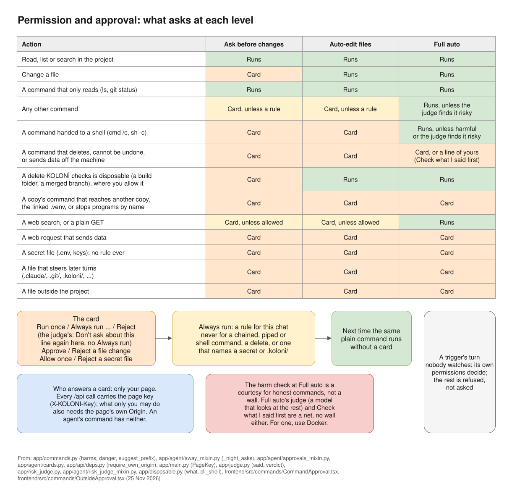

# Permission levels

The permission level decides what agents may do without asking you first. It stands in the message box's
row as three comb cells and its name (**Ask** one cell, **Auto-edit** two, **Full auto** three): a click
lists the levels, each with a line on what it does - Ask before changes: "Each file change and command waits
for your card"; Auto-edit files: "Writes files at once (revertible); commands still ask"; Full auto: "Changes
and commands run; only harmful or risky actions ask" - **Plan first**, and in a project's chat **Test and
review changes** ([what KOLONİ checks after a change](checked.md#for-one-chat), on or off for this chat; off, the
level says "· no checks"). Each chat has its own level.

| Level | In short |
|---|---|
| **Ask before changes** | Each file change and each command waits for your card. |
| **Auto-edit files** | File changes are written at once and can be reverted. Commands still ask. |
| **Full auto** | Changes and commands run without asking. Only harmful or risky actions still ask. |

## What asks at each level

"Card" means the agent stops and waits until you answer on a card in the chat.
"Runs" means it goes ahead without asking.

*The levels at a glance; the table below has every case.*

| Action | Ask before changes | Auto-edit files | Full auto |
|---|---|---|---|
| Reading, listing or searching files in the project | Runs | Runs | Runs |
| Changing a file | Card | Runs | Runs |
| A command that only reads, such as `cat`, `ls` or `git status` | Runs | Runs | Runs |
| Any other command | Card, unless a rule covers it | Card, unless a rule covers it | Runs |
| A command that keeps running, such as a dev server | Card, every time | Card, every time | Runs |
| A command that deletes, cannot be undone, or sends data off the machine (`rm -rf`, `git reset --hard`, `git push --force`, `scp`, a `curl` that posts data, …) | Card | Card | Card, unless [Check what I said first](#check-what-i-said-first) finds a line of yours that names it |
| A delete KOLONİ checks is disposable - a build folder git ignores, a clean worktree of yours, a merged branch - where you allowed [such deletes](#disposable-deletes) | Card | Runs | Runs |
| A command handed to a shell (`cmd /c`, `powershell -c`, `sh -c`) | Card, every time | Card, every time | Runs, unless what it runs is harmful |
| Reading a secret file (`.env`, keys, …) | Card | Card | Card |
| A command that names a secret file, or searches a folder that holds one | Card | Card | Card |
| Writing a file that steers agents' later turns (`.claude/`, `.codex/`, `.git/`, `.github/`, `.vscode/`, `.mcp.json`, …) | Card | Card | Card |
| Writing `AGENTS.md`, `CLAUDE.md` or `GEMINI.md` | Card | Card | Runs |
| Writing in the folder's `.koloni/` | Card | Card | Card |
| A web search | Card, unless you allowed searching in this chat | Card, unless you allowed searching in this chat | Runs |
| A web request that only fetches a page (a plain GET) | Card, unless you allowed that site | Card, unless you allowed that site | Runs |
| Any other web request (one that sends data) | Card | Card | Card |
| A tool of an MCP server you have not trusted yet | Card | Card | Card |
| A tool of a trusted MCP server | Card, unless the tool is set to run without asking | Card, unless the tool is set to run without asking | Card, unless the tool is set to run without asking |
| A file outside the project | Card | Card | Card |
| A change in a folder added to the chat for reading only | Card | Card | Card |
| A command that stops programs by their name (`taskkill /IM`, `pkill`, `killall`, `Stop-Process -Name`), or looks a process up and stops it | Card | Card | Card (in the project, **Check what I said first** may let it run, but never for python, node, uvicorn, an agent's CLI, a filter, a wildcard, `kill -1` or a process looked up) |
| A sub-agent's command in its copy that names another agent's copy, a worktree of the project or a place above its copy (`../..`), or writes in or installs into the linked `node_modules`, `.venv` or `venv` | Card | Card | Card |

A plain `git` command counts as read-only only when it runs at the top of the project and the
project holds no secret file.

The secret-file rows have exceptions for CLIs run with their own tools (Codex's own safe commands,
agy's reads): see [Known limits](../reference/known-limits.md#secrets).

## The cards

<video src="../videos/approval.webm" poster="../../videos/approval.jpg" controls muted loop playsinline preload="none" style="width: 100%; height: auto" aria-label="Video: at Ask before changes the Orchestrator asks to run python check.py, and Run once lets it run"></video>

*An agent asks, you approve: **Run once** on its card, and the turn goes on.*

- **A file change** shows the diff, with **Approve** and **Reject**. After it is written you can
  still **Revert** it.
- **"Run this command?"** offers **Run once**, **Always run …** and **Reject**. **Always run**
  keeps a rule for this chat, so the same kind of command runs without a card next time. Some
  commands never get a rule; their card says "This command is asked every time." A rejected command
  ends that one action, not the task. If you reject a command that writes a file or applies a patch,
  the agent is told to make the change with its file tools instead, so it comes to you as a file change.
- A delete KOLONİ found disposable also offers **Allow such deletes in this project**
  (see [Disposable deletes](#disposable-deletes)).
- **"Search the web?"** offers **Search once**, **Always allow searching in this conversation**
  and **Reject**.
- **"Make this request?"** offers **Send once**, **Always allow GET to …** (for that site) and
  **Reject**.
- **"Read a secret file?"** offers **Allow once** and **Reject**. There is no rule for secret files.
- **"Read outside the project?"** offers **Allow once**, **Allow reading this folder**, **Allow changes in
  this folder** and **Reject**.
- When an agent wants another folder, **"Add a folder to this chat?"** offers **Add to this chat**,
  **This time** and **Reject**.
- An MCP tool asks with **Allow** and **Reject**.

You can see and remove the rules you made under Settings › This project › **Runs without asking**.

## What a rule never covers

**Always run** is offered only for plain commands. It is never offered, and never matches, for:

- a command that is chained, piped or redirected, or handed to a shell or another program;
- a command that deletes or cannot be undone;
- a command that names a secret file, `.koloni/`, or a file that steers agents.

Below Full auto, a command that keeps running (a server) asks every time, even with a rule.

## Disposable deletes

Some deletes KOLONİ can check by itself. Where you allow them - Settings › This project › Asking and
away › **Agents may delete what is disposable without asking**, or **Allow such deletes in this
project** on the card of one - they run without a card at **Auto-edit files** and **Full auto**, in
a chat you started, and the command's row says "Ran without asking · disposable: …":

- a build or cache folder (`build`, `dist`, `__pycache__`, `.pytest_cache`, `.ruff_cache`,
  `.mypy_cache`, `coverage`, `.next`, `.turbo`, `target`) below where the command runs, spelt as the
  folder is on disk, that git ignores and that holds no file git tracks or would take (in any case of
  its letters), no link and no repository of its own - not inside `node_modules`, `.venv`, `venv`, a
  folder whose name starts with a dot, KOLONİ's own, a folder git ignores, or another repository, a
  submodule or a worktree in the project; in the project, and in a sub-agent's copy;
- a worktree of yours that git lists, named with no link on the way, `..` only at its start and by
  no end of its path another worktree shares: not the main one, not locked, not one of KOLONİ's, on
  a branch, holding nothing its commits do not (a new or changed file, one marked skip-worktree or
  assume-unchanged - whatever `status.showUntrackedFiles` says - or a last commit on no branch, tag
  or remote), no link, no secret file and nothing git ignores but whole build and cache folders with
  no repository in them (git deletes what it ignores with the worktree);
- a local branch that neither the project, the turn nor any worktree stands on: with `-d`, git
  itself deletes only one it finds merged; with `-D`, only one whose commits the default branch has.
  Never the default branch, `main` or `master`, nor KOLONİ's `koloni/…` ones.

Worktrees and branches go this way only from the project itself (the Orchestrator), never from a
copy, and only run in the project's top folder or a plain folder in it - not in another repository,
a submodule or a worktree inside the project, nor through a link.

Only such a delete alone on its line counts, written the way the shell it runs in reads it:

- **PowerShell** - KOLONİ's own commands on Windows, and Claude Code's PowerShell tool: `Remove-Item`
  or its aliases (`rm`, `ri`, `del`, `erase`) with `-Recurse` (or `-r`), `-Force` (`-fo`) if you like,
  and one path: `Remove-Item -Recurse dist`, `rm -r build`, `ri -r -Force build`. `rm -rf build` is
  not disposable there: PowerShell refuses `-rf` and deletes nothing, so it keeps its card.
- **sh** - KOLONİ's own commands on Linux and macOS and in Docker, and Claude Code's Bash tool (Git
  Bash on Windows): `rm` with `-r`, `-R` or `-rf`, `-f` / `--force` if you like: `rm -rf build dist`.
- **git**, in every shell: `git worktree remove ../wt/x`, `git branch -d old`.

Codex, agy and Qoder do not say which shell their command runs in, so their delete of a folder keeps
its card. A disposable delete that ran and then failed says so on its row: "Ran without asking as
disposable (…) and failed: exit 1". Anything else on the line, a forced worktree
remove, a path above the folder or with a link in it, a line the shell continues, a command of a CLI
whose folder KOLONİ does not know or that its model names, and any of GitHub Copilot CLI's own
commands (it has no sandbox) asks as before. A delete whose folder changed
between KOLONİ's look and its run - a card of the turn was answered meanwhile - asks too. At
**Ask before changes**, in a turn nobody watches,
a side of a comparison, a To-do task's turn and a job while you are away, every delete asks or waits
as before. No **Always run** rule covers a delete either way.

## Sub-agents

Sub-agents work in a working copy of your project, not in your folder. Their edits there never
get a card, at any level. You decide once, when their work comes back:

- At **Ask before changes**, a card asks whether to take their changes into the project.
- At **Auto-edit files** and **Full auto**, the changes come in without a card when the sub-agent
  finished, its changes do not clash with yours, and the project's test passed (if you set one
  under Settings › This project › Checks and git). Otherwise a card asks.
- At **Full auto**, if the test fails, the work goes back to the Orchestrator a few times before the card
  asks you.

Files that steer agents are held for your card at every level.

Whether opening a sub-agent asks first is set under Settings › This project › Asking and away ›
**Opening a sub-agent**: **Ask when it matters** (the default: a card at Ask before changes when
the sub-agent can change things), **Always ask** or **Never ask**.

## Check what I said first

In the level menu, under the levels, **Check what I said first** is the project's switch (Settings
› This project › Asking and away › **A harmful-looking command at Full auto**): "Before a
harmful-looking command waits for you at Full auto or while you're away, your own words are read
first; it runs without a card only where a line of yours names it." It is off (**Ask me**) until you
turn it on.

At Full auto, in a chat you started, a command that deletes, overwrites or sends something off this
machine would wait for you on a card. With the switch on, the first model of your Fast tier first reads
your preferences, this project's rules as saved on the [Memory](../memory.md) page and your own
messages in the chat - never anything an agent wrote - and then:

- A whole line of yours that names the command and what it touches ("You may delete build/ and
  dist/."), and forbids nothing and sets no condition: the command runs without a card. Its row says
  "Ran without asking · your rule: …" with where the line is (Your preferences, This project's rules
  or your message).
- A whole sentence of yours that forbids it ("Never push to main."): it is not run and opens no card.
  The agent is told that sentence (for a sentence in a message of yours, only that one of yours
  forbids it - the sentence stays with you), and not to run it or anything that does the same again,
  and goes on with the rest of its task. Its row says "Not run · your rule: …".
- A sentence that sets a condition or asks to be asked ("unless", "ask me before"), or nothing of
  yours that covers it: the card, as before. Its card then says "Nothing you said covers this."

A command that ran or was not run this way also waits under **Decided for you** until you press
**OK**. After 3 such refusals in a row, or 10 in one turn, KOLONİ says so in the chat and the rest of
that turn asks you on a card. Secret files, `.koloni`, files that steer later turns, paths outside the
folder, a delete or a send of the whole folder, and a CLI's command whose folder KOLONİ does not know
are always asked; anything that goes wrong (no Fast model, over the budget, a slow or unreadable
answer) opens the card as before. Each such command is one request of your Fast tier's first model.

While you're away it holds in a
To-do task's chat at Full auto too, reading the chat you went away from - never the task's words -
for a one-line delete in the task's copy only: a command of more than one line or continued, a send,
a git remote's branch, Docker's prune or volumes, a file that steers agents and a command that runs
another through a shell or a wrapper keep their card. The
same holds in the chat you went away from, while you're away. A plain chat has no such switch.

## Plan first

With **Plan first** on, each new message first gets a plan to approve. While it plans, an agent
can only read, search and ask you. It cannot write or run anything, at any level.

## Turns nobody watches

A turn started by a trigger has nobody to ask. There the permission level and your rules do not
count. The trigger's own permissions decide, and anything they do not allow is refused, not
asked - except the project's own test command, which runs even when it is not ticked. Secret files, files that steer agents, files outside the project and MCP tools are always
refused in such a turn. See [Triggers](../automation/triggers.md).

## Choosing a level

- Start with **Ask before changes** in a project you care about. You see every change before it
  is made.
- **Auto-edit files** suits work you review afterwards. Changes can be reverted, and commands
  still ask.
- **Full auto** is for work you are ready to let run. Harmful commands and risky files still ask,
  but everything else runs. A script that opens `.env` without naming it can still read it, unless
  KOLONİ's own commands run in Docker (Settings › This project › Commands and secrets) or Copilot's
  sandbox is on; a CLI run **Native** runs its commands on this machine, outside Docker.
