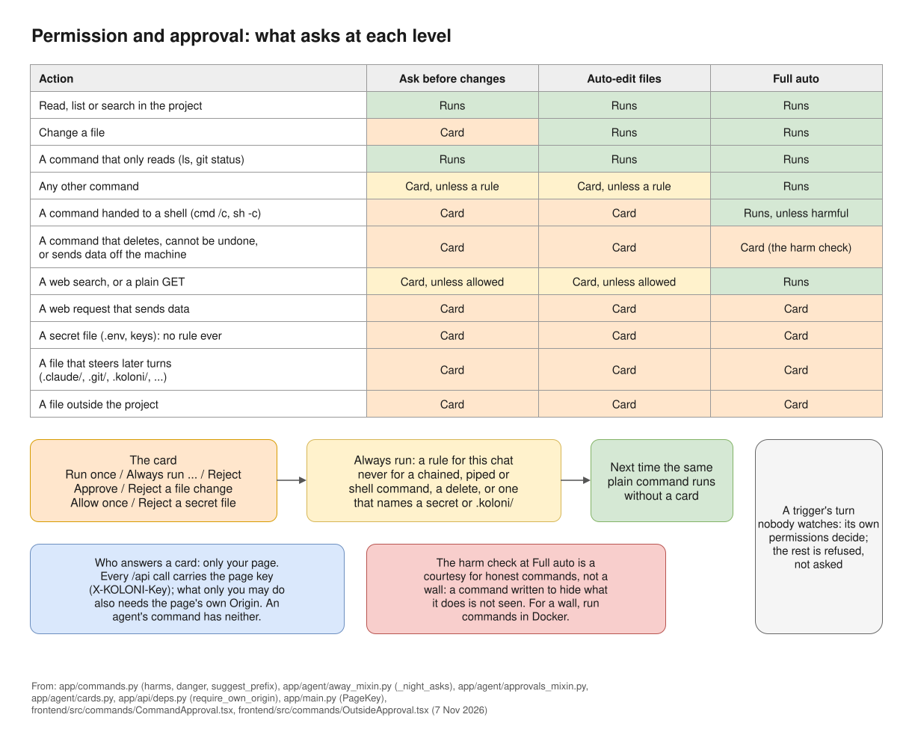

# Permission levels

The permission level decides what agents may do without asking you first. You pick it in the
menu next to the message box. Each chat has its own level. The box shows the short name (**Ask**,
**Auto-edit** or **Full auto**); its tooltip says the full one.

| Level | In short |
|---|---|
| **Ask before changes** | Each file change and each command waits for your card. |
| **Auto-edit files** | File changes are written at once and can be reverted. Commands still ask. |
| **Full auto** | Changes and commands run without asking. Only harmful or risky actions still ask. |

## What asks at each level

"Card" means the agent stops and waits until you answer on a card in the chat.
"Runs" means it goes ahead without asking.

*The levels at a glance; the table below has every case.*

| Action | Ask before changes | Auto-edit files | Full auto |
|---|---|---|---|
| Reading, listing or searching files in the project | Runs | Runs | Runs |
| Changing a file | Card | Runs | Runs |
| A command that only reads, such as `cat`, `ls` or `git status` | Runs | Runs | Runs |
| Any other command | Card, unless a rule covers it | Card, unless a rule covers it | Runs |
| A command that keeps running, such as a dev server | Card, every time | Card, every time | Runs |
| A command that deletes, cannot be undone, or sends data off the machine (`rm -rf`, `git reset --hard`, `git push --force`, `scp`, a `curl` that posts data, …) | Card | Card | Card |
| A command handed to a shell (`cmd /c`, `powershell -c`, `sh -c`) | Card, every time | Card, every time | Runs, unless what it runs is harmful |
| Reading a secret file (`.env`, keys, …) | Card | Card | Card |
| A command that names a secret file, or searches a folder that holds one | Card | Card | Card |
| Writing a file that steers agents' later turns (`.claude/`, `.codex/`, `.git/`, `.github/`, `.vscode/`, `.mcp.json`, …) | Card | Card | Card |
| Writing `AGENTS.md`, `CLAUDE.md` or `GEMINI.md` | Card | Card | Runs |
| Writing in the folder's `.koloni/` | Card | Card | Card |
| A web search | Card, unless you allowed searching in this chat | Card, unless you allowed searching in this chat | Runs |
| A web request that only fetches a page (a plain GET) | Card, unless you allowed that site | Card, unless you allowed that site | Runs |
| Any other web request (one that sends data) | Card | Card | Card |
| A tool of an MCP server you have not trusted yet | Card | Card | Card |
| A tool of a trusted MCP server | Card, unless the tool is set to run without asking | Card, unless the tool is set to run without asking | Card, unless the tool is set to run without asking |
| A file outside the project | Card | Card | Card |
| A change in a folder added to the chat for reading only | Card | Card | Card |

A plain `git` command counts as read-only only when it runs at the top of the project and the
project holds no secret file.

The secret-file rows have exceptions for CLIs run with their own tools (Codex's own safe commands,
agy's reads): see [Known limits](../reference/known-limits.md#secrets).

## The cards

<video src="../videos/approval.webm" poster="../../videos/approval.jpg" controls muted loop playsinline preload="none" style="width: 100%; height: auto" aria-label="Video: at Ask before changes the Orchestrator asks to run python check.py, and Run once lets it run"></video>

*An agent asks, you approve: **Run once** on its card, and the turn goes on.*

- **A file change** shows the diff, with **Approve** and **Reject**. After it is written you can
  still **Revert** it.
- **"Run this command?"** offers **Run once**, **Always run …** and **Reject**. **Always run**
  keeps a rule for this chat, so the same kind of command runs without a card next time. Some
  commands never get a rule; their card says "This command is asked every time." A rejected command
  ends that one action, not the task. If you reject a command that writes a file or applies a patch,
  the agent is told to make the change with its file tools instead, so it comes to you as a file change.
- **"Search the web?"** offers **Search once**, **Always allow searching in this conversation**
  and **Reject**.
- **"Make this request?"** offers **Send once**, **Always allow GET to …** (for that site) and
  **Reject**.
- **"Read a secret file?"** offers **Allow once** and **Reject**. There is no rule for secret files.
- **"Read outside the project?"** offers **Allow once**, **Allow reading this folder**, **Allow changes in
  this folder** and **Reject**.
- When an agent wants another folder, **"Add a folder to this chat?"** offers **Add to this chat**,
  **This time** and **Reject**.
- An MCP tool asks with **Allow** and **Reject**.

You can see and remove the rules you made under Settings › This project › **Runs without asking**.

## What a rule never covers

**Always run** is offered only for plain commands. It is never offered, and never matches, for:

- a command that is chained, piped or redirected, or handed to a shell or another program;
- a command that deletes or cannot be undone;
- a command that names a secret file, `.koloni/`, or a file that steers agents.

Below Full auto, a command that keeps running (a server) asks every time, even with a rule.

## Sub-agents

Sub-agents work in a working copy of your project, not in your folder. Their edits there never
get a card, at any level. You decide once, when their work comes back:

- At **Ask before changes**, a card asks whether to take their changes into the project.
- At **Auto-edit files** and **Full auto**, the changes come in without a card when the sub-agent
  finished, its changes do not clash with yours, and the project's test passed (if you set one
  under Settings › This project › Checks and git). Otherwise a card asks.
- At **Full auto**, if the test fails, the work goes back to the Orchestrator a few times before the card
  asks you.

Files that steer agents are held for your card at every level.

Whether opening a sub-agent asks first is set under Settings › This project › Asking and away ›
**Opening a sub-agent**: **Ask when it matters** (the default: a card at Ask before changes when
the sub-agent can change things), **Always ask** or **Never ask**.

## Plan first

With **Plan first** on, each new message first gets a plan to approve. While it plans, an agent
can only read, search and ask you. It cannot write or run anything, at any level.

## Turns nobody watches

A turn started by a trigger has nobody to ask. There the permission level and your rules do not
count. The trigger's own permissions decide, and anything they do not allow is refused, not
asked - except the project's own test command, which runs even when it is not ticked. Secret files, files that steer agents, files outside the project and MCP tools are always
refused in such a turn. See [Triggers](../automation/triggers.md).

## Choosing a level

- Start with **Ask before changes** in a project you care about. You see every change before it
  is made.
- **Auto-edit files** suits work you review afterwards. Changes can be reverted, and commands
  still ask.
- **Full auto** is for work you are ready to let run. Harmful commands and risky files still ask,
  but everything else runs. A script that opens `.env` without naming it can still read it, unless
  KOLONİ's own commands run in Docker (Settings › This project › Commands and secrets) or Copilot's
  sandbox is on; a CLI run **Native** runs its commands on this machine, outside Docker.
