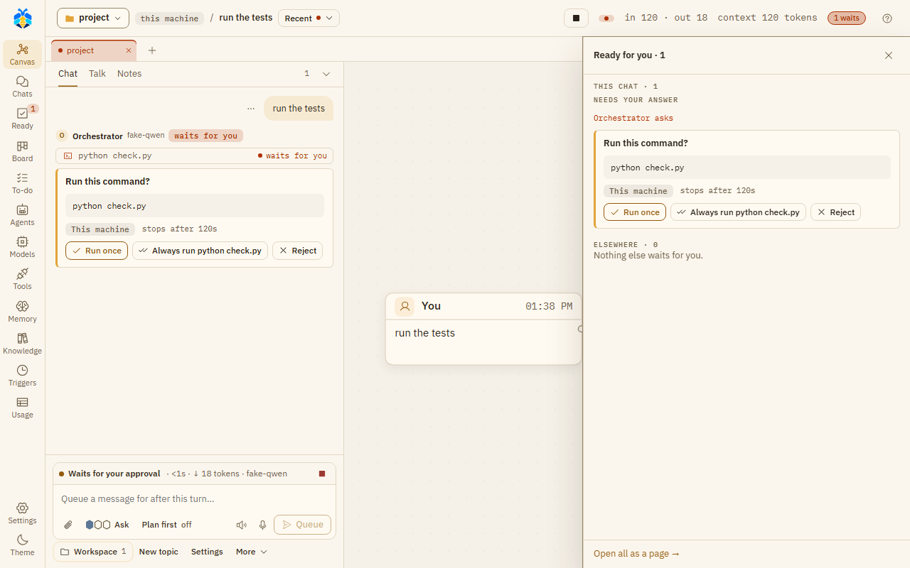

# Ready and approval cards

Everything that waits for your word is in one place: **Ready for you**. Each item is a card with its
own buttons. You answer it there, or in the chat where it was asked. Since 0.1.10 the page is also
where your [To-do](../automation/todo.md) is: what was done and what waits for you on the left, your
stories and tasks on the right.

Every card has the same shape: a title that says what is asked or told, one sentence on what and why,
the buttons, and a folded **Details** with the longer notes on what the buttons do. A warning about what
something runs, sends or spends is never folded. A card that asks has a honey edge; a card that only
tells you something (such as a turn that failed) has a grey one. The same act has the same word on every card: **Take in** brings work into the project, **Approve**
says yes to a proposal, and **Reject** says no. **Discard** deletes kept work and **Not now** puts a
question off.

## Where you see what waits

- **Ready** on the left rail. When something waits, it shows the count. Its page has the night's
  report, what waits for your word and **Decided for you** - what was decided for you in the project,
  with **OK** and **Change** (see [Decisions](decisions.md)) - on the left, and To-do on the right.
- **The pill in the top bar**, such as "2 wait". It opens the **Ready for you** panel. When nothing
  waits but things were decided for you, it says how many wait for your OK in the project ("5 decided"),
  the count **Not seen** lists - or, in a chat with no folder, in that chat.
- **In the chat**, where the card was asked. A closed chat's line says how many wait for you, and a
  chat says under its message box when more wait elsewhere ("2 more wait elsewhere").
- Ctrl+K lists **Ready for you** too, and **To-do (on Ready for you)**, which brings To-do into view.

### The panel

The **Ready for you** panel opens from the right. Esc closes it.

- **This chat** lists what waits in the open chat in two parts: **Needs your answer** (questions and
  approvals) and **Ready to take in** (work in a copy), then one line on what was decided for you in
  the project and waits for your OK - the pill's count, **Not seen**'s -, with **Open in Ready for you**.
  What was decided is not counted with what waits.
- **Elsewhere** lists what waits in other chats, the To-do list, memory and work while you're away.
- **Open all as a page →** opens the Ready page.

<video src="../videos/ready.webm" poster="../../videos/ready.jpg" controls muted loop playsinline preload="none" style="width: 100%; height: auto" aria-label="Video: two chats wait; the pill opens Ready for you, Run once answers this chat, the page lists the other, and Open chat answers it there"></video>

*Ready for you: the panel answers this chat, the page goes to another.*

*An approval card under **This chat** in the **Ready for you** panel, and the same card in the chat.*

### The page

**Ready for you** is one page in two halves: on the left, what was done and what waits for you; on the
right, [To-do](../automation/todo.md). On a wide screen they stand side by side, each scrolling by
itself; on a narrow one To-do comes under the rest.

*The morning: the night's report and what waits on the left, To-do on the right.*

The left half, from the top:

- **The greeting** and one line: how many things wait for your word, and how many decisions were made
  for you since you left.
- **What was done**: the report of the project's last [☾ Away](../automation/overnight.md) - while it
  works, and once it has ended. One sentence says how it went ("2 of 3 jobs done, 1 could not be
  done."), then a row for each job: its [cell](#the-cells), its name, what came of it, its branch and
  checks, and what you can do about it - **Take in**, **Try again**, **Open its chat**. What a job asks
  is answered on its card, under **Waiting for your word**. Once the night has ended, a lane for each
  job on the night's clock, the decisions made for you on its lane, **Not checked**, how many were
  decided for you on its jobs (**See them** opens them under **Decided for you**), what it spent, **The whole
  report** and **Copy report as Markdown** - see
  [The night on Ready for you](../automation/overnight.md#the-night-on-ready-for-you). With no night,
  or one you have seen that ended more than a day ago, this is one line: "Nothing new since you last
  looked" - with **The whole report** of that night, where there is one. Where the record says why the
  night ended (its money limit, its time, **Stop all**), the report says it too. KOLONİ opened after a night opens on this page, until the night has been on screen - not
  where you opened another page before it was read.
- **Waiting for your word**: everything that waits, oldest first - what the night parked for you
  first -, in one list. Each row starts with its cell and says what it is - **Push**, **Parked
  command**, **Question**, **Command**, **Proposed task**, **Done?**, **Memory proposal**,
  **Ready to take in** and so on - and whose: a chat's row names its agent, "Coder asks" for its own
  question or request, "for Coder" on KOLONİ's own card about it, such as its step limit or its work
  waiting for **Take in**. Each says how long it has waited, and has **Open chat** to go to its chat.
  The buttons over the list show one kind at a time: **All**, **Chats**, **To-do**, **Memory**,
  **Last night** and **Other folders**. When new To-do tasks are proposed, **Approve all** approves
  them one by one.
- **Decided for you**: the project's decisions, with **OK** and **Change** - see
  [Decisions](decisions.md).

The right half is [To-do](../automation/todo.md): each story a card, a story opened in a panel over
it, and the rough note the Hive keeper splits into tasks.

### The cells

A small hexagon - a cell of the hive - says how a thing stands, the same way in the report, in
**Waiting for your word** and on To-do. Its colour never says it alone: a word stands beside it, and
the cell's own name (its tooltip, and what a screen reader says) is its state.

| Cell | Means |
|---|---|
| Green, full | done |
| Honey, full | at work |
| Honey rim, lightly filled | waits for your word |
| Red-orange, full | stuck: it could not be done, or is blocked |
| Empty | queued, not started, or stopped |
| A thin rim | proposed |

To-do lists them under its cards.

What waits:

- **Chat cards** from every chat, including chats in other folders.
- **To-do** decisions: a new task (**Add to To-do** / **Edit** / **Not wanted**), a "done?" (**Done** / **Not yet**),
  or a change (**Change** / **Reject**). New tasks include the
  [Scout](../automation/todo.md#follow-up-tasks)'s suggestions after a turn. At Full auto, a task
  the Orchestrator added for you is under **Decided for you** (**OK** / **Change → Reject**): it does
  not start until you press **OK**.
- **Memory** proposals (**Approve**, **Approve as edited**, **Reject**) and suggested preferences
  (**Add** / **Reject**). See [Memory](../memory.md).
- **Last night**: what the night's jobs parked for you, and the jobs that wait. A job's push comes first:
  **Push** - **Push and open PR** where the project's way is a pull request - or **Not now**; where
  KOLONİ notes something first, its notes and **Push anyway**. Then each command it parked, **Run** or **Reject**, and each question, its answer - the rows
  of [Waiting for you](../automation/overnight.md#waiting-for-you), decided only once you are back and
  the job is not at work; a row that cannot be decided now says why. A job that waits for something
  else is answered in its chat (**Open its chat to answer**).

A Project notes offer or the Orchestrator's Go away line waits only in its own chat unless that
chat has something else waiting.

## The "Teams' work is ready" card

When a team's recipe has finished, its work waits in a working copy. The **Teams' work is ready** card
asks once whether to take it into the project. In the chat it is one line, such as "Teams' work is ready ·
Web app 3 files". It can also say that a team failed or stopped.

| Button | What it does |
|---|---|
| **Take in** | Brings the work into your project. |
| **Fix the findings** | Takes the work in, then has a Coder fix what the reviewers found. Shown only when findings were left and the team has a Coder. |
| **Ask for changes** | Opens "What to change (optional)…". The work goes back to its loop, with your words added to the next agent's task. |

The card does not ask:

- at **Full auto**, when nothing failed or went unchecked: the work is taken in by itself;
- when the work changed nothing;
- at any level - Auto-edit and Ask too - when KOLONİ's checks left it failing or a Reviewer still
  holds it after the fix rounds: the work stays in its copy, and the turn's **Checked** section
  says "Not taken in" with **Take in anyway** (no look first) and **Fix it** (its turn checks and
  looks at the whole kept work again) ([docs](checked.md#a-stronger-model)).

On the canvas the same card is a box titled **Ready for you**. **Open the list →** opens the panel.

## The kinds of card

| Card | Buttons | When |
|---|---|---|
| **Run this command?** | **Run once**, **Always run …**, **Reject** | Before an agent's command runs. |
| A file change (the file's name and lines changed) | **View diff**, **Approve**, **Reject**; after: **Revert** | An agent wants to write a file. |
| **Search the web?** | **Search once**, **Always allow searching in this conversation**, **Reject** | Before a web search. |
| **Make this request?** | **Send once**, **Always allow GET to …**, **Reject** | Before a web request. |
| **Open this site?** | **This time**, **Allow this site**, **Reject** | An agent's browser would open a site. |
| **Send this form?**, **Click this?**, **Type into this field?**, **Type into a password field?** | **Yes, this once**, **Reject** | A form, sign-in or payment step in an agent's browser. Asked every time. |
| **Read outside the project?** (or **Change …**, **Run a command outside the project?**) | **Allow once**, **Allow reading this folder**, **Allow changes in this folder**, **Reject** | A path outside the project. |
| **Read a secret file?** (or **Read this computer's settings?**) | **Allow once**, **Reject** | Reading a `.env` file, a key or a similar file, or a CLI's own settings folder. |
| **Add a folder to this chat?** | **Add to this chat**, **This time**, **Reject** | An agent asks for another folder. |
| **Give a secret to its commands?** | a hidden field, **Give**, **Reject** | An agent asks for a key by name. The value goes only into the environment of that turn's commands; the model, the chat and the record never get it. See [Security model](../security/model.md#secrets). |
| **Open this sub-agent?** | **Open agent**, **Reject** | Before a sub-agent starts, when your settings ask. Also when KOLONİ would move an agent to a provider that is paid per token. |
| **Create this role?** | **Create role**, **Reject** | An agent proposes a new role. |
| **Add this skill?** | **Add skill**, **Reject** | An agent proposes a skill. |
| **Approve this plan?** | **Approve**, **Edit**, **Reject** | With Plan first on. See [Plan first](plan-first.md). |
| **Take in …'s work?** | **Take in** (or **Merge**, **Open pull request**), **Discard** | A sub-agent's work waits in its working copy. |
| An agent's question itself, saying who asks (**Orchestrator asks**, **Coder asks**), or a title of KOLONİ's own such as **Allow this?** or **Go on with the recipe?** (**KOLONİ asks**), with its words whole under it | its own options, or **Or answer in your own words…** | An agent, or KOLONİ, asks you a question. KOLONİ's **Deny** is shown as **Reject**. A question KOLONİ did not put to you (your message was waiting, or it offered **Take in**) is a row in the chat, "Wanted to ask: … · not asked"; open it for why. |
| **Add to Project notes?** | ticks, **Add**, **Not now** | After a turn found things worth noting. It never holds the turn. |
| **☾ Go away now?** | **Go away**, **Change** | The Orchestrator put work on To-do and offers to go away; nothing starts before Go away. |
| **Decided for you** (on the Ready for you page; a chat with no folder: **Decided for you while you were away**) | **OK**, or **Change →** another answer - **Change and redo →** once the agent that asked has finished | The Orchestrator answered for you (see [Answering for you](../automation/answering-for-you.md)), KOLONİ's judge refused a command, or [Check what I said first](permissions.md#check-what-i-said-first) ran a command without a card, or did not run it, on a line of yours (**OK**). See [Decisions](decisions.md). |
| **Go on past its step limit?** | **Continue (+*N* steps)**, **Stop here** | An agent came to its step limit before its work was done. See [Step limits](../agents/step-limits.md). |
| "*Model* has not answered for 5 min. Keep waiting, or stop this turn and pick another model?" | **Keep waiting**, **Stop and pick another model** | The Orchestrator's model said nothing for 5 minutes in a turn you started. See [Step limits](../agents/step-limits.md#when-the-orchestrators-model-is-slow-to-answer). |

See [Permission levels](permissions.md) for when each card is asked.

### Cards that only tell

These have a grey edge. Nothing waits on them.

| Card | Buttons | When |
|---|---|---|
| **Text tried to give orders** | **False alarm** | Text from outside (a web page, an MCP tool's result, a file, another agent's message) looks like it tries to give the agent orders. It names the rule that matched, never the text. The agent was already told to take it as data; nothing was held back. **False alarm** is counted for that rule. See [Outside content](../security/model.md#outside-content). |
| **Not all of …'s work reached the project** | none | Some of an agent's changes did not come in. Each file says why. |

## When a turn ends, stops, or KOLONİ restarts

- When a turn ends or you stop it, its open questions are cancelled, and commands, changes and web
  requests you did not decide are rejected. A recipe's working copy is kept, and waits under **Ready to
  take in**. An agent on a branch keeps its work committed there. See
  [When an agent stops](workspace.md#when-an-agent-stops).
- Under the Orchestrator's last answer of a turn that changed files, KOLONİ says where the work is,
  from its own records rather than the model's words: "In the project: server.py (+1 −1).", "Not in
  the project yet: server.py waits in Ready for you - Take in to apply it.", or "Nothing reached the
  project." The line is written when the turn ends: a copy you take in later does not change it.
- When KOLONİ starts again, work that was open is marked interrupted. Nothing is ever run again by
  itself: a message that was still queued says "Not sent: KOLONİ restarted", and runs only when you
  press its **Send**.
- A question that ended without an answer shows in the chat as "not answered".
