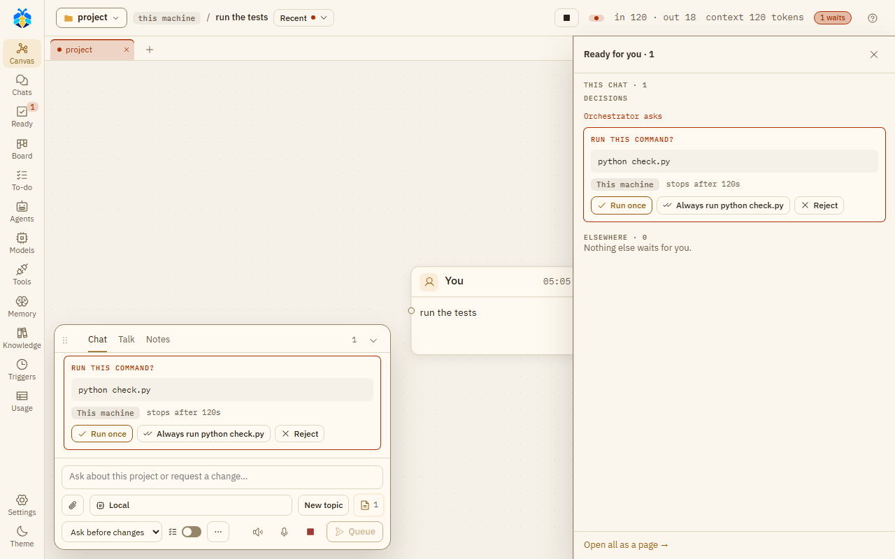

# Ready and approval cards

Everything that waits for your word is in one place: **Ready for you**. Each item is a card with its
own buttons. You answer it there, or in the chat where it was asked.

Every card has the same shape: a title that says what is asked or told, one sentence on what and why,
the buttons, and a folded **Details** with the longer notes on what the buttons do. A warning about what
something runs, sends or spends is never folded. A card that asks has a honey edge; a card that only
tells you something (such as **Decided for you while you were away**, or a turn that failed) has a grey
one. The same act has the same word on every card: **Take in** brings work into the project, **Approve**
says yes to a proposal, and **Reject** says no. **Discard** deletes kept work and **Not now** puts a
question off.

## Where you see what waits

- **Ready** on the left rail. When something waits, it shows the count.
- **The pill in the top bar**, such as "2 wait". It opens the **Ready for you** panel. When nothing
  waits but the Orchestrator decided things for you in this chat, the pill says how many it decided.
- **In the chat**, where the card was asked. A closed chat's line says how many wait for you, and a
  chat says when more wait elsewhere.
- Ctrl+K lists **Ready for you** too.

### The panel

The **Ready for you** panel opens from the right. Esc closes it.

- **This chat** lists what waits in the open chat in three parts: **Needs your answer** (questions and
  approvals), **Ready to take in** (work in a copy), and **Told you** (what the Orchestrator decided
  for you). **Told you** is not counted with what waits.
- **Elsewhere** lists what waits in other chats, the To-do list, memory and work while you're away.
- **Open all as a page →** opens the Ready page.

<video src="../videos/ready.webm" poster="../../videos/ready.jpg" controls muted loop playsinline preload="none" style="width: 100%; height: auto" aria-label="Video: two chats wait; the pill opens Ready for you, Run once answers this chat, the page lists the other, and Open chat answers it there"></video>

*Ready for you: the panel answers this chat, the page goes to another.*

*An approval card under **This chat** in the **Ready for you** panel, and the same card in the chat.*

### The page

The Ready page lists everything that waits, oldest first, under **Needs your answer** and **Ready to
take in**, with the open chat's **Told you** last. The buttons at the top show one kind at a
time: **All**, **Chats**, **To-do**, **Memory**, **While away** and **Other folders**. Each row says where it
comes from and how long it has waited, and has **Open chat** to go to its chat. When new To-do tasks
are proposed, **Approve all** approves them one by one.

What waits:

- **Chat cards** from every chat, including chats in other folders.
- **To-do** decisions: a new task (**Add** / **Edit** / **Reject**), a "done?" (**Done** / **Not yet**),
  or a change (**Change** / **Reject**). New tasks include the
  [Assistant PO](../automation/todo.md#follow-up-tasks)'s suggestions after a turn. At Full auto, a task
  the Orchestrator added for you waits as "Added for you" (**OK** / **Reject**): it does not start until
  you press **OK**.
- **Memory** proposals (**Approve**, **Approve as edited**, **Reject**) and suggested preferences
  (**Add** / **Reject**). See [Memory](../memory.md).
- **While away**: jobs while you're away that wait. You answer it in its chat (**Open its chat to answer**).

A proposed trigger, a Project notes offer or a While you're away card waits only in its own chat unless that
chat has something else waiting.

## The "Teams' work is ready" card

When a team's recipe has finished, its work waits in a working copy. The **Teams' work is ready** card
asks once whether to take it into the project. In the chat it is one line, such as "Teams' work is ready ·
Web app 3 files". It can also say that a team failed or stopped.

| Button | What it does |
|---|---|
| **Take in** | Brings the work into your project. |
| **Fix the findings** | Takes the work in, then has a Coder fix what the reviewers found. Shown only when findings were left and the team has a Coder. |
| **Ask for changes** | Opens "What to change (optional)…". The work goes back to its loop, with your words added to the next agent's task. |

The card does not ask:

- at **Full auto**, when nothing failed or went unchecked: the work is taken in by itself;
- when the work changed nothing.

On the canvas the same card is a box titled **Ready for you**. **Open the list →** opens the panel.

## The kinds of card

| Card | Buttons | When |
|---|---|---|
| **Run this command?** | **Run once**, **Always run …**, **Reject** | Before an agent's command runs. |
| A file change (the file's name and lines changed) | **View diff**, **Approve**, **Reject**; after: **Revert** | An agent wants to write a file. |
| **Search the web?** | **Search once**, **Always allow searching in this conversation**, **Reject** | Before a web search. |
| **Make this request?** | **Send once**, **Always allow GET to …**, **Reject** | Before a web request. |
| **Open this site?** | **This time**, **Allow this site**, **Reject** | An agent's browser would open a site. |
| **Send this form?**, **Click this?**, **Type into this field?**, **Type into a password field?** | **Yes, this once**, **Reject** | A form, sign-in or payment step in an agent's browser. Asked every time. |
| **Read outside the project?** (or **Change …**, **Run a command outside the project?**) | **Allow once**, **Allow reading this folder**, **Allow changes in this folder**, **Reject** | A path outside the project. |
| **Read a secret file?** (or **Read this computer's settings?**) | **Allow once**, **Reject** | Reading a `.env` file, a key or a similar file, or a CLI's own settings folder. |
| **Add a folder to this chat?** | **Add to this chat**, **This time**, **Reject** | An agent asks for another folder. |
| **Give a secret to its commands?** | a hidden field, **Give**, **Reject** | An agent asks for a key by name. The value goes only into the environment of that turn's commands; the model, the chat and the record never get it. See [Security model](../security/model.md#secrets). |
| **Open this sub-agent?** | **Open agent**, **Reject** | Before a sub-agent starts, when your settings ask. Also when KOLONİ would move an agent to a provider that is paid per token. |
| **Create this role?** | **Create role**, **Reject** | An agent proposes a new role. |
| **Add this skill?** | **Add skill**, **Reject** | An agent proposes a skill. |
| **Approve this plan?** | **Approve**, **Edit**, **Reject** | With Plan first on. See [Plan first](plan-first.md). |
| **Take in …'s work?** | **Take in** (or **Merge**, **Open pull request**), **Discard** | A sub-agent's work waits in its working copy. |
| An agent's question itself (**The agent asks**), or a title of KOLONİ's own such as **Allow this?** or **Go on with the recipe?** (**KOLONİ asks**), with its words whole under it | its own options, or **Or answer in your own words…** | An agent, or KOLONİ, asks you a question. KOLONİ's **Deny** is shown as **Reject**. |
| **Make this trigger?** | **Approve**, **Edit**, **Reject** | An agent proposes a trigger. |
| **Add to Project notes?** | ticks, **Add**, **Not now** | After a turn found things worth noting. It never holds the turn. |
| **While you're away** | **Start**, **Change the list**, **Not now** | The Orchestrator proposes work for while you are away. |
| **Decided for you while you were away** | **OK**, or **Change →** another answer | The Orchestrator answered for you. See Settings › This project › Asking and away › **When you're away**. |
| **Go on past its step limit?** | **Continue (+*N* steps)**, **Stop here** | An agent came to its step limit before its work was done. See [Step limits](../agents/step-limits.md). |

See [Permission levels](permissions.md) for when each card is asked.

### Cards that only tell

These have a grey edge. Nothing waits on them.

| Card | Buttons | When |
|---|---|---|
| **Text tried to give orders** | **False alarm** | Text from outside (a web page, an MCP tool's result, a file, another agent's message) looks like it tries to give the agent orders. It names the rule that matched, never the text. The agent was already told to take it as data; nothing was held back. **False alarm** is counted for that rule. See [Outside content](../security/model.md#outside-content). |
| **Not all of …'s work reached the project** | none | Some of an agent's changes did not come in. Each file says why. |
| **Nobody was here to ask** | **Allow this in the trigger** | A trigger's turn would have asked you. Each request was refused, and nothing was done in its place. **Allow this in the trigger** opens the trigger's form; saving it is yours. |

## When a turn ends, stops, or KOLONİ restarts

- When a turn ends or you stop it, its open questions are cancelled, and commands, changes and web
  requests you did not decide are rejected. A recipe's working copy is kept, and waits under **Ready to
  take in**. An agent on a branch keeps its work committed there. See
  [When an agent stops](workspace.md#when-an-agent-stops).
- Under the Orchestrator's last answer of a turn that changed files, KOLONİ says where the work is,
  from its own records rather than the model's words: "In the project: server.py (+1 −1).", "Not in
  the project yet: server.py waits in Ready for you - Take in to apply it.", or "Nothing reached the
  project." The line is written when the turn ends: a copy you take in later does not change it.
- When KOLONİ starts again, work that was open is marked interrupted. Nothing is ever run again by
  itself.
- A question that ended without an answer shows in the chat as "not answered".
