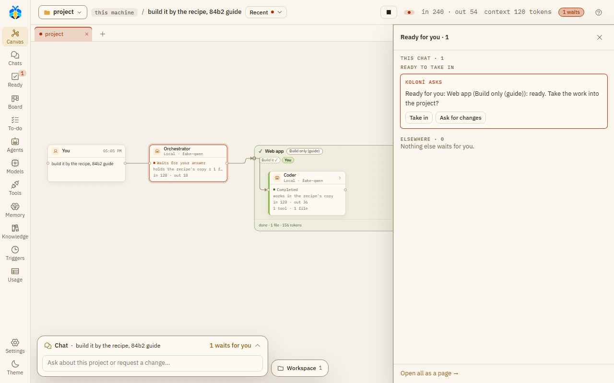

# Working copies and Take in

## The Workspace

The **Workspace** button opens "the project's files, what agents changed, wrote or showed, and what
waits for you".

- **Files**: the project's files. Open files show as tabs.
- **Changes**: what changed, sorted by what you have to do: **Waits for you**, **At work**, **Kept**,
  **In the project**, **Not by an agent**, **Needs a look**, and **Closed** (shut at first).
  Inside a group, each change sits under its agent and your message. Each file says in words what
  happened ("changed", "new", "deleted", "you said no"). With git, the tab shows this chat's work and
  what git sees changed since the last commit. Without git (or when git does not answer in time), it shows
  this chat's record and says so. The tab's count is git's (as in the top bar), or without git what is not
  closed.
  **Show folders as a tree** puts the files in their folders. When changes wait for you, it says how many
  and offers **Next waiting ▸**. A file that waits opens on its diff with **Approve** and **Reject**; one
  in the project offers **Revert**. An agent's copy opens on what it holds, with **Take in…** (or
  **Look**) to its card.
- **Previews**: dev servers agents started.
- **Working copies**: each sub-agent's copy ("*name*'s copy").

## Working copies

Each sub-agent changes files in its own copy of the project, outside your folder. Your folder does not
change until its work is taken in.

- `.git` and caches are not copied. `node_modules`, `.venv` and `venv` are linked, not copied.
- A project over 20,000 files or 500 MB gets no copy: the agent works in the project itself.
- When you and an agent changed the same file, KOLONİ merges line by line (for files up to 1 MiB).
- On Linux and macOS a copy keeps whether each file is runnable, so a script such as `./gradlew` still
  runs, and Take in carries that back to your project. A new file written with **Write files** gets your
  usual mode (`0644` with the common umask).

*A working copy's life, from the copy to your project; the "On a branch" lane is [Branches](#branches) below. ([full size](../diagrams/working-copy.svg))*

## Taking work in

When a sub-agent finishes, its changes come back on a card: **Take in …'s work?**, with
**Take in** and **Discard**. At **Auto-edit files** and **Full auto** they come in without a card when the
agent finished, nothing clashes and the project's test passed. See [Permission levels](permissions.md).

- **Changed on both sides**: files you and the agent both changed. "Nothing is chosen for you"; pick a
  side for each, or press **Let an agent resolve the conflicts**.
- **Run the test** runs the project's test on the copy (Settings › This project › Checks and git › **Test before
  adding**).

A team's recipe keeps its work in one copy until you press **Take in** on the **Teams' work is ready** card. See
[Ready and approval cards](ready.md).

<video src="../videos/take-in.webm" poster="../../videos/take-in.jpg" controls muted loop playsinline preload="none" style="width: 100%; height: auto" aria-label="Video: the Ready for you node opens the list, Take in brings the team's work in, and the node says In the project"></video>

*Take in: the team's work comes into the project only now.*

*A team's work waits under **Ready to take in** until you press **Take in**.*

## Branches

The Orchestrator can give a team's work a git branch of its own. Then the card offers **Merge** or **Open
pull request**, as you chose under Settings › This project › Checks and git › **How a team's finished branch reaches
yours**. Until you choose, the first finished branch on a GitHub project asks. A pull request lets KOLONİ
push the branch; it never merges one. **Keep this branch after merging** keeps the branch.

Opening a pull request needs **gh** (GitHub's CLI) installed and signed in (`gh auth login`), and the
project's `origin` must be the GitHub repository gh sees. Until then the card says why it cannot open one.

The Inspector and **Where the work is** label such an agent "works on branch koloni/*name*" (an agent
in a plain copy: "works in its own copy").

A secret you gave in this turn (see [Security model](../security/model.md#secrets)) never leaves on a
branch:

- If a file on a finished branch holds it, the card does not merge it or open a pull request, at any
  level, even on your click. Take the secret off the branch, or press **Discard**, which deletes the
  branch.
- If the agent stopped first, or nobody watched the turn, a branch that holds it is deleted whole and
  the Orchestrator is told (on a **Stop**, the chat says so too). For a branch opened again from an
  earlier turn, the work of those turns goes with it.
- **Keep this branch after merging** is refused when any of its commits holds it.

### When an agent stops

An agent on a branch that stops before it finishes leaves its work committed on the branch. That holds
also when you press **Stop** or **Stop everything** while it works; the chat says so.

Told to go on (by the Orchestrator, in this turn or a later one you watch), it goes on on the same
branch: its earlier commits are there, and new work goes on top. Its merge is still held to where the
branch was first made from: if the project is on another branch now, or that commit is gone from it, the
merge waits for you, at Full auto too.

Sometimes it cannot go on on its branch. Then it works in a fresh copy of the project instead:

- The branch was merged or sent as a pull request already: it and the Orchestrator are told why.
- Git refuses the branch (it was deleted, another branch has its name now, or it is checked out
  somewhere else): they are told why too.
- You pressed **Discard**, which deleted the branch: no message.
- The branch was made by an older KOLONİ that did not record where it started: no message.

An agent in a plain working copy that stops unfinished keeps what it changed: by itself (it failed, or
hit its [step limit](../agents/step-limits.md)), and on **Stop** or **Stop everything** too, also when
its Take in card was already waiting for you. A card under
**Ready to take in** offers **Take in** or **Discard**; nothing of it reaches your folder before that,
at Full auto too. An agent told to go on gets that copy back. A copy with no changes is removed. A
team's recipe and a job while you're away keep their copy on a Stop as well.

The git button in the top bar ("⑂ main · 4 changed") opens **Where the work is**. It reads git and changes
nothing but the branch you switch to. It has three parts, each saying in words how a piece of work stands:

- **Your branch**: what is not saved in git yet (**See changes**), the last commit, and **+ New branch**.
  While a turn works or files are not committed, it says why you can't switch.
- **Agents' copies · this chat**: "working" (**See changes**), "finished, waits for you" (**Take in…**),
  or "kept" (**Look**).
- **Other branches**: "not joined" or "joined ✓", how many commits ahead and behind, with **Look** and
  **Switch to**. What an agent said it made, but git does not show, is listed last.

While a branch is open in the Workspace (**Look**), it shows read only, against your branch, with **Back
to the project**.

### Starting from a GitHub issue

On the [Chats](chats.md) page, **From a GitHub issue…** (beside **New chat**) starts a chat in the open
chat's folder from an issue. Paste the issue's address, or its `#number` in the project's repository, or
pick one of the repository's open issues from the list. KOLONİ opens a new chat, attaches the issue's
title, text and comments as a file (`github-issue-12.md`), and writes a short first message. Nothing
runs until you press **Send**. Long issues are cut at about 20,000 characters.

Anyone can write an issue, so KOLONİ marks its text as data for the agents, never as your instructions.
See [Outside content](../security/model.md#outside-content) for what that does and does not stop.

KOLONİ reads GitHub with your own **gh** (GitHub's CLI) and never stores or sees a token. Install gh
from <https://cli.github.com> and sign in once with `gh auth login`. Until you do, the dialog says why
no issues are listed. The project folder must be a git repository. Listing issues, or picking one by
`#number`, also needs its git remote to be on GitHub; an issue's address works without that.

## Committing

With **Save each sub-agent's work as a git commit** on (Settings › This project › Checks and git), the card offers a
commit once the changes are in: one commit per piece of work, only where the folder is the top of a git
repository. It is always your click, and nothing is pushed.
