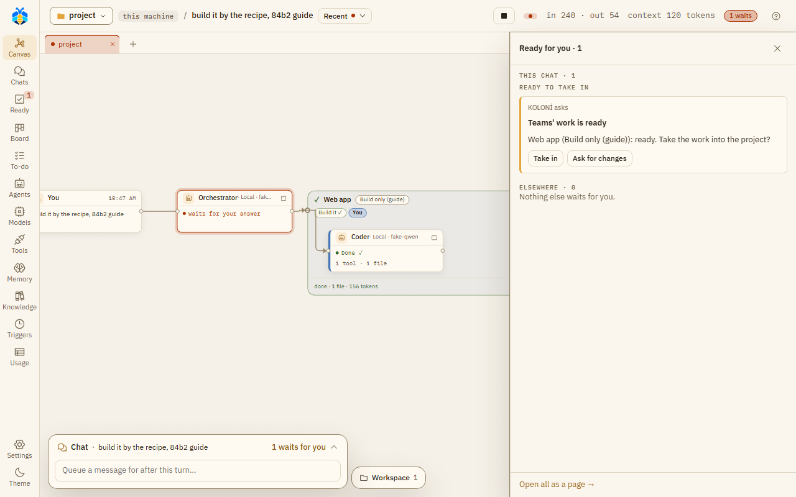

# Working copies and Take in

## The Workspace

The **Workspace** button, the first under the message box, opens "the project's files, what agents changed,
wrote or showed, and what waits for you". Its number is what waits for you in this chat, a copy kept for **Take in** too (in
**Changes** that copy is under **Kept**).

- **Files**: the project's files. Open files show as tabs.
- **Changes**: what changed, sorted by what you have to do: **Waits for you**, **At work**, **Kept**,
  **In the project**, **Not by an agent**, **Needs a look**, and **Closed** (shut at first).
  Inside a group, each change sits under its agent and your message. Each file says in words what
  happened ("changed", "new", "deleted", "you said no"). With git, the tab shows this chat's work and
  what git sees changed since the last commit. Without git (or when git does not answer in time), it shows
  this chat's record and says so. The tab's count is git's (as in the top bar), or without git what is not
  closed.
  **Show folders as a tree** puts the files in their folders. When changes wait for you, it says how many
  and offers **Next waiting ▸**. A file that waits opens on its diff with **Approve** and **Reject**; one
  in the project offers **Revert**. An agent's copy opens on what it holds, with **Take in…** (or
  **Look**) to its card.
- **Previews**: dev servers agents started.
- **Working copies**: each sub-agent's copy ("*name*'s copy").

## Working copies

Each sub-agent changes files in its own copy of the project (where it is, [below](#where-copies-and-worktrees-are)).
Your folder does not change until its work is taken in.

- `.git` and caches are not copied. `node_modules`, `.venv` and `venv` are linked, not copied.
- A project over 20,000 files or 500 MB gets no copy: the agent works in the project itself.
- When you and an agent changed the same file, KOLONİ merges line by line (for files up to 1 MiB).
- On Linux and macOS a copy keeps whether each file is runnable, so a script such as `./gradlew` still
  runs, and Take in carries that back to your project. A new file written with **Write files** gets your
  usual mode (`0644` with the common umask).
- Work goes into your folder one way at a time: a Take in waits while a branch is merged, and the other
  way round. What went in reaches the other agents' copies where they did not change those files, and a
  copy made at that moment gets all of it.

Agents at work beside each other are told that each works in a copy of its own: change only what
their task needs, write nothing outside their copy, stop no program by its name, start a server on a
free port, and install nothing into the linked `node_modules`, `.venv` or `venv`. A command an agent
runs in its copy is asked at every level, Full auto too, when it:

- names another agent's copy, a worktree of your project, or a place above its copy (`../..`) - also
  past a `cd` KOLONİ cannot follow, where any `..` counts;
- writes in the linked `node_modules`, `.venv` or `venv`, which are your project's own, or installs
  into them (in a turn you watch);
- stops programs by their name (`taskkill /IM`, `pkill`, `killall`, `Stop-Process -Name`), or looks a
  process up and stops it (`lsof -ti:8000 | xargs kill`, `fuser -k`). By its id (`taskkill /PID`,
  `kill 1234`, `Stop-Process -Id 1234`), or one the line itself started (`kill $!`), is fine. In
  your project, at Full auto, **Check what I said
  first** may let a stop by name run on a line of yours, but never one that may stop KOLONİ itself
  or another agent's CLI (python, node, uvicorn, claude, codex, copilot, qodercli, agy, a
  filter, a wildcard, `kill -1` or `kill 0`, or a process looked up).

KOLONİ reads the command as written: a path built in a script is not seen.

### Where copies and worktrees are

| Your project | A sub-agent's copy | A branch's worktree (a ☾ Away job's, a team's on a branch) |
|---|---|---|
| In git | Outside it: `runtime/copies/`, or your data folder (`%LOCALAPPDATA%\KOLONI\copies\` on Windows, `~/.local/share/KOLONI/copies/` elsewhere) where the runtime folder sits in a repository or beside an `AGENTS.md` / `CLAUDE.md` | In the project: `.koloni/worktrees/<id>/<agent>/tree` |
| Not in git | In the project: `.koloni/copies/<id>/<agent>/tree` | - (no git, no branch) |

- `<id>` is this KOLONİ's own folder there: two KOLONİs on one project (yours and a test copy) never
  clear away each other's.
- A copy inside a project in git would have no `.git` of its own, so `git` in it would answer with your
  repository: that is why such copies stay outside. A worktree has its own `.git`, so git in it answers
  with its branch. Whether your project is in git is looked at each time a copy is made: once you
  `git init`, the next copy is made outside.
- The first time a worktree is made, KOLONİ adds `/.koloni/worktrees/` and `/.koloni/copies/` to your
  repository's own `.git/info/exclude` (in a linked worktree of yours, the main repository's), so
  `git status` stays clean. Your `.gitignore` is not touched. In a project with no git,
  `.koloni/copies/` holds a `.gitignore` of its own that ignores all of it, so the copies stay out of
  the git it gets later; KOLONİ's `.koloni/.gitignore` lists `worktrees/` and `copies/` too once it
  writes one for its scratch (a line it lacks is added after yours).
- Each is one agent's work: that agent works in it as its own folder; any other agent, or a command
  at the project's root, may look in but not write, delete or run anything there
  ([permissions](permissions.md#the-folders-koloni)).
- Neither is copied into another copy, shown in the Files window, searched by an agent's search, nor
  listed as a change of your project. When you delete the project from KOLONİ, they go with it (your
  branches stay). A worktree whose records your `git clean -fdx` removed is left as it is, with its
  uncommitted work, for you to delete.
- A CLI started in a copy or worktree in `.koloni/` reads your project's `AGENTS.md` / `CLAUDE.md`
  from the folders above it, and the copy's own as well: the same words, read twice.
- Copies and worktrees made before 0.1.10 stay where they were made, and are found and decided there.

*A working copy's life, from the copy to your project; the "On a branch" lane is [Branches](#branches) below. ([full size](../diagrams/working-copy.svg))*

## Taking work in

When a sub-agent finishes, its changes come back on a card: **Take in …'s work?**, with
**Take in** and **Discard**. At **Auto-edit files** and **Full auto** they come in without a card when the
agent finished, nothing clashes and the tests it wrote passed. See [Permission levels](permissions.md#sub-agents).

- **Changed on both sides**: files you and the agent both changed. "Nothing is chosen for you"; pick a
  side for each, or press **Let an agent resolve the conflicts**.
- **Run the test** runs, on the copy, the tests the agent wrote or changed - only those, each part's test
  command from the project map narrowed to them. They are its own code: KOLONİ's guess runs them by itself
  only at Full auto, so at Auto-edit the card waits for this click. One that wrote no test has none to
  run: "No tests of its own to run before it is added - KOLONİ's check at the turn's end runs every
  test." See [Checked](checked.md#when-the-tests-fail).
- **Part of it taken**: a card can take some of its files and keep the rest - a file that changed since you
  looked is shown again, not taken, and the API's Take in may name the files it takes (`files`). Those taken
  say they are in the project; the rest wait on the same card for **Take in** or **Discard**, the agent's
  copy kept for them. **Discard** then throws away only the rest: what was taken stays, and the card says
  its work was taken in. The commit offered once the card closes - where [**Save each sub-agent's work as a
  git commit**](#committing) is on, as after any Take in - holds only the agent's change in each file
  taken, whichever step took it - even across a restart of KOLONİ. A branch's work goes in whole: naming
  some of its files is refused, also on the card of a branch copy kept after KOLONİ stopped.

A team's recipe keeps its work in one copy until you press **Take in** on the **Teams' work is ready** card. See
[Ready and approval cards](ready.md).

<video src="../videos/take-in.webm" poster="../../videos/take-in.jpg" controls muted loop playsinline preload="none" style="width: 100%; height: auto" aria-label="Video: the Ready for you node opens the list, Take in brings the team's work in, and the node says In the project"></video>

*Take in: the team's work comes into the project only now.*

*A team's work waits under **Ready to take in** until you press **Take in**.*

## Branches

The Orchestrator can give a team's work a git branch of its own. Then the card offers **Merge** or **Open
pull request**, as you chose under Settings › This project › When the work is done › **How a team's finished branch reaches
yours**. Until you choose, the first finished branch on a GitHub project asks. A pull request lets KOLONİ
push the branch; it never merges one. **Keep this branch after merging** keeps the branch.

Opening a pull request needs **gh** (GitHub's CLI) installed and signed in (`gh auth login`), and the
project's `origin` must be the GitHub repository gh sees. Until then the card says why it cannot open one.
A branch that holds commits of yours that origin does not have - your branch or another merged into it,
fast-forwarded to, rebased onto or cherry-picked - is not pushed until you push them, also after you
amended, rebased or dropped them; the card names them. What counts as the agent's own is what its branch's
history says was committed on it. A commit not on origin that this history does not show and no branch of
yours holds - an agent's cherry-pick of yours (a new commit), or the agent's own once that history is gone
(`git reflog expire`, or git's cleanup of an old branch) - is not pushed either: the card says KOLONİ cannot
attribute it, rather than calling it yours. Nor is a file that holds exactly what a commit of yours not
pushed yet put there (an agent's squash, pick or amend of it, or a copy of a stashed file, of a commit on a
detached HEAD - in this folder or in another worktree of yours -, or of a file you had not committed when
the branch began). What is on GitHub is what origin itself says its branches hold, asked right before the
push - never your remote-tracking branches (`origin/*`), which anything in your repository may write: a
commit only such a ref says is pushed is yours, and a stale one (a branch deleted on GitHub, a teammate's
push you have not fetched) changes nothing. Where GitHub's branch the pull request goes into has commits
you have not fetched, it asks you to fetch first; where git's config rewrites the address the push goes
to (an `insteadOf` or `pushInsteadOf` rule matching it), nothing is pushed. And while you have any commit or
stash not on GitHub - on a branch, in a stash, on a detached HEAD, in any worktree of yours - or the
branch began from your uncommitted work, a pull request waits for your click at every level, Full auto
too: the card says why ("you have 2 commits not on GitHub yet", "you have a stash not on GitHub yet";
"not on origin" where the push goes to a folder or another host), so you can check its files are the
agent's work. KOLONİ never pushes onto a branch of the same name origin has already, a fast-forward
too: "origin already has a branch named …: nothing was pushed". Nor does a secret KOLONİ knows - a
provider key you saved, an MCP server's variable a secret's name holds, the page's key, one given on a
card, one of the environment's or a value the project passes to its commands, or the token or password
such a value holds alone (a `DATABASE_URL`'s password in a settings.py) - go up or into your
branch, in a file or in its name: KOLONİ's own commit leaves such a file out and its card says so, and
a branch an agent committed one on itself is neither merged nor pushed ("take it off the branch
first"). The rest of the work goes on; an ordinary value (`production`, a path) stops nothing. A
file named as a secret (`.env.local`, `token.json`, a data file in a `secrets` folder -
[which names](../reference/known-limits.md#git)) goes up with a pull request only on your click, at
Full auto too: its card says "token.json: named as a secret - it goes to GitHub only on your click". A
task's name goes up as the commit's subject and the pull request's title mentioning nobody and closing
no issue, a token by its shape (`ghp_…`, a password in an address) masked: a zero-width joiner follows each `@` and comes before the number a closing keyword names
(`Fixes #12`, `Fixes GH-9`, an issue's link), and no control character is kept; the pull request's
body puts what an agent wrote - the task, the files' names, the check, its notes - in code.
Where git checks your files
out with CRLF (`core.autocrlf=true`, Windows' default) and they are LF, a file whose line ends alone
differ is no change of yours, and Take in keeps your file's own line ends. Where a commit of yours not pushed is in another worktree, the
card names that worktree's folder; if you deleted that folder by hand, git still keeps the worktree and
its commit, and `git worktree prune` lets git drop it. A worktree of yours where you look at the agent's
branch (`git worktree add --detach <folder> koloni/…`) does not make its commits yours, nor does a
worktree of another KOLONİ on its own `koloni/…` branch - but a commit you made there before it went
onto such a branch, or one a branch, tag or other remote of yours holds too, stays yours; a worktree
of yours whose branch you deleted still holds your commits.

The Inspector and **Where the work is** label such an agent "works on branch koloni/*name*" (an agent
in a plain copy: "works in its own copy").

The branch starts from your folder as it is, not only from your last commit: your edits, staged files
and new files that git does not ignore are in the agent's worktree. KOLONİ makes that one commit
("KOLONİ: your folder as koloni/*name* began") from an index of its own, so your files, your index,
your branch and HEAD are not touched; it is the branch's first commit and shows in `git log
koloni/*name*`. Left out, whether you staged them or not: what git ignores (`.env`, build output),
files named as secrets (`.env.local`, `.env.sample`, a key file, `credentials.json`, `token.json`, a
data file in a `credentials` or `secrets` folder - [which names](../reference/known-limits.md#git)),
`node_modules`,
`.venv` and `venv` (linked in instead), a git repository inside your folder, KOLONİ's own `.koloni`
folder, and every link or junction with what it leads to. Code named like a secret (`credentials.py`,
`.env.example`) is taken as any file. The card says in one line which of your files were left out as a
secret or a link: "Not in its branch: 2 of your files (.env, token.json) - a secret by its name, or
through a link".

The card, the merge and a pull request carry the agent's work alone, measured from that commit - never
your uncommitted files. A merge waits for your commit:

- If the agent changed a file you have uncommitted changes in, the card lists it under what is in the
  way; commit yours, then **Merge**.
- If it changed the very lines you had not committed when it began (or a new file of yours), the card
  says so - nothing is merged or sent as a pull request over them, and no agent puts them together.
  Commit yours, then **Merge**.
- If what is in the way is another agent's work you took in and did not commit yet, the card names that
  agent's Take in: commit it (on its card, where a commit is offered), then **Merge**.

Where the agent's work changes a file you had not committed when it began, the card says so and waits
for your **Merge**, at Full auto too.

If your folder had more new or changed files than a copy takes, your git is older than 2.40, or git
could not take your folder as it is (a file another program holds open, a path too long for git, a
folder it may not read, or longer than three minutes), the branch starts from your last commit as
before, and its card says so in one line under its heading: your uncommitted changes were not in it.

Its worktree, in your project's `.koloni/worktrees/` ([where](#where-copies-and-worktrees-are)), is locked while the agent works (`git worktree list -v` says
"KOLONİ: an agent works here; KOLONİ removes it"), so your own `git worktree prune`, `remove` or `move`
leaves it alone. KOLONİ unlocks it before it removes it. When KOLONİ starts, it removes git's records of
its own worktrees whose folder is gone (after a crash, say), and nothing else: never your worktrees,
never a branch. The Orchestrator is told that `koloni/…` branches and these worktrees are not its to
delete, rename or switch to.

In its copy, git works for the agent on its own branch, and it is told so: status, diff, history and
its commits there, with a few plain options, run as its other commands do. Any other option, and git
that reaches your own repository - switching branches, stashing, reset, merge, push, config - is asked
at every level, Full auto too. In a project that runs in Docker the agent is told that git does not
work in its copy: the worktree points to a folder on this machine, not in the container.

Your repository's git hooks (pre-commit, commit-msg, post-commit, also those of a `core.hooksPath` such
as husky's) do not run for an agent's own git commands in its copy - a commit on its branch included -
nor for an MCP server's it starts there; nor does your `core.fsmonitor`, and its commits are not
signed. On a branch, a command that clears or sets git's own environment (`unset GIT_…`, `env -i`,
`$env:GIT_… =`) would bring them back: it is asked at every level, Full auto too.

Those settings reach whatever the agent runs in its copy, your project's tests too: a test that needs
your git hooks or signed commits does not get them there.

A secret you gave in this turn (see [Security model](../security/model.md#secrets)) never leaves on a
branch:

- If a file on a finished branch holds it, the card does not merge it or open a pull request, at any
  level, even on your click. Take the secret off the branch, or press **Discard**, which deletes the
  branch.
- If the agent stopped first, or nobody watched the turn, a branch that holds it is deleted whole and
  the Orchestrator is told (on a **Stop**, the chat says so too). For a branch opened again from an
  earlier turn, the work of those turns goes with it.
- **Keep this branch after merging** is refused when any of its commits holds it.

### When an agent stops

An agent on a branch that stops before it finishes leaves its work committed on the branch. That holds
also when you press **Stop** or **Stop everything** while it works; the chat says so. A **Stop** while
KOLONİ merges a finished branch by itself (at Full auto) waits for git to finish: the merge is on its
card, and the branch's worktree goes.

Told to go on (by the Orchestrator, in this turn or a later one you watch), it goes on on the same
branch: its earlier commits are there, and new work goes on top. Its merge is still held to where the
branch was first made from: if the project is on another branch now, or that commit is gone from it, the
merge waits for you, at Full auto too. Its work is still measured from your folder as the branch began.

A branch copy kept over a restart comes back as a kept card, like a plain copy's: a file you changed too
is merged line by line, from what the branch was made of. **Discard** deletes its branch and git's
record of its worktree; so does a **Take in** that took all of it, unless the agent may still go on
on that branch.

Sometimes it cannot go on on its branch. Then it works in a fresh copy of the project instead:

- The branch was merged or sent as a pull request already: it and the Orchestrator are told why.
- Git refuses the branch (it was deleted, another branch has its name now, or it is checked out
  somewhere else): they are told why too.
- You pressed **Discard**, which deleted the branch: no message.
- The branch was made by an older KOLONİ that did not record where it started: no message.

An agent in a plain working copy that stops unfinished keeps what it changed: by itself (it failed, or
hit its [step limit](../agents/step-limits.md)), and on **Stop** or **Stop everything** too, also when
its Take in card was already waiting for you. A card under
**Ready to take in** offers **Take in** or **Discard**; nothing of it reaches your folder before that,
at Full auto too. An agent told to go on gets that copy back. A copy with no changes is removed. A
team's recipe and a job while you're away keep their copy on a Stop as well. Every copy kept for your
word, in any chat, is listed in Settings › The app › [Your data](../settings.md#your-data), with what it
takes and **Discard**; KOLONİ deletes none unasked.

The git button in the top bar ("⑂ main · 4 changed") opens **Where the work is**. It reads git and changes
nothing but the branch you switch to. It has three parts, each saying in words how a piece of work stands:

- **Your branch**: what is not saved in git yet (**See changes**), the last commit, and **+ New branch**.
  While a turn works or files are not committed, it says why you can't switch.
- **Agents' copies · this chat**: "working" (**See changes**), "finished, waits for you" (**Take in…**),
  or "kept" (**Look**).
- **Other branches**: "not joined" or "joined ✓", how many commits ahead and behind, with **Look** and
  **Switch to**. What an agent said it made, but git does not show, is listed last.

While a branch is open in the Workspace (**Look**), it shows read only, against your branch, with **Back
to the project**.

### Starting from a GitHub issue

On the [Chats](chats.md) page, **From a GitHub issue…** (beside **New chat**) starts a chat in the open
chat's folder from an issue. Paste the issue's address, or its `#number` in the project's repository, or
pick one of the repository's open issues from the list. KOLONİ opens a new chat, attaches the issue's
title, text and comments as a file (`github-issue-12.md`), and writes a short first message. Nothing
runs until you press **Send**. Long issues are cut at about 20,000 characters.

Anyone can write an issue, so KOLONİ marks its text as data for the agents, never as your instructions.
See [Outside content](../security/model.md#outside-content) for what that does and does not stop.

KOLONİ reads GitHub with your own **gh** (GitHub's CLI) and never stores or sees a token. Install gh
from <https://cli.github.com> and sign in once with `gh auth login`. Until you do, the dialog says why
no issues are listed. The project folder must be a git repository. Listing issues, or picking one by
`#number`, also needs its git remote to be on GitHub; an issue's address works without that.

## Committing

With **Save each sub-agent's work as a git commit** on (Settings › This project › When the work is done), the card offers a
commit once the changes are in: one commit per piece of work, only where the folder is the top of a git
repository. It is always your click, and nothing is pushed.
